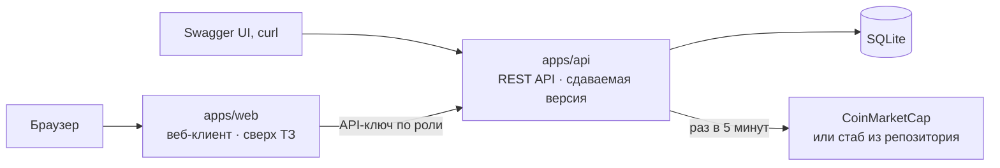
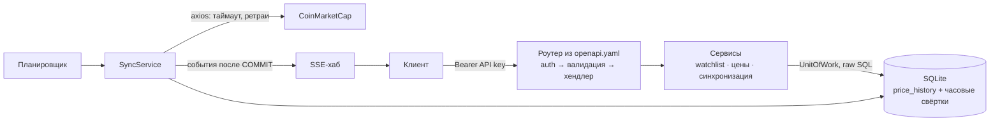

# Crypto Price Tracker

Backend-сервис, который ведёт список отслеживаемых криптовалют, в фоне забирает их цены из CoinMarketCap, хранит историю в SQLite и отдаёт актуальные цены, историю и агрегаты через REST API.
Тестовое задание Evercode Lab Fast Track (Backend, Node.js).

## Проверяющему

| Что нужно | Куда идти |
|---|---|
| **Реализация строго по ТЗ** — только `apps/api`, ничего сверх задания | Тег [`v1.0-submission`](https://github.com/LeshBerz/crypto-price-tracker/tree/v1.0-submission) → гайд [Сданная версия](docs/guides/submission.md) |
| Запустить и убедиться, что работает | [Быстрый старт](#быстрый-старт) ниже: Docker, около пяти минут, без ключа CoinMarketCap |
| Как каждое требование ТЗ закрыто кодом и тестами | [Требования → код и тесты](docs/project/requirements.md), [тесты по эндпоинтам](docs/project/test-matrix.md) |
| Где ТЗ потребовало решения и какое принято | [Ограничения ТЗ](#ограничения-тз-и-как-они-соблюдены) ниже, [ADR](docs/adr/) |

**Ветка `main` — текущее состояние проекта:** тот же api плюс то, что сделано после сдачи. Эндпоинты из ТЗ, схема БД и зависимости api после тега не менялись; полный список отличий — в гайде [Сданная версия](docs/guides/submission.md#чем-main-отличается-от-сданной-версии).

## Как это выглядит

Сдаваемая версия — REST API, её интерфейс — Swagger UI. Снимки ниже — веб-клиент `apps/web`, сделанный **сверх ТЗ** поверх того же api; данные на них — со стаба CoinMarketCap.

| Дашборд: цены в реальном времени | Карточка монеты: свечи из агрегатов api |
|---|---|
| [](docs/screenshots/dashboard-desktop-light.png) | [](docs/screenshots/coin-desktop-dark.png) |
| **«Линза точности»: цена без потери знаков** | **Гид по экранам** |
| [](docs/screenshots/price-lens-desktop-dark.png) | [](docs/screenshots/tour-step-desktop-light.png) |

Остальные экраны — панель оператора, диалог удаления, баннер деградации, смена временного пароля, вид на телефоне, обе темы — в [галерее снимков](docs/screenshots/README.md).

## На этой странице

1. [Что в репозитории](#что-в-репозитории)
2. [Быстрый старт](#быстрый-старт)
3. [Способы запуска](#способы-запуска) — ссылки на гайды
4. [API](#api)
5. [Тесты](#тесты)
6. [Ограничения ТЗ и как они соблюдены](#ограничения-тз-и-как-они-соблюдены)
7. [Команды](#команды)
8. [Документация](#документация)

## Что в репозитории



| Часть | Отношение к ТЗ | Состояние | Где |
|---|---|---|---|
| `apps/api` | **Сдаваемая версия**, строго по ТЗ | Готова, тег `v1.0-submission`. В `main` — она же с одним расширением операционного эндпоинта (контракт `1.1.0`) | [код](apps/api), [требования → код и тесты](docs/project/requirements.md) |
| `apps/web` | Сверх ТЗ: веб-клиент | Готово: вход и сессии с обязательной сменой временного пароля, дашборд с ценами в реальном времени, карточка монеты с графиком, панель оператора, пользователи и профиль, гид по экранам и «линза точности» цены, Docker-образ; 601 тест. Не сделаны e2e-сценарии в браузере | [README web](apps/web/README.md), [снимки экрана](docs/screenshots/README.md), [макеты](docs/project/design/README.md) |
| Алерты, профиль `platform` | Сверх ТЗ | Спроектировано, не реализовано | [ROADMAP](ROADMAP.md), [ADR](docs/adr/) |

Как гарантируется, что дополнения не затрагивают сдаваемую версию:

- `apps/api` не зависит от остального: его образ собирается и запускается без каталога `apps/web`, `docker compose up` поднимает только api и стаб CoinMarketCap. Веб-клиент включается отдельно: `docker compose --profile web up`.
- Ограничение «только указанные библиотеки» проверяется для `apps/api` в CI на каждый коммит — зависимости `apps/web` в него не попадают.
- Изменения контракта api после сдачи делаются отдельными версиями и описываются в ADR; что и когда изменилось — в [ROADMAP](ROADMAP.md) и [дейликах](docs/dailies.md).

**Стек api (строго по ТЗ):** Node.js 24 · TypeScript · Express 5 · SQLite на raw SQL (`node:sqlite`) · axios · Jest + Supertest · Swagger (OpenAPI 3.0) · Docker.
В рантайме три зависимости: `express`, `axios`, `swagger-ui-express` — это проверяет CI.

| | |
|---|---|
| Операций в контракте | 16, все реализованы |
| Тесты api | 727 (в сданной версии — 726), покрытие 100 % строк, 98,7 % веток |
| C8 | у каждой операции есть позитивный и негативный тест — [матрица](docs/project/test-matrix.md) (127 тестов) |
| CI | lint, типы, зависимости, контракт, тесты, сборка образа, smoke в Docker, остановка по `SIGTERM` |
| Тесты web (сверх ТЗ) | 601, отдельный job в CI |

## Быстрый старт

Нужен только Docker. Сервис ходит в **стаб CoinMarketCap** из того же compose: ключ CMC и интернет не нужны.

**1. Запустить** (из корня репозитория):

```bash
docker compose up --build
```

**2. Выпустить API-ключ** — во втором терминале. Ключ печатается один раз, в БД хранится только хэш:

```bash
docker compose run --rm api node dist/cli/keys.js create --name reviewer --role operator
```

**3. Проверить** в Swagger UI — <http://localhost:3000/docs> → **Authorize** → вставить ключ:

| Запрос | Ожидается |
|---|---|
| `POST /api/v1/cryptocurrencies` с телом `{"symbol":"BTC"}` | `201` |
| `POST /api/v1/sync-runs` | `202` |
| `GET /api/v1/prices` | BTC с ценой-строкой |

Ответ `GET /api/v1/prices` на стабе (сокращён):

```json
{
  "currency": "USD",
  "items": [
    {
      "cryptocurrencyId": 1,
      "symbol": "BTC",
      "name": "Bitcoin",
      "latest": {
        "price": "67123.451234567891",
        "currency": "USD",
        "sourceUpdatedAt": "2026-10-07T11:59:00.000Z",
        "isStale": false
      }
    }
  ]
}
```

Цена — строка, а не число: так не теряются знаки после запятой. Стаб знает три монеты: BTC, ETH и MEME.

**4. Остановить** и удалить данные:

```bash
docker compose down -v
```

Если в корне уже есть файл `.env` со строкой `CMC_BASE_URL`, api пойдёт по этому адресу, а не в стаб, — подробности в [гайде по Docker](docs/guides/docker.md#api-на-стабе).

## Способы запуска

Каждый гайд самодостаточен: что нужно → шаги → как проверить → как остановить и начать заново.

| Способ | Нужно на машине | Источник цен | Гайд |
|---|---|---|---|
| Сданная версия, строго по ТЗ | Docker | стаб | [Сданная версия](docs/guides/submission.md) |
| Docker: api | Docker | стаб | [api на стабе](docs/guides/docker.md#api-на-стабе) |
| Docker: api с живыми ценами | Docker, ключ CMC | CoinMarketCap | [api с настоящим CoinMarketCap](docs/guides/docker.md#api-с-настоящим-coinmarketcap) |
| Docker: api и веб-клиент | Docker | любой | [api и веб-клиент](docs/guides/docker.md#api-и-веб-клиент) |
| Без Docker: api | Node.js ≥ 24.15 | стаб | [Локально: api на стабе](docs/guides/local.md#api-на-стабе) |
| Без Docker: api с живыми ценами | Node.js ≥ 24.15, ключ CMC | CoinMarketCap | [Локально: api с настоящим CoinMarketCap](docs/guides/local.md#api-с-настоящим-coinmarketcap) |
| Без Docker: веб-клиент | Node.js ≥ 24.15 | любой | [Локально: веб-клиент](docs/guides/local.md#веб-клиент) |

Справочные страницы:

- [Окружение](docs/guides/environment.md) — файл `.env` один, в корне; все переменные, кто и как их читает, что будет, если переменной нет.
- [Типовые поломки](docs/guides/troubleshooting.md) — сообщение об ошибке → причина → что сделать.
- [Стаб и настоящий CoinMarketCap](docs/guides/README.md#стаб-и-настоящий-coinmarketcap) — чем отличаются и как переключать.

**Проверка одной командой.** Скрипт проходит путь проверяющего: готовность → 401 без ключа → 403 с ролью viewer → добавить BTC → ручная синхронизация → цена → событие в SSE. Как запустить — [Автоматическая проверка](docs/guides/docker.md#автоматическая-проверка).

## API

Контракт — [`apps/api/openapi/openapi.yaml`](apps/api/openapi/openapi.yaml) (OpenAPI 3.0). Он же — источник маршрутов и валидации: роутер строится из спеки, поэтому эндпоинта «мимо документации» не существует.

- Swagger UI — `/docs`, спека — `/openapi.json` (оба без ключа).
- Аутентификация — `Authorization: Bearer <API key>`. Две роли: **viewer** (`prices:read`) и **operator** (все права).
- Ошибки — `application/problem+json` (RFC 9457) с `type`, `detail`, `requestId`; у ошибок валидации — список `errors` с путём до поля.
- Цены — десятичные **строки** в USD (`"67123.451234567891"`): JSON-число потеряло бы цифры.

| Метод и путь | Что делает | Scope |
|---|---|---|
| `GET /health/live`, `GET /health/ready` | Жив ли процесс; готов ли принимать трафик (БД, миграции, не идёт остановка) | — |
| `GET /api/v1/cryptocurrencies` | Список отслеживаемых | `prices:read` |
| `POST /api/v1/cryptocurrencies` | Добавить по символу; символ проверяется в CMC | `watchlist:write` |
| `GET /api/v1/cryptocurrencies/{id}` | Одна криптовалюта | `prices:read` |
| `PATCH /api/v1/cryptocurrencies/{id}` | Изменить имя или приостановить синхронизацию | `watchlist:write` |
| `DELETE /api/v1/cryptocurrencies/{id}` | Убрать из отслеживаемых (история удаляется каскадом) | `watchlist:write` |
| `GET /api/v1/prices` | Актуальные цены всех монет, признак устаревания, изменение за 24 ч | `prices:read` |
| `GET /api/v1/prices/sparklines` | Мини-графики всех монет одним запросом | `prices:read` |
| `GET /api/v1/cryptocurrencies/{id}/prices` | История цен: период `from`/`to`, курсорная пагинация | `prices:read` |
| `GET /api/v1/cryptocurrencies/{id}/prices/aggregates` | Агрегаты `1h` · `4h` · `1d` · `1w`: OHLC, среднее, % изменения | `prices:read` |
| `GET /api/v1/sync-runs`, `GET /api/v1/sync-runs/{id}` | Журнал запусков синхронизации | `ops:read` |
| `POST /api/v1/sync-runs` | Запустить синхронизацию вручную (202; 409, если уже идёт) | `ops:write` |
| `GET /api/v1/system/cmc` | Состояние интеграции с CMC и остаток квоты | `ops:read` |
| `GET /api/v1/stream` | Поток событий SSE: `price.updated`, `sync.finished`, `watchlist.changed`, `heartbeat` | `prices:read` |

Пример для bash (ключ — в переменной `KEY`). В Windows PowerShell `curl` — псевдоним другой команды: вызывать `curl.exe` или выполнять запросы из Swagger UI.

```bash
curl -X POST localhost:3000/api/v1/cryptocurrencies -H "Authorization: Bearer $KEY" -H "Content-Type: application/json" -d '{"symbol":"BTC"}'
```

```bash
curl -X POST localhost:3000/api/v1/sync-runs -H "Authorization: Bearer $KEY"
```

```bash
curl localhost:3000/api/v1/prices -H "Authorization: Bearer $KEY"
```

```bash
curl "localhost:3000/api/v1/cryptocurrencies/1/prices/aggregates?interval=1h&from=2026-10-01T00:00:00Z" -H "Authorization: Bearer $KEY"
```

### Как это работает



- **Чтение не зависит от CMC.** Цены отдаются из БД. Если CMC недоступен, сервис продолжает отвечать, а цены получают `isStale: true`.
- **Синхронизация без наложения.** Следующий запуск планируется после завершения текущего; от второго процесса защищает уникальный индекс в БД.
- **Точность.** Цена от ответа CMC до ответа API идёт строкой; арифметика — свой `Decimal` на `BigInt`, без float.
- **Остановка.** По `SIGTERM`/`SIGINT`: readiness → 503, планировщик останавливается, запросы дорабатывают, SSE-клиенты получают `shutdown`, БД закрывается. `docker compose stop` завершает процесс с кодом 0 за доли секунды.

## Тесты

```bash
npm test -w @cpt/api
```

```bash
npm run check
```

`npm run check` — всё, что делает CI: ESLint, Prettier, типы, проверка зависимостей (C7), актуальность кодогенерации из контракта, тесты с покрытием и проверка C8.

- **БД не мокается:** каждый тест получает настоящую SQLite `:memory:` с миграциями.
- **CoinMarketCap — HTTP-стаб на `node:http`**, а не мок axios: таймауты, обрывы соединения, 429 с `Retry-After`, 5xx и битый JSON проверяются на настоящем сокете.
- **Время — `FakeClock`:** ретраи, планировщик и heartbeat проверяются без ожидания.
- **Каждый HTTP-ответ сверяется с контрактом** матчером `toMatchContract` — тест падает, если ответ разошёлся с `openapi.yaml`.
- **C8 доказан скриптом:** [`check-endpoint-coverage`](apps/api/scripts/check-endpoint-coverage.ts) сверяет отчёт Jest с операциями спеки и генерирует [матрицу тестов](docs/project/test-matrix.md).
- **Остановка:** unit-тест координатора и e2e с настоящим `SIGTERM` (на Linux; на Windows сигнал не доставляется, тест пропускается).

## Ограничения ТЗ и как они соблюдены

Полный чек-лист со ссылками на код и тесты — [`docs/project/requirements.md`](docs/project/requirements.md).

| | Ограничение | Как соблюдено |
|---|---|---|
| C1 | Без ORM | Только SQL-запросы в [`src/db/repositories`](apps/api/src/db/repositories), миграции — [SQL-файл](apps/api/migrations/0001_core.sql) |
| C2 | Данные только в БД | Watchlist, история, запуски синхронизации и API-ключи — в SQLite. В памяти — только открытые SSE-соединения |
| C3 | Файл БД не в репозитории | `data/`, `*.db` в `.gitignore`; в Docker — volume |
| C4 | Ключ CMC не в коде и не у клиента | Только env → заголовок запроса. Логгер маскирует секреты по имени поля и по виду значения |
| C5 | Таймауты и обработка ошибок | Один внешний клиент: таймаут, 6 кодов ошибок, ретраи с backoff и jitter только для временных сбоев |
| C6 | Остановка по SIGINT/SIGTERM | [`ShutdownCoordinator`](apps/api/src/shutdown.ts), проверено в CI настоящим сигналом и `docker compose stop` |
| C7 | Только библиотеки из ТЗ | [`scripts/check-deps.ts`](scripts/check-deps.ts) в CI и pre-commit: импорт вне списка — ошибка |
| C8 | Позитивный и негативный тест на эндпоинт | [Матрица](docs/project/test-matrix.md), проверка в CI |
| C9 | Тесты фоновых задач и ошибок внешнего API | [`tests/sync`](apps/api/tests/sync), [`tests/market-data`](apps/api/tests/market-data) |
| C10 | Валидация всех входных данных | Валидатор из спеки: path, query, body; неизвестное поле или параметр — 400 |

### Где ТЗ потребовало решения

ТЗ разрешает «только указанные библиотеки и стандартные возможности Node.js» и предлагает обосновать своё решение там, где это мешает. Таких мест четыре, каждое оформлено как ADR:

| Вопрос | Решение | Почему |
|---|---|---|
| Драйвера SQLite нет в списке | Встроенный `node:sqlite` (Node 24 LTS) — [ADR 0003](docs/adr/0003-sqlite-driver-and-node-version.md) | Стандартная возможность Node.js: ноль зависимостей и нативной сборки. «Node.js 18+» соблюдено |
| Библиотеки валидации нет в списке | Свой валидатор подмножества JSON Schema по `openapi.yaml` — [ADR 0008](docs/adr/0008-validation-and-openapi.md) | Один источник правды: документация, маршруты и валидация не расходятся. Неподдерживаемое ключевое слово — отказ старта |
| Цена во float теряет точность | `TEXT` в БД, строка в API, `Decimal` на `BigInt` — [ADR 0006](docs/adr/0006-price-precision.md) | В финтехе цену нельзя округлять молча |
| Что значит «только указанные библиотеки» | Правило действует на runtime-зависимости; dev-инструменты (ESLint, Prettier, кодогенерация типов) — нет — [ADR 0004](docs/adr/0004-c7-interpretation-and-dev-tooling.md) | В образ попадают только `express`, `axios`, `swagger-ui-express` |

Чего в сдаваемой версии нет: `dotenv` (заменён на `node --env-file`), логгера-библиотеки (свой JSON-логгер), планировщика-библиотеки (цикл ожиданий на таймере).

## Команды

Все — с `-w @cpt/api` из корня или без него из `apps/api`. Нужны Node.js ≥ 24.15 и установленные зависимости — [Локально: подготовка](docs/guides/local.md#подготовка).

| Команда | Что делает |
|---|---|
| `npm run dev` | Сервер с перезапуском при изменениях |
| `npm run keys:create -- --name <имя> --role viewer\|operator` | Выпустить API-ключ |
| `npm run keys:revoke -- --name <имя>` | Отозвать ключ (действует со следующего запроса) |
| `npm run rollups:rebuild` | Пересобрать часовые свёртки из сырой истории |
| `npm run smoke:cmc` | Проверить формат живого ответа CMC (нужен `CMC_API_KEY`, тратит 2 кредита) |
| `npm run smoke` | Дымовая проверка запущенного сервиса (нужны `BOOTSTRAP_*`-ключи, с которыми он поднят) |
| `npm run test:cov`, `npm run test:matrix` | Тесты с покрытием; проверка C8 и генерация матрицы |
| `npm run codegen` | Перегенерировать типы и встроенную спеку из `openapi.yaml` |

## Документация

| Раздел | Что внутри |
|---|---|
| [docs/guides/](docs/guides/README.md) | Гайды по запуску: сданная версия, Docker, локально, окружение, типовые поломки |
| [docs/project/requirements.md](docs/project/requirements.md) | Требования ТЗ → код и тесты |
| [docs/project/test-matrix.md](docs/project/test-matrix.md) | Тесты по каждому эндпоинту |
| [docs/adr/](docs/adr/) | Архитектурные решения: контекст, варианты, выбор, последствия |
| [docs/project/architecture.md](docs/project/architecture.md) | Обзор архитектуры и карта ADR |
| [docs/study/](docs/study/) | Разборы тем: как это сделано и почему |
| [ROADMAP.md](ROADMAP.md), [docs/dailies.md](docs/dailies.md) | План, прогресс, дейлики |
| [apps/web/](apps/web/README.md), [docs/screenshots/](docs/screenshots/README.md) | Веб-клиент — сверх ТЗ, в сдаваемую версию не входит; снимки его экранов |
