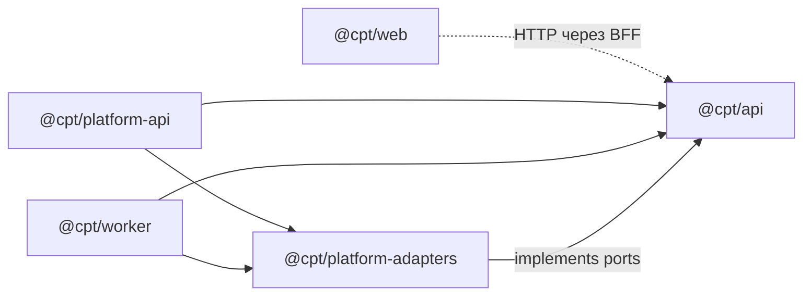

# 0005. Монорепо: инструмент и структура

- **Статус:** Accepted (06.10.2026)
- **Дата:** 06.10.2026
- **Вопрос брифа:** Q6
- **Связано:** [0003 — Node 24](0003-sqlite-driver-and-node-version.md), [0004 — трактовка C7](0004-c7-interpretation-and-dev-tooling.md)

## Контекст

В одном репозитории живут:
- `apps/api` — сдаваемая версия, рантайм строго по ТЗ (ADR 0004);
- `apps/web` — Next.js (ADR 0001);
- редакция `platform` — те же порты, но адаптеры Postgres/Redis/RabbitMQ и отдельный воркер (бриф §2).

Ключевое ограничение: **адаптеры `platform` не могут лежать внутри `apps/api`.** Иначе `ioredis` и `amqplib` оказались бы в рантайме сдаваемой версии и нарушили бы C7. Значит, нужен способ собрать то же ядро с другими адаптерами **снаружи** `apps/api`. По Ports & Adapters это отдельный **composition root**.

Что важно для выбора инструмента:
- Проверяющий запускает проект через `docker compose up` и, возможно, `npm install && npm test`. Лишние шаги установки — это трение.
- Пакетов немного: 3–5. Время CI исчисляется минутами.
- Node 24 запускает `.ts` нативно, но **не внутри `node_modules`**. Нужно, чтобы импорт ядра api из соседнего пакета работал.

### Проверено руками (Node 24.21, npm workspaces, прототип)

| Проверка | Результат |
|---|---|
| `apps/platform-api` импортирует `@cpt/api` (`exports: ./src/index.ts`) через workspace-симлинк и запускается нативно | ✅ работает: Node резолвит симлинк в реальный путь вне `node_modules` |
| Подмена адаптера в composition root (`RedisPriceCache implements PriceCache`) | ✅ |
| `apps/api` импортирует пакет, объявленный только в `platform-api` (phantom dependency) | ⚠️ **работает**, потому что npm поднимает зависимости в корень. Без контроля C7 можно нарушить незаметно |

## Варианты

1. **npm workspaces** — встроены в npm 7+. Один lockfile, симлинки между пакетами.
2. **pnpm workspaces** — строгая изоляция `node_modules` (phantom dependencies невозможны), быстрая установка, экономия диска.
3. **npm/pnpm + Turborepo** — поверх workspaces: граф задач, кэш сборок и тестов, удалённый кэш.
4. **Nx** — полноценная платформа монорепо: генераторы, граф проекта, кэш, правила границ модулей.
5. **Без workspaces** — независимые пакеты, у каждого свой `package.json` и lockfile.

## Сравнение

| Критерий | 1. npm ws | 2. pnpm ws | 3. + Turborepo | 4. Nx | 5. Без ws |
|---|---|---|---|---|---|
| Установка у проверяющего | ✅ npm уже есть | 🟡 нужен pnpm. Corepack убран из поставки Node начиная с 25, в 24 — экспериментальный opt-in | 🟡 как у базы | 🟡 | ✅ |
| Защита от phantom deps | ❌ hoisting → закрываем `check-deps` (ADR 0004) | ✅ из коробки | как у базы | как у базы | ✅ |
| Импорт ядра api в `platform` | ✅ проверено | ✅ | ✅ | ✅ | 🟡 `file:` или относительные пути, хрупко |
| Кэш задач в CI | ❌ | ❌ | ✅ | ✅ | ❌ |
| Сложность и конфиги | ✅ ноль | ✅ `pnpm-workspace.yaml` | 🟡 `turbo.json`, ещё одна концепция | ❌ много: плагины, генераторы, свой CLI | ✅ |
| Польза при 3–5 пакетах | ✅ | ✅ | 🟡 выигрыш в секундах | ❌ оверинжиниринг | 🟡 |
| Рынок | стандарт npm | лидер среди монорепо-инструментов по State of JS 2024 | стандарт для Next.js-монорепо (Vercel) | энтерпрайз, Angular-корни | — |

Данные: в [State of JS 2024 — Monorepo tools](https://2024.stateofjs.com/en-US/libraries/monorepo_tools) pnpm — явный лидер. Сами монорепо при этом, по выводу опроса, ещё не мейнстрим. Corepack: [OpenReplay](https://blog.openreplay.com/manage-package-managers-node-corepack/), [commit в nodejs/node](https://github.com/nodejs/node/commit/fa834896c8).

Главный аргумент за pnpm — защита от phantom deps. В проекте она уже есть: `check-deps` из ADR 0004 проверяет каждый импорт в `apps/api/src` по allowlist. Причём это **точнее**, чем pnpm: pnpm не запретит импорт пакета, явно добавленного в `dependencies`, а скрипт запретит всё, чего нет в ТЗ.

## Решение (рекомендация)

**npm workspaces, без Turborepo и Nx.** Turborepo пересматриваем в фазе E, если CI станет дольше ~5 минут. Подключение займёт полчаса и не меняет структуру.

### Структура

```
crypto-price-tracker/
├─ package.json            # private, workspaces, общие devDeps (eslint, prettier, husky, commitlint)
├─ package-lock.json       # единственный lockfile
├─ tsconfig.base.json      # общие опции TS (ADR 0004)
├─ docker-compose.yml      # api + web; platform-сервисы с profiles: [platform]
├─ scripts/check-deps.ts   # контроль C7 (ADR 0004)
├─ apps/
│  ├─ api/                 # @cpt/api — СДАВАЕМАЯ ВЕРСИЯ. Ни от кого в репо не зависит
│  │  └─ src/
│  │     ├─ index.ts       # публичный API пакета: createApp(deps), интерфейсы портов, доменные типы
│  │     ├─ server.ts      # composition root ТЗ-редакции: SQLite-адаптеры, in-process EventBus
│  │     └─ ...            # модули по ADR архитектуры
│  ├─ web/                 # @cpt/web — Next.js (BFF + UI)
│  ├─ platform-api/        # @cpt/platform-api — composition root: ядро @cpt/api + адаптеры platform   [profile platform]
│  └─ worker/              # @cpt/worker — фоновая синхронизация вне HTTP-процесса                    [profile platform]
├─ packages/
│  └─ platform-adapters/   # @cpt/platform-adapters — Postgres/Redis/RabbitMQ-реализации портов api   [profile platform]
└─ docs/
```

### Правила зависимостей



1. **`@cpt/api` не зависит ни от одного пакета репозитория.** Все стрелки направлены к нему. Это правило проверяет `check-deps`: `@cpt/*` нет в allowlist.
2. **`@cpt/web` не импортирует код api.** Общается только по HTTP через BFF, а типы получает из OpenAPI-контракта (генерация — решаем в Q9). Так web проверяет контракт, а не внутренности.
3. Публичная поверхность ядра — только `apps/api/src/index.ts` (`exports` в `package.json`). Глубокие импорты `@cpt/api/src/...` запрещены.

### Команды

| Задача | Команда |
|---|---|
| Всё поставить | `npm ci` |
| Только сдаваемая версия | `npm ci -w @cpt/api` и `npm test -w @cpt/api` |
| Проверить всё | `npm run lint && npm run typecheck && npm test --workspaces --if-present` |
| Docker-образ api | контекст — корень. `npm ci -w @cpt/api --omit=dev` → в образе только express, axios, swagger-ui-express |

## Последствия

- ➕ Ноль новых инструментов: у проверяющего есть всё нужное вместе с Node.
- ➕ Composition root в `platform-api` — наглядная демонстрация Ports & Adapters: одно ядро, две сборки, и сдаваемая версия не знает о Redis.
- ➕ README для проверяющего: «сдаваемая версия — `apps/api`, она самодостаточна».
- ➖ Hoisting npm допускает phantom deps. Закрыто `check-deps` в CI и pre-commit.
- ➖ Один lockfile на всё: `npm ci` в корне ставит и Next.js. Для проверки только api есть `-w @cpt/api`.
- ➖ Ядро api экспортируется как `.ts`, поэтому сборка `platform-api` через `tsc` должна включать исходники api (project references). Настраиваем в фазе D, а нативный запуск в dev работает уже сейчас.
- Открыто: состав `platform` (Q8), генерация типов контракта для web (Q9).

## Как защищать на интервью

«Пакетов пять, поэтому мне хватает встроенных npm workspaces: Turborepo дал бы выигрыш в секундах ценой ещё одного конфига. От phantom dependencies защищает не pnpm, а мой скрипт, и он строже: пропускает в рантайм api только то, что разрешает ТЗ. Адаптеры Redis и RabbitMQ лежат вне сдаваемого пакета, а собираются с тем же ядром в отдельном composition root. Это и есть порты и адаптеры на практике».
