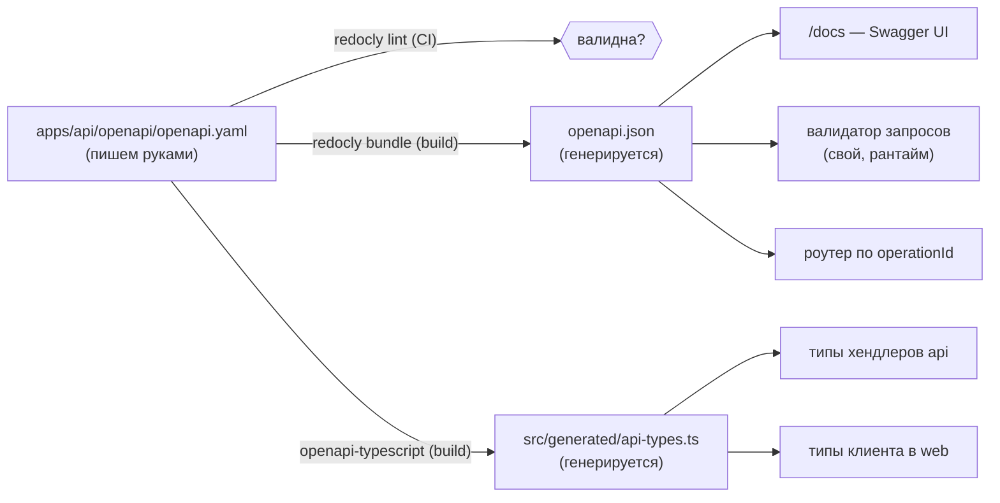

# 0008. Валидация и OpenAPI без zod: spec-first

- **Статус:** Accepted (06.10.2026)
- **Поправка (06.10.2026, [ADR 0014](0014-api-contract.md#поправки-к-принятым-adr)):** в подмножество валидатора добавлены `allOf` из одного элемента, `minProperties`, `default` (только query и path)
- **Дата:** 06.10.2026
- **Вопрос брифа:** Q9 (в requirements — открытые решения D2, D7)
- **Требования:** F8 (OpenAPI), C10 (валидация всех входных данных), C7, стек «Swagger (OpenAPI 3.0)»
- **Связано:** [0004 — трактовка C7](0004-c7-interpretation-and-dev-tooling.md), [0005 — web берёт типы из контракта](0005-monorepo-structure.md), [0006 — цены строками](0006-price-precision.md)

## Контекст

- C10: «Все входные данные должны проходить обязательную валидацию». zod, joi, ajv, express-validator в рантайме запрещены (C7).
- F8 и стек: документация в формате **OpenAPI 3.0** + Swagger.
- Главный риск двух независимых описаний (спека и валидаторы) — **дрейф**: спека говорит одно, код проверяет другое. Пользователь откроет `/docs`, отправит запрос и увидит расхождение.
- OpenAPI — единый источник истины: из него генерируются документация и SDK.
- Аналогия с Nest: там `ValidationPipe` + class-validator, а `@nestjs/swagger` генерирует спеку **из кода** (code-first). Здесь вопрос стоит наоборот: может ли спека сама управлять валидацией?

### Проверено руками

| Проверка | Результат |
|---|---|
| `openapi-typescript@7` на спеке OpenAPI 3.0.3 | типы за 42 мс. `nullable: true` → `string \| null`, `required` учитывается, `$ref` разворачивается |
| `@redocly/cli@2 lint` | работает, находит ошибки спеки (нет `servers`, `license` и т. п.) |
| Express 5: `req.query` | **геттер**, переприсвоить нельзя. Провалидированные и приведённые значения кладём отдельно (см. ниже) |

## Варианты

1. **Свои валидаторы руками + спека руками.** Две независимые копии контракта.
2. **Code-first.** Свой мини-zod (комбинаторы `str()`, `int()`, `obj()`), спека генерируется из схем в коде. Подход Nest и `zod-to-openapi`.
3. **Spec-first.** Спека (YAML) — источник истины. Из неё: типы TS (codegen), валидация запросов (свой интерпретатор подмножества JSON Schema), маршруты (по `operationId`), Swagger UI.
4. **Spec-first с готовым валидатором** (`express-openapi-validator`, `ajv`) — нарушает C7 в рантайме.

## Сравнение

| Критерий | 1. Руками ×2 | 2. Code-first | 3. Spec-first, свой валидатор | 4. Spec-first + ajv |
|---|---|---|---|---|
| C7 | ✅ | ✅ | ✅ | ❌ |
| Дрейф спеки и кода | ❌ гарантирован со временем | ✅ невозможен | ✅ невозможен: валидатор **читает** спеку | ✅ |
| Качество спеки для людей | 🟡 | 🟡 зависит от генератора, описания и примеры «размазаны» по коду | ✅ пишется как документ: описания, примеры, ошибки | ✅ |
| API-first (бриф: «сначала контракт») | 🟡 | ❌ контракт появляется после кода | ✅ контракт готов **до** кода, web может стартовать параллельно | ✅ |
| Объём своего кода | 🟡 много однотипных проверок | ❌ мини-zod + генератор спеки | 🟡 интерпретатор ~250 строк | ✅ |
| Типы для web (ADR 0005) | 🟡 руками | 🟡 нужен экспорт | ✅ тот же codegen из спеки | ✅ |

## Решение (рекомендация)

**Вариант 3: spec-first. `openapi.yaml` — единственный источник истины для документации, типов, валидации и маршрутов.**

### Конвейер



- **OpenAPI 3.0.3** — ТЗ прямо называет 3.0, а не 3.1. Это самая широко поддерживаемая версия 3.0.x. `nullable: true` вместо `type: [..., 'null']`.
- YAML парсится **только при сборке** (devDependencies: `@redocly/cli`, `openapi-typescript`). В рантайм попадает готовый JSON, YAML-парсер в `dependencies` не нужен (C7).
- Сгенерированные файлы коммитим. CI проверяет, что они актуальны: перегенерация + `git diff --exit-code`. Diff в PR показывает, как изменился контракт.

### Валидатор: свой интерпретатор подмножества JSON Schema

При старте приложения схемы из спеки **компилируются** в функции-валидаторы (один раз). На запросе выполняется только готовая функция.

| Поддерживаем | Не поддерживаем (→ **ошибка при старте**) |
|---|---|
| `type` (string, integer, number, boolean, object, array), `nullable`, `enum`, `required`, `properties`, `additionalProperties: false`, `items`, `minItems`/`maxItems`, `pattern`, `minLength`/`maxLength`, `minimum`/`maximum`, `format: date-time`, `$ref` на `components` | `oneOf`/`anyOf`/`allOf`, `discriminator`, `not`, прочие `format` |

**Fail-fast — ключевое свойство.** Если в спеке появится ключевое слово, которое валидатор не умеет проверять, приложение **не запустится**. Спека не может молча обещать проверку, которой нет. Аннотации (`description`, `example`) игнорируются.

Правила проверки:

| Где | Правило |
|---|---|
| Тело запроса | Строго: никаких приведений типов, `additionalProperties: false` везде (защита от mass assignment). Неизвестное поле → 400 |
| Query и path | Значения приходят строками, поэтому **приводим по схеме** (`"10"` → `10` для `integer`), затем валидируем. Неизвестный query-параметр → 400 |
| Content-Type | Есть тело, но не `application/json` → **415** |
| Размер тела | `express.json({ limit: '16kb' })` → **413** |
| Цены | Только строка по `pattern` из ADR 0006. JSON-число → 400 |
| Время | `date-time` по RFC 3339 **с обязательной зоной** (`Z` или `±hh:mm`). «Голое» время → 400, потому что неоднозначно |
| Результат | Все ошибки сразу (а не только первая), с путями: `/body/symbol`, `/query/limit` |
| Куда кладём результат | `res.locals.input = { params, query, body }`, типизированный по `operationId` (в Express 5 `req.query` — геттер) |

### Маршруты из спеки

```ts
// типы сгенерированы из спеки: пропущенный хендлер — ошибка компиляции
const handlers: Handlers<operations> = {
  listCryptocurrencies: ...,
  createCryptocurrency: ...,
  // ...
};
mountFromSpec(router, spec, handlers); // auth (security + scopes из ADR 0002) → validate → handler
```

Роутер обходит `paths` спеки и для каждой операции монтирует: auth по `security` и scopes (ADR 0002) → валидацию → хендлер по `operationId`.
- Эндпоинта «мимо спеки» не существует по построению.
- Операция в спеке без хендлера — ошибка TypeScript и ошибка старта.
- Аналог в Nest: декораторы `@Get` + `@UseGuards` + `ValidationPipe`, только описанные в одном YAML.

### Ответы и ошибки

- Формат ошибок — **RFC 9457 Problem Details** (`application/problem+json`; RFC 9457 заменил RFC 7807):
  ```json
  { "type": "https://…/problems/validation-error", "title": "Validation failed", "status": 400,
    "detail": "Request has 2 invalid fields", "requestId": "…",
    "errors": [{ "path": "/body/symbol", "message": "must match ^[A-Z0-9]{1,15}$" }] }
  ```
- Коды: 400 — невалидный вход, 401/403 — ADR 0002, 404, 409 — дубликат монеты, 413, 415, **422** — синтаксически верно, но не проходит бизнес-проверку (символа нет в CMC), 503 — CMC недоступен и данных нет.
- **Ответы валидируются в тестах:** Jest-матчер `expect(res).toMatchContract('createCryptocurrency', 201)` прогоняет тело ответа через тот же валидатор. Каждый тест эндпоинта заодно проверяет соответствие контракту. В рантайме ответы не валидируем: это цена без пользы для клиента.

### Swagger UI

`swagger-ui-express` (ADR 0004) на `/docs`, спека — `/openapi.json`. Оба публичные. Кнопка Authorize работает с `bearerAuth`.

## Последствия

- ➕ Контракт пишется **сегодня**, до кода (API-first из брифа). Web и тесты опираются на него с первого дня.
- ➕ Дрейф исключён конструктивно: одна спека управляет роутингом, валидацией, типами и документацией.
- ➕ Интервью: spec-first против code-first, fail-fast на неподдерживаемых ключевых словах, mass assignment, 400 против 422, RFC 9457.
- ➖ Свой валидатор (~250 строк) — критичный код. Покрываем тестами каждое ключевое слово, позитивные и негативные кейсы.
- ➖ Ограниченное подмножество JSON Schema: нет `oneOf` и др. Для домена проекта хватает. Если понадобится — расширяем валидатор, и fail-fast напомнит.
- ➖ Шаг кодогенерации в сборке и CI.
- Закрывает D2 (валидация) и D7 (Swagger UI) в `requirements.md`.

## Как защищать на интервью

«Контракт у меня spec-first: `openapi.yaml` написан до кода и управляет всем остальным. Из него генерируются типы, по `operationId` монтируются маршруты, а свой валидатор интерпретирует схемы из той же спеки. Ajv нельзя по ТЗ, поэтому я поддержал подмножество JSON Schema, а на неизвестном ключевом слове приложение падает при старте: спека не может обещать то, чего код не проверяет. Ответы сверяю с контрактом в каждом тесте. В Nest я бы сделал code-first через `@nestjs/swagger`, но тогда контракт появляется после кода».
