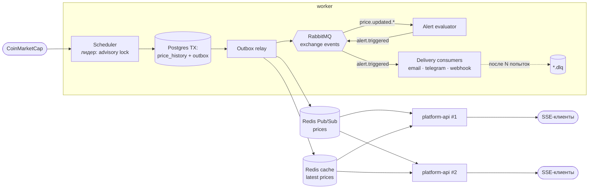

# 0011. Состав `platform`: какие хранилища и брокеры и зачем

- **Статус:** Accepted (06.10.2026)
- **Дата:** 06.10.2026
- **Вопрос брифа:** Q8
- **Связано:** [0005 — composition root](0005-monorepo-structure.md), [0006 — точность](0006-price-precision.md), [0007 — свёртки](0007-aggregates-and-rollups.md), [0009 — контрактные тесты портов](0009-testing-strategy.md), [0010 — outbox](0010-email-alert-channel.md)

## Контекст

`platform` — портфолио-редакция (бриф §2): те же порты, другие адаптеры. Включается через `docker compose --profile platform`. В бриф заложено и предостережение: «MSA для одного домена — оверинжиниринг». Значит, каждый компонент обязан **отвечать на конкретную проблему**, а не украшать схему.

**Метод.** Мысленно запускаем `apps/api` в N репликах за балансировщиком и смотрим, что ломается. Каждая поломка даёт один компонент `platform` с обоснованием. Чего не ломается — то не добавляем.

### Что ломается при N > 1 репликах `apps/api`

| # | Проблема | Почему | Чем решаем |
|---|---|---|---|
| P1 | SQLite — файл на одном хосте, писать из нескольких процессов и машин нельзя | встраиваемая БД (урок «Работа с БД») | **PostgreSQL** |
| P2 | Каждая реплика запускает свой планировщик → N запросов к CMC, квота сгорает в N раз быстрее (ADR 0007: 15 000 кредитов/мес) | планировщик живёт внутри HTTP-процесса | **Отдельный `worker`** + лидер через Postgres advisory lock |
| P3 | SSE-клиент подключён к реплике A, а цену обновил worker → A ничего не узнает | in-process `EventBus` не выходит за процесс | **Redis Pub/Sub** — fan-out событий во все реплики |
| P4 | Алерты и доставки: обработка должна переживать падения, ретраиться и не теряться | outbox-поллинг в одном процессе (ADR 0010) не масштабируется на независимых потребителей | **RabbitMQ** — надёжная очередь работы с ack, ретраями и DLQ |
| P5 | Чтение актуальных цен — самый частый запрос, все реплики бьют в БД | нет общего кэша | **Redis** как кэш (cache-aside) — тот же сервис, что в P3 |
| P6 | История растёт: 2,1 млн строк/год на 20 монет, свёртки поддерживаем руками (ADR 0007) | обычная таблица | **TimescaleDB** (расширение Postgres): hypertable + continuous aggregates |

Не ломается и потому **не добавляется**: Kafka (нет потоковой аналитики и replay на миллионы событий в секунду), ClickHouse (OLAP-объёмы не те), MongoDB (данные реляционные), service mesh, k8s (это IaC, фаза F).

## Варианты

1. **«Just use Postgres».** Postgres закрывает всё: хранение, `LISTEN/NOTIFY` для fan-out, `FOR UPDATE SKIP LOCKED` для очереди доставок, advisory locks.
2. **Postgres (+ Timescale) + Redis + RabbitMQ** — по компоненту на проблему из таблицы.
3. **Postgres + Redis Streams** — Redis одновременно и кэш, и брокер.
4. **Postgres + Kafka + Redis** — «как в больших финтехах».

## Сравнение

| Критерий | 1. Только Postgres | 2. PG + Redis + RabbitMQ | 3. PG + Redis Streams | 4. PG + Kafka + Redis |
|---|---|---|---|---|
| Закрывает P1–P6 | ✅ (P5 слабее: кэш в той же БД) | ✅ | ✅ | ✅ |
| Сколько сервисов | 1 | 3 | 2 | 3 (+ KRaft) |
| Ретраи, DLQ, poison messages | 🟡 своими руками на таблице | ✅ из коробки: quorum queues с `delivery-limit` + dead-letter exchange | 🟡 руками через `XPENDING`/`XCLAIM` | 🟡 руками через retry-топики |
| Маршрутизация событий | ❌ | ✅ topic exchange (`price.updated.BTC`) | 🟡 | 🟡 |
| Fan-out эфемерных событий в SSE | ✅ `LISTEN/NOTIFY` | ✅ Pub/Sub | ✅ | 🟡 тяжеловесно |
| Опыт заказчика (Korefan: RabbitMQ + DLQ, Redis) | — | ✅ прямое продолжение | 🟡 | ❌ новый стек за 1,5 дня |
| Ценность для портфолио и Evercode (FinTech/Web3) | 🟡 | ✅ типовой стек | 🟡 | ✅, но риск не успеть |
| Риск оверинжиниринга | ✅ минимальный | 🟡 оправдан таблицей P1–P6 | 🟡 | ❌ |

**Честная оговорка.** Для реальной нагрузки этого продукта (десятки монет, раз в 5 минут) вариант 1 достаточен, и это стоит сказать на интервью первым. Вариант 2 выбираем как **демонстрацию пути масштабирования** — это явная цель `platform` по брифу. Каждый компонент закрывает строку P1–P6, а не «потому что модно».

## Решение (рекомендация)

**Вариант 2: PostgreSQL 18 + TimescaleDB, Redis 8, RabbitMQ 4. Отдельный `worker`.**

### Принцип разделения брокеров

- **RabbitMQ — для работы**, которую нельзя потерять: «оцени алерты», «доставь уведомление». Нужны ack, ретраи, DLQ.
- **Redis Pub/Sub — для уведомлений о состоянии**, которые можно потерять: «цена обновилась, перерисуй экран». Пропустил сообщение — клиент получит следующее или перечитает состояние.

### Компоненты

| Компонент | Версия (Docker Hub, 06.10.2026) | Роль | Порт / адаптер |
|---|---|---|---|
| PostgreSQL + TimescaleDB | `timescale/timescaledb:2.30.2-pg18` | Хранение: `NUMERIC` для цен (точность из ADR 0006 без строковых трюков), `timestamptz`. История — hypertable, свёртки — **continuous aggregates** (`time_bucket`, `first`/`last`) вместо ручного пересчёта (ADR 0007). Advisory lock — выбор лидера worker'а | репозитории (`pg`, raw SQL — без ORM и здесь) |
| Redis | `redis:8.8` | Кэш актуальных цен (cache-aside, TTL = 2 × интервал синхронизации, fallback в БД); Pub/Sub-канал `prices` для fan-out в SSE | `PriceCache`, `RealtimeBus` (`ioredis`) |
| RabbitMQ | `rabbitmq:4.3-management` | Topic exchange `events`: `price.updated.<symbol>`, `alert.triggered`. Очереди потребителей — **quorum queues** с `x-delivery-limit` и dead-letter exchange → `*.dlq`. Ретраи с задержкой — через очереди ожидания с TTL | `EventBus` (`amqplib`) |
| `worker` | наш образ | Планировщик синхронизации (лидер по advisory lock), outbox-relay в RabbitMQ, потребители: оценка алертов, доставка по каналам | composition root (ADR 0005) |
| `platform-api` | наш образ, N реплик | То же HTTP-ядро `@cpt/api`, без планировщика. SSE подписан на Redis | composition root (ADR 0005) |

### Поток данных

- **Transactional outbox.** Цены и событие пишутся в одной транзакции Postgres, relay публикует их после коммита. Это исключает «записали в БД, но не отправили в брокер» и наоборот. Тот же паттерн, что в ADR 0010, только транспорт — RabbitMQ.
- **Идемпотентные потребители.** Доставка at-least-once, поэтому потребители дедуплицируют по id события (таблица обработанных сообщений).

### Приоритет внутри фазы D (1,5 дня)

| MoSCoW | Что |
|---|---|
| **Must** | Postgres-адаптеры репозиториев (проходят контрактные тесты ADR 0009), `worker` с лидером, RabbitMQ: outbox-relay + доставки с DLQ |
| **Should** | Redis: Pub/Sub для SSE fan-out и кэш цен; `platform-api` в 2 репликах в compose |
| **Could** | TimescaleDB continuous aggregates (иначе — та же свёртка, что в ADR 0007, на Postgres) |
| **Won't** (сейчас) | k8s-манифесты и IaC (фаза F), Kafka, мультитенантность |

### Документ «Целевая архитектура и путь миграции» (фаза D)

Пошаговый путь `apps/api` → `platform`:
1. SQLite → Postgres (данные, миграции, отличия диалекта: bare columns → `DISTINCT ON` / `first()`);
2. вынос планировщика в worker;
3. брокер;
4. кэш и fan-out.

Для каждого шага — триггер («когда это нужно»: метрика или симптом) и откат.

## Последствия

- ➕ Каждый компонент обоснован конкретной поломкой при масштабировании. Это ответ на «а не оверинжиниринг ли это?».
- ➕ Порты из `apps/api` получают вторые реализации, и контрактные тесты доказывают взаимозаменяемость.
- ➕ Прямая преемственность с Korefan (RabbitMQ + DLQ, Redis) плюс новое: transactional outbox, quorum queues, leader election, continuous aggregates.
- ➖ Четыре новых сервиса в compose. Только под профилем `platform`, на сдаваемую версию не влияют.
- ➖ Ядро `@cpt/api` должно уметь запускаться **без** планировщика (флаг composition root). Учитываем в архитектуре api с первого дня.
- ➖ Лицензии: TimescaleDB community (TSL) бесплатна для собственного использования, но не для перепродажи как DBaaS. Redis 8 — AGPLv3/RSAL/SSPL, при сомнениях есть drop-in Valkey (BSD). Фиксируем в документе миграции.
- ⚠️ Объём фазы D большой. Порядок MoSCoW обязателен, Could режется первым.

## Как защищать на интервью

«Честно: для десятков монет хватило бы одного Postgres. `platform` — это ответ на вопрос "что будет при N репликах". Каждый компонент закрывает конкретную поломку. Postgres — потому что SQLite однохостовая. Worker с advisory lock — чтобы квоту CMC не жгли все реплики. Redis Pub/Sub — чтобы SSE-клиент на любой реплике узнал о новой цене. RabbitMQ — для работы, которую нельзя терять: ретраи, quorum queues, DLQ. Kafka не взял: нет задачи, которую она решает лучше».
