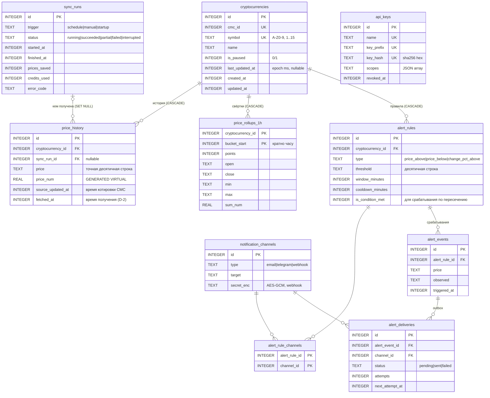

# 0013. Доменная модель и схема БД

- **Статус:** Accepted (06.10.2026)
- **Дата:** 06.10.2026
- **Фаза A:** артефакт «Доменная модель и схема БД»
- **Требования:** D-1, D-2, D-3, F2, F4, F5, C1, C2, C3; D10 (наложение запусков)
- **Сводит решения:** [0002](0002-access-model.md) (ключи), [0003](0003-sqlite-driver-and-node-version.md) (драйвер), [0006](0006-price-precision.md) (точность), [0007](0007-aggregates-and-rollups.md) (свёртки, время), [0010](0010-email-alert-channel.md) (outbox)
- **DDL (проверен):** [`apps/api/migrations/0001_core.sql`](../../apps/api/migrations/0001_core.sql) (применяется раннером миграций), [`schema/0002_alerts.sql`](../project/schema/0002_alerts.sql)

## Контекст

ТЗ задаёт минимум:
- D-1: монета — id, символ, название, время последнего обновления;
- D-2: история — монета, цена, время получения.

Предыдущие ADR добавили ключи API, свёртки и outbox доставок. Здесь всё сводится в одну схему и фиксируются доменные правила, которые из неё следуют.

## Ключевые решения

| # | Вопрос | Варианты | Решение | Почему |
|---|---|---|---|---|
| 1 | Как идентифицировать монету в CMC | по `symbol` · по `cmc_id` | Храним **`cmc_id`** (UNIQUE), синхронизацию ведём по `id=` | **Символы в CMC не уникальны**: у популярных тикеров бывают однофамильцы. Поэтому `quotes/latest?symbol=` в v2 возвращает массив на символ. По `id` ответ однозначен |
| 2 | Монета с неоднозначным символом при добавлении | ошибка со списком кандидатов · авто-выбор | Авто-выбор **активной монеты с лучшим `cmc_rank`**. Необязательный `cmcId` в запросе — явный выбор. В ответе есть `name` и `cmcId`, выбор виден | Пользователь, вводящий «BTC», ждёт Bitcoin. Явный `cmcId` закрывает редкие случаи |
| 3 | Что можно менять (PATCH) | всё · ничего | `name` (отображаемое имя) и `isPaused` (приостановить синхронизацию без удаления) | `symbol` и `cmc_id` — идентичность. Их смена — это другая монета, то есть DELETE + POST |
| 4 | Удаление монеты | soft delete · hard delete | **Hard delete + `ON DELETE CASCADE`** на историю, свёртки и правила алертов | CRUD-семантика ТЗ: убрал из watchlist — убрал и данные. Soft delete усложнил бы каждый запрос (`WHERE deleted_at IS NULL`) ради сценария, которого нет. Нужна пауза — для неё есть `isPaused` |
| 5 | `last_updated_at` (D-1) | время котировки CMC · время получения | **Время, когда мы получили последнюю цену** (`fetched_at`). Время котировки CMC — отдельное поле истории `source_updated_at`, отдаётся в API | D-2 говорит «время получения». Оба времени нужны для честного мониторинга |
| 6 | Идемпотентность синхронизации | нет · UNIQUE | **`UNIQUE (cryptocurrency_id, source_updated_at)`** + `ON CONFLICT DO NOTHING` | Ретрай или повторный ручной запуск не создадут дубль одной и той же котировки CMC. Проверено: повторная вставка → `changes = 0` |
| 7 | Защита от наложения запусков (D10) | флаг в памяти · ограничение в БД | **Частичный уникальный индекс**: не больше одной строки `sync_runs` со статусом `running` | Гарантия на уровне БД, а не только флага `isRunning`. Работает и между процессами (важно для `platform`). Проверено: второй `running` → `UNIQUE constraint failed` |
| 8 | Зависший `running` после падения процесса | — | При старте все `running` → `interrupted` | Иначе индекс из п. 7 заблокирует синхронизацию навсегда |
| 9 | Строгость типов SQLite | обычные таблицы · **`STRICT`** | **`STRICT` везде** | SQLite по умолчанию молча сохранит `'abc'` в INTEGER. STRICT — ошибка. Проверено: текст и `1.5` в INTEGER отклоняются. Это страховка к правилу «целые — BigInt» (ADR 0007) |
| 10 | Где живут инварианты | только в коде · **код + CHECK** | Формат цены, символа, хэша ключа, JSON scopes, согласованность статусов (`running` ⇔ нет `finished_at`, `sent` ⇔ есть `sent_at`), webhook ⇔ есть секрет | Defense in depth: валидатор (ADR 0008) — первая линия, БД — последняя. 26 проверок в прототипе прошли |
| 11 | Время | ISO TEXT · epoch | **INTEGER, epoch ms, UTC** везде. В API — ISO 8601 UTC | ADR 0007: дешёвая арифметика бакетов. Курс допускает оба формата |
| 12 | Булевы | — | `INTEGER CHECK (x IN (0, 1))` | В SQLite нет BOOLEAN |
| 13 | Секрет webhook (для HMAC-подписи) | открытым текстом · хэш · **шифрование** | **AES-256-GCM** (`node:crypto`), ключ — `APP_ENCRYPTION_KEY` из env, формат `v1:iv:tag:ciphertext` | Секрет нужен в открытом виде, чтобы подписывать, поэтому хэш не подходит. Хранить открытым — утечка при дампе БД. Префикс версии позволяет ротацию ключа. Секрет показываем один раз при создании канала |
| 14 | `api_keys.last_used_at` на каждый запрос | писать всегда · **троттлить** | Обновляем, только если прошло ≥ 60 с | Иначе каждый GET превращается в запись в SQLite |

## Схема

### Индексы и почему именно они

| Индекс | Запрос, который он обслуживает |
|---|---|
| `price_history (cryptocurrency_id, fetched_at)` | история по монете за период (F5), пересчёт свёртки часа, изменение за 24 ч |
| `UNIQUE price_history (cryptocurrency_id, source_updated_at)` | идемпотентность синхронизации |
| `PK price_rollups_1h (cryptocurrency_id, bucket_start)`, `WITHOUT ROWID` | агрегаты по интервалам. Таблица кластеризована по ключу, чтение диапазона — последовательное |
| `UNIQUE sync_runs (status) WHERE status = 'running'` | защита от наложения (D10) |
| `sync_runs (started_at DESC)` | история запусков в панели оператора |
| `alert_deliveries (next_attempt_at) WHERE status = 'pending'` | выборка доставок «к отправке». Частичный индекс не хранит уже отправленные |
| `alert_rules (cryptocurrency_id) WHERE is_enabled = 1` | оценка правил после синхронизации |

### Семантика алертов (то, что видно в схеме)

- **По пересечению, а не по состоянию.** Срабатывание — переход `is_condition_met` 0 → 1. Пока цена остаётся ниже порога, повторных писем нет.
- **`cooldown_minutes`** защищает от «дребезга» у порога.
- `change_pct_above` требует `window_minutes` (CHECK): «изменение > N % за окно».
- Детали оценки правил — в событийной модели.

## Миграции

| Аспект | Решение |
|---|---|
| Формат | SQL-файлы `apps/api/migrations/NNNN_name.sql` — raw SQL (C1), без DSL |
| Учёт | таблица `schema_migrations (version, name, checksum, applied_at)`, `checksum` — SHA-256 файла |
| Применение | при старте, каждая миграция — в своей транзакции. Ошибка → откат и остановка процесса |
| Защита | изменён уже применённый файл (checksum не совпал) → процесс **не стартует**. Историю миграций не переписывают |
| Направление | **только вперёд** (forward-only). Откат — новой миграцией. Down-миграции в проде редко безопасны: данные не «отматываются» |
| Порядок | `0001_core` — ядро ТЗ (фаза B). `0002_alerts` — вместе с модулем алертов, позже |

PRAGMA при подключении (ADR 0003): `foreign_keys = ON`, `journal_mode = WAL`, `synchronous = NORMAL`, `busy_timeout` через опцию `timeout`.

## Проверено руками (Node 24.21, SQLite 3.53)

Прототип выполняет обе миграции и 26 проверок, все прошли:

| Группа | Что проверено |
|---|---|
| Монеты | lowercase и дефис в символе, дубль символа — отклоняются |
| Типы (STRICT) | `'abc'` и `1.5` в INTEGER отклоняются. JS `5` (приходит как REAL `5.0`) принимается: преобразование без потерь |
| Синхронизация | второй `running` отклоняется. `failed` без `finished_at` отклоняется. Повторная вставка той же котировки → 0 изменений |
| Свёртки | два upsert подряд дают тот же результат (`points=3, open=60000.5, close=59990, min=59990, max=60010.25`). Невыровненный `bucket_start` отклоняется |
| Ключи, каналы, алерты | невалидные scopes, хэш в верхнем регистре, webhook без секрета, `change_pct` без окна, `sent` без `sent_at`, дубль доставки — отклоняются |
| Каскады | удаление монеты стирает историю, свёртки, правила, события и доставки. `sync_runs` и каналы остаются. `integrity_check = ok`, нарушений FK — 0 |

## Последствия

- ➕ Схема покрывает D-1, D-2 и расширения. Инварианты защищены дважды: валидатором и БД.
- ➕ Темы для интервью: неуникальные символы CMC, частичный уникальный индекс как межпроцессная блокировка, STRICT, идемпотентная синхронизация, шифрование секрета, forward-only миграции с контрольной суммой.
- ➖ Больше DDL, чем требует ТЗ. Но алертная часть (`0002`) приезжает только вместе с модулем алертов.
- ➖ `APP_ENCRYPTION_KEY` — ещё один обязательный секрет. Нужен только при включённых webhook-каналах.
- После аппрува: обновить ER в `architecture.md` и закрыть D-1/D-2 в `requirements.md` на уровне проектирования.

## Как защищать на интервью

«Монету идентифицирую по `cmc_id`: символы в CMC не уникальны, поэтому синхронизирую по id. Таблицы STRICT: SQLite по умолчанию молча сохранит строку в INTEGER. Инварианты дублирую CHECK-ами: валидатор — первая линия, БД — последняя. Наложение синхронизаций запрещает частичный уникальный индекс, это блокировка даже между процессами. Повтор синхронизации не плодит дубли благодаря UNIQUE по времени котировки. Миграции только вперёд, с контрольной суммой».
