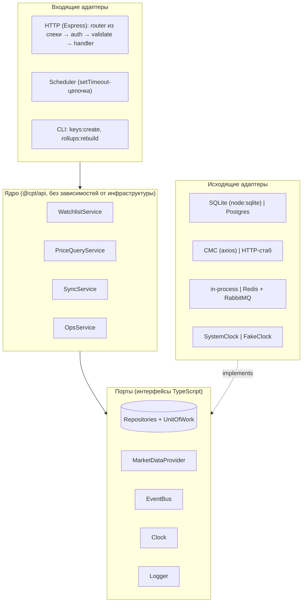

# 0015. Порты, события и жизненный цикл приложения

- **Статус:** Accepted (06.10.2026)
- **Дата:** 06.10.2026
- **Фаза A:** артефакт «Событийная модель (события, порты, адаптеры)»
- **Требования:** F3, F6, F7, C2, C5, C6, C9; D8 (retry), D10 (планировщик)
- **Связано:** [0005](0005-monorepo-structure.md) (composition root), [0007](0007-aggregates-and-rollups.md) (свёртки), [0009](0009-testing-strategy.md) (Clock, стабы), [0011](0011-platform-composition.md) (адаптеры platform), [0013](0013-data-model.md) (схема), [0014](0014-api-contract.md) (контракт)

## Контекст

Бриф требует архитектуру на портах и адаптерах: ядро `apps/api` одно, а адаптеры меняются (SQLite → Postgres, in-process → Redis/RabbitMQ). Курс («Структура и архитектура»): зависимости направлены внутрь, DIP — зависеть от абстракций и внедрять зависимости. «Фоновые задачи»: TaskScheduler, graceful shutdown.

Здесь фиксируется:
1. какие порты есть и кто их реализует;
2. какие доменные события существуют и с какими гарантиями доставляются;
3. как устроены синхронизация, ретраи и деградация;
4. как приложение стартует и останавливается (C6).

## 1. Слои и направление зависимостей



Ядро знает только интерфейсы. Адаптеры собираются в composition root:
- `apps/api/src/server.ts` — ТЗ-редакция;
- `apps/platform-api`, `apps/worker` — редакция `platform` (ADR 0005).

Аналог в Nest — провайдеры с токенами (`{ provide: PRICE_REPO, useClass: … }`), только без DI-контейнера: зависимости передаются явно аргументом `createApp(deps)`. Это проще отлаживать и тестировать, и для такого объёма контейнер не нужен.

## 2. Порты

| Порт | Методы (сокращённо) | Адаптер `apps/api` | Адаптер `platform` | Тестовый |
|---|---|---|---|---|
| `UnitOfWork` | `run(fn: (repos) => Promise<T>)` — транзакция, внутри доступны репозитории | `BEGIN/COMMIT/ROLLBACK` на `node:sqlite` | `pg` client + транзакция | реальная SQLite `:memory:` (ADR 0009) |
| `CryptocurrencyRepository` | `list`, `get`, `getBySymbol`, `create`, `update`, `delete`, `listActive`, `markUpdated` | SQLite | Postgres | — |
| `PriceRepository` | `insertMany` (с `ON CONFLICT DO NOTHING`), `latestFor(ids)`, `pageHistory`, `priceAt(coin, t)`, `recomputeRollup(coin, hour)`, `aggregates(…)` | SQLite | Postgres / Timescale | — |
| `SyncRunRepository` | `start` (ловит нарушение уникальности → `SyncAlreadyRunning`), `finish`, `page`, `get`, `markInterrupted` | SQLite | Postgres | — |
| `ApiKeyRepository` | `findByPrefix`, `touch` (с троттлингом 60 с), `create`, `revoke` | SQLite | Postgres | — |
| `MarketDataProvider` | `resolveSymbol(symbol, cmcId?)`, `getQuotes(cmcIds, signal)`, `getUsage()` | axios → CMC Pro API | тот же | HTTP-стаб на `node:http` |
| `EventBus` | `publish(event)`, `subscribe(type, handler) → unsubscribe` | in-process | Redis Pub/Sub (SSE) + RabbitMQ (работа) | in-process + шпион |
| `Clock` | `now(): number` (epoch ms), `sleep(ms, signal)` | `SystemClock` | `SystemClock` | `FakeClock` |
| `Logger` | `debug/info/warn/error(msg, fields)`, `child(fields)` | JSON в stdout | тот же | шпион |

Правила:
- **Порт описывает потребность ядра, а не API библиотеки.** `MarketDataProvider.getQuotes` возвращает доменные `Quote { cmcId, price: string, sourceUpdatedAt }`, а не ответ CMC. Маппинг и `context.source` (ADR 0006) живут в адаптере.
- **Интерфейсы асинхронные**, даже если SQLite синхронна (ADR 0003): иначе Postgres-адаптер не встанет на место.
- **Время и ожидание — только через `Clock`** (ADR 0009: fake timers не подменяют `node:timers/promises`).
- **Целые параметры в SQLite — `BigInt`** (ADR 0007). Это деталь адаптера, ядро её не видит.

## 3. Доменные события

### Конверт

```ts
type DomainEvent<T extends string, P> = {
  id: string;          // crypto.randomUUID()
  type: T;             // 'price.updated'
  version: 1;          // версия схемы payload — для эволюции без поломки потребителей
  occurredAt: string;  // ISO 8601 UTC
  payload: P;
};
```

### Каталог

| Событие | Payload | Публикует | Потребители (api) | Потребители (platform) |
|---|---|---|---|---|
| `price.updated` | `{ cryptocurrencyId, symbol, price, currency, sourceUpdatedAt, fetchedAt, syncRunId }` | `SyncService`, по одному на сохранённую цену | SSE-хаб | Redis Pub/Sub → SSE всех реплик; RabbitMQ → оценка алертов; инвалидация кэша |
| `sync.finished` | `SyncRun` (как в контракте) | `SyncService` | SSE-хаб, метрики | то же + RabbitMQ |
| `watchlist.changed` | `{ cryptocurrencyId, change: 'added' \| 'updated' \| 'removed' }` | `WatchlistService` | SSE-хаб (дашборд перечитывает список) | Redis Pub/Sub; инвалидация кэша |
| `alert.triggered` | `{ ruleId, cryptocurrencyId, price, observed, triggeredAt }` | v1.1 (модуль алертов) | SSE-хаб, outbox доставок (ADR 0010) | RabbitMQ → доставки с DLQ |

В SSE (контракт ADR 0014) уходят `price.updated`, `sync.finished`, `watchlist.changed`, `heartbeat` (`watchlist.changed` внесён в контракт 06.10 вместе с UI-флоу).

### Гарантии доставки

| | `apps/api` (in-process) | `platform` |
|---|---|---|
| Когда публикуем | **только после COMMIT** транзакции. Внутри транзакции — никогда | outbox-запись в той же транзакции, relay публикует после коммита (ADR 0011) |
| Семантика | at-most-once: процесс упал между коммитом и публикацией — событие потеряно | at-least-once + идемпотентные потребители |
| Почему этого достаточно | Все потребители эфемерные (SSE). Клиент после переподключения перечитывает состояние через REST (контракт `/stream`). **Данные никогда не теряются: они в БД (C2)**, теряется только уведомление | Потребители делают работу (алерты, доставки), терять нельзя |
| Изоляция ошибок | `publish` вызывает обработчики синхронно, каждый в своём `try/catch`. Ошибка потребителя логируется и **не ломает** издателя и соседей | ack/nack, ретраи, DLQ |

«Публикуем после коммита» — ключевое правило. Иначе при откате транзакции SSE-клиенты увидели бы цену, которой нет в БД (phantom event).

## 4. Синхронизация цен

### Планировщик (D10, F6)

- **Цепочка `setTimeout`**, а не `setInterval`: следующий запуск планируется **после завершения** текущего. Долгий запрос к CMC не вызывает наложения, и Event Loop не копит «долг» таймеров (урок «Фоновые задачи»).
- `SYNC_INTERVAL_MS` по умолчанию 300 000 (5 мин). Валидация конфига: **< 180 000 → ошибка старта**, потому что квота CMC Basic не выдержит (ADR 0007: ~2,9 мин — теоретический минимум).
- **Старт:** если последняя цена старше интервала (или цен нет), запуск `trigger = 'startup'` сразу, иначе — через остаток интервала.
- **Защита от наложения — в два слоя:** флаг `isRunning` в процессе (дёшево, без похода в БД) + частичный уникальный индекс `sync_runs` (ADR 0013, работает и между процессами). Ручной `POST /sync-runs` проходит через те же два слоя → `409 sync-already-running`.
- **Таймер хранится**, чтобы его можно было очистить при shutdown (C6, урок «Фоновые задачи»).

### Один запуск

```mermaid
sequenceDiagram
  autonumber
  participant T as Scheduler / POST /sync-runs
  participant S as SyncService
  participant DB as UnitOfWork (SQLite)
  participant M as MarketDataProvider (CMC)
  participant B as EventBus
  T->>S: run(trigger)
  S->>DB: sync_runs.start() — индекс не пускает второй running
  S->>DB: listActive() (без is_paused)
  alt watchlist пуст
    S->>DB: finish(succeeded, 0 цен) — CMC не вызываем, квоту не тратим
  else есть монеты
    loop попытка 1..3 (только retryable ошибки)
      S->>M: getQuotes(cmcIds, signal) — timeout 10 с
      M-->>S: quotes | CmcError
      Note over S: retryable → Clock.sleep(backoff + jitter; при 429 — Retry-After, но ≤ 60 с)
    end
    alt получены котировки (все или часть)
      S->>DB: BEGIN · insertMany(ON CONFLICT DO NOTHING) · recomputeRollup(текущий час) · markUpdated · finish(succeeded | partial) · COMMIT
      S->>B: price.updated × N, sync.finished (после COMMIT)
    else ошибка после всех попыток
      S->>DB: finish(failed, error_code) — старые цены остаются (graceful degradation)
      S->>B: sync.finished(failed)
    end
  end
  S-->>T: SyncRun
```

### Ошибки CMC: классификация

| Код (`error_code`) | Причина | Ретраим? | Для `createCryptocurrency` |
|---|---|---|---|
| `CMC_TIMEOUT` | axios `ECONNABORTED` / `ETIMEDOUT` | ✅ | 503 `upstream-unavailable` |
| `CMC_UNAVAILABLE` | 5xx, обрыв соединения, DNS | ✅ | 503 |
| `CMC_RATE_LIMITED` | 429 | ✅ с учётом `Retry-After` | 503 + `Retry-After` |
| `CMC_AUTH` | 401/403 — неверный или просроченный ключ | ❌ (ошибка конфигурации сервиса) → `error` в лог | 500 `internal-error`, детали только в логе |
| `CMC_BAD_RESPONSE` | невалидный JSON, нет ожидаемых полей, цена не проходит `Decimal.parse` | ❌ (ретрай не поможет) | 503 |
| `CMC_UNKNOWN_SYMBOL` | символ не найден | ❌ | 422 `unknown-symbol` |

- **Backoff:** `min(base · 2^attempt, cap) · random(0.5…1)`, base 1 с, cap 30 с (D8).
- **Partial.** CMC вернул часть id (например, монету делистнули): сохраняем то, что есть, статус `partial`, отсутствующие id — в `error_message`.
- **Все проверки ответа — в адаптере**, ядро получает только валидные `Quote`.

### Деградация при падении CMC (F7)

- Последние цены продолжают отдаваться из БД, `isStale = true` через 2 интервала (контракт ADR 0014).
- `/health/ready` остаётся 200: CMC не входит в readiness.
- Запуски помечаются `failed` с кодом, это видно в `GET /sync-runs` и `GET /system/cmc`. В дашборде — баннер по `sync.finished(failed)`.
- `POST /cryptocurrencies` → 503 + `Retry-After`: добавить непроверенный символ нельзя.

## 5. Жизненный цикл процесса

### Старт (`server.ts`)

1. **Конфиг** из env (`process.loadEnvFile` в dev). Валидация: обязательные переменные, интервал ≥ 3 мин, формат ключей. Ошибка → понятное сообщение без значений секретов и выход с кодом 1.
2. **БД:** открыть, PRAGMA (ADR 0003), миграции с проверкой checksum (ADR 0013). `sync_runs` со статусом `running` → `interrupted`.
3. **Bootstrap API-ключей** из env (ADR 0002), идемпотентно.
4. **Компиляция спеки:** валидаторы, роутер. Неподдерживаемое ключевое слово → отказ старта (ADR 0008).
5. `listen`, затем запуск планировщика. Readiness = 200 только после всех шагов.

### Остановка (C6)

Проверено на прототипе (Node 24.21, Express 5). Если просто вызвать `server.close()`, он **не завершится**, пока открыт SSE-поток. Даже после закрытия SSE он ждёт ещё до 5 с: это keep-alive сокета (по умолчанию `keepAliveTimeout`). Поэтому порядок такой:

| Шаг | Действие | Зачем |
|---|---|---|
| 0 | Повторный сигнал во время остановки — игнорируем (флаг `shuttingDown`). Readiness → 503 | Идемпотентность. Балансировщик перестаёт слать трафик |
| 1 | Планировщик: `clearTimeout` следующего запуска | Новая синхронизация не начнётся (урок «Фоновые задачи») |
| 2 | `server.close()` | Новые соединения не принимаются, текущие запросы дорабатывают |
| 3 | SSE: каждому клиенту `event: shutdown` + `res.end()` | Клиент переподключится к живой реплике, а не будет ждать таймаута |
| 4 | `server.closeIdleConnections()` | Закрывает keep-alive сокеты без активных запросов. Без этого — до 5 с ожидания |
| 5 | Ждём текущую синхронизацию, но не дольше 10 с. По таймауту — `AbortController.abort()` для запроса в CMC (проверено: axios отклоняет с `ERR_CANCELED` за 4 мс) | Не оставляем «висящую» транзакцию. Прерванный запуск получит `interrupted` |
| 6 | Grace 10 с истёк, а соединения ещё есть → `server.closeAllConnections()` | Гарантированное завершение |
| 7 | Закрыть БД (`db.close()`), сбросить логи | Чекпоинт WAL, целостность файла |
| 8 | `process.exit(0)`. Общий сторожевой таймер 15 с → `exit(1)` | Не зависнуть навсегда |

Прототип: активный запрос завершился с кодом 200, SSE-клиент получил `shutdown`, сервер закрылся через 1 мс после последнего ответа.

В Docker — `CMD ["node", "dist/server.js"]` и `init: true` (ADR 0009), иначе SIGTERM не дойдёт до процесса. Сигналы: `SIGTERM` (Docker, k8s), `SIGINT` (Ctrl+C локально).

## Последствия

- ➕ Ядро тестируется без инфраструктуры. Те же контрактные тесты портов проходят адаптеры `platform` (ADR 0009).
- ➕ Явные гарантии доставки: где at-most-once и почему этого достаточно, где at-least-once и outbox.
- ➕ C6 проработан до уровня сокетов и проверен прототипом, включая неочевидную ловушку keep-alive у SSE.
- ➕ Темы для интервью: публикация после коммита (phantom events), setTimeout-цепочка против setInterval, классификация ошибок по retryable, порядок graceful shutdown, `closeIdleConnections`.
- ➖ Явная передача зависимостей вместо DI-контейнера: composition root длиннее, зато без магии.
- ➖ In-process шина теряет уведомления при падении процесса. Это осознанно: данные в БД, а клиенты перечитывают состояние.

## Поправки (аппрув 11.10)

Уточнения, принятые при реализации B9–B12:

| # | Решение | Почему |
|---|---|---|
| 1 | `POST /cryptocurrencies` не ретраит CMC внутри запроса: сразу 503 + `Retry-After` | Клиент не ждёт до 90 с на открытом соединении; повтор — его решение |
| 2 | `Retry-After` от CMC больше 60 с → ждём 60 с | Запуск не должен «зависать» дольше интервала синхронизации |
| 3 | Битая цена одной монеты → `rejected`, остальной батч сохраняется | Одна монета не лишает цен все остальные |
| 4 | Отозванный bootstrap-ключ не воскресает при рестарте | Отзыв — решение оператора, env его не отменяет |
| 5 | Коды `error_code` вне классификации CMC: `SYNC_PARTIAL` (сохранены не все монеты; id — в `error_message`) и `SYNC_INTERNAL` (сбой не на стороне CMC, детали только в логе) | Контракт требует `error.code`, а кода CMC у этих случаев нет |
| 6 | Прерванный запуск (`abort` при остановке) сразу получает `interrupted` и публикует `sync.finished`; пометка при старте остаётся для убитого процесса | Журнал честен без ожидания рестарта |
| 7 | Квота CMC (`key/info`) читается после каждого успешного запуска и кэшируется в памяти; до первого запуска `quota = null` | `GET /system/cmc` не ходит в сеть и не зависит от CMC |
| 8 | Период агрегатов режется по началу часовой свёртки: точность `from`/`to` — час | Агрегаты строятся из `price_rollups_1h` (ADR 0007) |

Уточнения, принятые при реализации B13–B17 (SSE, остановка, Docker), утверждены 11.10:

| # | Решение | Почему |
|---|---|---|
| 9 | SSE `price.updated` несёт ровно 6 полей контракта; `syncRunId` из события шины наружу не отдаётся | Контракт — источник истины; идентификатор запуска — внутренняя деталь шины, клиенту для обновления цены он не нужен |
| 10 | `docker compose up` по умолчанию ходит в стаб CMC; настоящий CMC включается через `.env` (`CMC_API_KEY` + `CMC_BASE_URL`) | Запуск одной командой без ключа и интернета. Цена решения: «из коробки» цены не настоящие — об этом сказано в README |
| 11 | В compose нет API-ключей по умолчанию: ключ выпускается CLI в контейнере или задаётся `BOOTSTRAP_*` | Известный всем ключ в репозитории — секрет в коде (D-4, C4) |
| 12 | SSE-клиент, накопивший больше 1 МБ в буфере записи, отключается | Медленный клиент не должен расходовать память сервера; после переподключения он перечитывает состояние |
| 13 | После начала остановки новый клиент `/stream` получает 200 и сразу `event: shutdown` | В контракте у операции нет 503; клиент получает тот же сигнал, что и уже подключённые |
| 14 | Одно окно grace (10 с) на синхронизацию и соединения вместе | Общий предел времени остановки проще объяснить и проверить, чем два последовательных окна |
| 15 | У `heartbeat` и `shutdown` в `id:` — UUID; `scheduler.stop()` вызывается первым шагом, а его завершение ожидается после шага 5 (ожидание синхронизации) | Единый формат `id` для всех событий; цикл планировщика может находиться внутри идущей синхронизации, и ожидание на шаге 1 задержало бы закрытие соединений |
| 16 | Проверка C8 вынесена в `test:matrix`; актуальность `test-matrix.md` проверяет CI; сборка образа и smoke — отдельный job `docker` | Локальный `check` не требует Docker, а расхождение матрицы и тестов не проходит в `main` |

## Как защищать на интервью

«Ядро зависит только от портов: репозитории с UnitOfWork, провайдер рыночных данных, шина событий, часы. Адаптеры собираются в composition root, у платформенной редакции свои. События публикую только после коммита, иначе при откате клиент увидит цену, которой нет в БД. В api шина in-process, at-most-once, и это нормально: все потребители эфемерные, данные в БД. В platform — outbox и at-least-once. Планировщик — цепочка setTimeout плюс уникальный индекс в БД от наложения. Graceful shutdown я проверил руками: `server.close()` висит на SSE и keep-alive, поэтому сначала закрываю потоки, потом idle-соединения, синхронизацию прерываю через AbortController».
