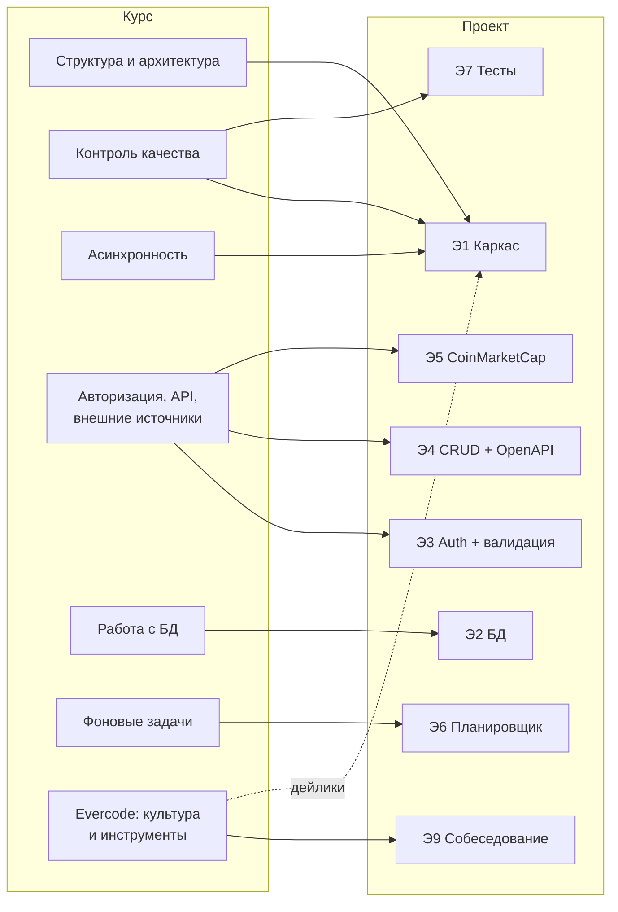

# Карта курса Fast Track Backend (Node.js)

Конспект всех уроков: суть в нескольких строках + куда это идёт в проекте.
Полные тексты уроков лежат в папке `Контекст` рядом с репозиторием.

## Граф: урок → требование → этап

## Шпаргалка «к какому уроку идти»

| Вопрос | Урок |
|---|---|
| Как разложить код по папкам и слоям? | Структура и архитектура |
| Как обрабатывать и типизировать ошибки? | Структура и архитектура · Контроль качества |
| Что и как логировать? | Контроль качества |
| Что мокать в тестах? | Контроль качества |
| Event Loop, промисы, Express, middleware | Асинхронность |
| Basic / JWT / RBAC, REST, OpenAPI, retry | Авторизация, API и внешние источники |
| Схема, SQL-инъекции, транзакции, Repository | Работа с БД |
| setTimeout/setInterval, graceful shutdown | Фоновые задачи |
| Как писать дейлик, стендап, follow-up | Стендапы · Follow-up · Деливери |
| Можно ли пользоваться AI | AI в работе |

---

## Техническая часть

### 1. Структура и архитектура Node.js-приложений
- **SoC** — каждый слой отвечает за своё: запросы, бизнес-логика, данные, конфиг, утилиты.
- Зависимости направлены **внутрь**: HTTP → бизнес-логика, не наоборот. Горизонтально — модули по фичам.
- Из SOLID важны **S** (одна ответственность) и **D** (зависеть от абстракций, внедрять зависимости).
- Асинхронные ошибки: callback → `.catch()` → **`try/catch` + `async/await`** (выбор курса).
- **Кастомные ошибки** наследуют `Error` и несут `statusCode`, `timestamp`, `requestId`, `context`.
- 👉 Этап 1: слои, `AppError`, error-middleware.

### 2. Контроль качества
- Логи — «чёрный ящик» прода: состояние системы, разбор инцидентов, аналитика.
- В проде включены `error`, `warn`, `info`; `debug`/`trace` — только при расследовании.
- **requestId / correlationId** пробрасывается во все компоненты, чтобы склеить след запроса.
- Jest = assertions + mocks + coverage.
- ❗ **Внешние API мокаем, БД — не мокаем**: проверяем цепочку от запроса до результата.
- 👉 Этапы 1 и 7.

### 3. Асинхронность в Node.js
- Один поток + неблокирующий I/O (Event Loop + libuv thread pool) → тысячи соединений.
- Паттерны: callbacks (callback hell) → Promise → async/await (сахар над Promise).
- Фазы Event Loop: timers → pending callbacks → poll → check → close; между ними — микрозадачи и `nextTick`.
- Блокировать основной поток нельзя: встанет всё.
- `http.createServer()` — низкий уровень; **Express** = маршрутизация + middleware-конвейер поверх него.
- 👉 Этап 1: `GET /status`.

### 4. Авторизация, API и внешние источники
- Аутентификация — «кто ты», авторизация — «что тебе можно» (RBAC, permissions, policies).
- **Basic Auth**: base64(login:password) в каждом запросе, нет отзыва и logout → legacy.
- **JWT**: header.payload.signature, stateless; минусы — нельзя отозвать до истечения, размер. Нужны HTTPS, короткий access + refresh.
- В Express авторизация — это middleware перед бизнес-логикой.
- **REST**: ресурсы-URL + HTTP-методы + статус-коды, stateless.
- **OpenAPI**: контракт API в YAML/JSON → документация, SDK, валидация.
- Внешние API: **таймауты, retry с задержкой, пул соединений**; данные валидировать → трансформировать → нормализовать; учитывать rate limit, кэшировать, **graceful degradation**.
- 👉 Этапы 3, 4, 5.

### 5. Работа с базой данных
- SQLite: встраиваемая, один файл = одна БД, ACID, FK, триггеры. Не для высокой параллельной записи.
- Динамическая типизация: 5 классов хранения (NULL, INTEGER, REAL, TEXT, BLOB); дат нет → ISO-строка или Unix time.
- Схема: сущность = таблица, атомарные столбцы, PK, `NOT NULL`, `UNIQUE`, FK.
- **Параметризованные запросы** (`?`, `$name`) — защита от SQL-инъекций; **prepared statements** — ещё и скорость.
- **Транзакции**: всё или ничего; ROLLBACK в `catch`; retry только для идемпотентных операций.
- **Repository Pattern**: SQL спрятан в репозиториях, SQL-ошибки → ошибки приложения.
- 👉 Этап 2.

### 6. Фоновые задачи и планировщики
- Фон — для того, что не должно держать HTTP-ответ: синхронизация с API, очистка, отчёты.
- Паттерн: обновлять данные заранее в фоне и сразу отдавать сохранённое.
- `setTimeout` — один раз, `setInterval` — периодически (может «плыть» при блокировке Event Loop).
- **Graceful shutdown**: хранить id таймеров → на SIGINT/SIGTERM `clearTimeout/clearInterval`.
- Слой **TaskScheduler**, зависимости через DI; мониторинг: статус последнего запуска, логи, алерты.
- 👉 Этап 6.

---

## Evercode Lab: компания и культура

### О компании
- 12+ лет, 500+ проектов, 400+ специалистов; офисы в 2026 открыты в Минске и Тбилиси.
- Ниша: **FinTech for Crypto / Web3 FinTech** — продукты для лидеров блокчейн-индустрии.
- NDA: не раскрываем проекты (даже в резюме), финансы, зарплаты.
- Испытательный срок 3 месяца, закрывается **по целям**.

### Ценности
- **Фокус на результат**, а не на процесс
- **Честность** — с партнёрами, коллегами, руководителями
- **Простота** — о сложном кратко и просто, без бюрократии
- **Смелость** — не боимся ответственности и трудных задач
- «Едим слона по кусочкам» — итерации + честная обратная связь

### Рабочие инструменты
| Инструмент | Суть |
|---|---|
| **Коммуникация** | Правда, прозрачность, скорость, преемственность. Один вопрос = один тред. Решения — только в публичных каналах |
| **Правило 5 минут** | Реакция в мессенджере ≤ 5 мин (почта ≤ 1 ч). Обязательно ETA; не успеваешь — даёшь новое |
| **Синк** | 15–30 мин, всегда с agenda заранее и follow-up после |
| **Эскалация** | Факт → влияние → риск → запрос. Не поиск виноватых, а снятие блокера |
| **Стендап** | 3–5 пунктов, результаты, а не процессы. Без «начать/продолжить» |
| **Follow-up** | Что решили → что делаем → кто → к какому сроку. «Не записано — не было» |
| **Деливери** | «Что изменилось благодаря моей работе?» — факт, цифра, решение |
| **Приоритизация** | «Зачем?» → матрица Эйзенхауэра → «5 почему» → риски (в финтехе — не релизим в пятницу вечером) |
| **Тайм-менеджмент** | Закон Паркинсона, реалистичные дедлайны, буфер 15–20% |
| **AI** | Можно как инструмент; нельзя сдавать непонятый результат («нейрослоп» = выбывание); никаких секретов и персональных данных в AI |

### Fast Track: правила игры
- 7 дней, одно задание, ежедневный дейлик в LMS (формат «done / plan»).
- Оценивают: **качество, самостоятельность, внимательность к граничным случаям, скорость, результат**.

### Словарик (самое частое)
Аппрув — согласование · ETA — оценка срока · ИР — инцидент-репорт · Пинг — напомнить · Синк — встреча-синхронизация · Таска — задача в Jira · Тред — ветка · FYI — к сведению · Эскалировать — поднять проблему к руководителю
