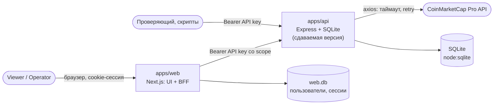
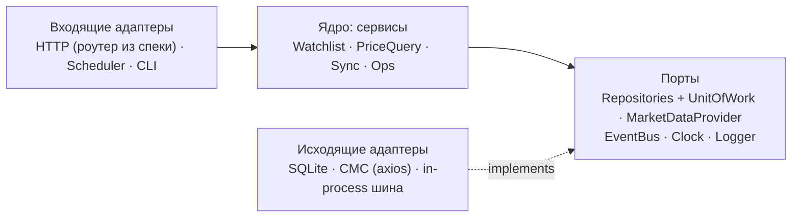

# Архитектура

Обзор и карта решений. Детали живут в ADR, здесь — только то, что нужно, чтобы за 5 минут понять систему и найти нужный документ.

## Контекст системы

- **`apps/api`** — сдаваемая версия, строго по ТЗ. Самодостаточна: ни от кого в репозитории не зависит ([ADR 0005](../adr/0005-monorepo-structure.md)).
- **`apps/web`** — бонус: дашборд и панель оператора. Ключи api в браузер не попадают — между ними BFF ([ADR 0002](../adr/0002-access-model.md), [0016](../adr/0016-web-auth-and-bff-routes.md)).
- **Профиль `platform`** — то же ядро api с адаптерами Postgres / Redis / RabbitMQ и отдельным воркером ([ADR 0011](../adr/0011-platform-composition.md)).

## Слои `apps/api`: порты и адаптеры

Зависимости направлены внутрь. Ядро знает только интерфейсы портов, адаптеры собираются в composition root (`server.ts`). Полная схема, таблица портов и правила — [ADR 0015 §1–2](../adr/0015-ports-events-and-lifecycle.md#1-слои-и-направление-зависимостей).

Аналогия с Nest: порт — это токен провайдера, адаптер — `useClass`. Только без DI-контейнера: зависимости передаются явно в `createApp(deps)`.

## Где что решено

| Тема | Документ |
|---|---|
| Структура монорепо, пакеты, правила зависимостей, команды | [ADR 0005](../adr/0005-monorepo-structure.md) |
| Эндпоинты, соглашения (версии, пагинация, ошибки, 202 + Location) | [ADR 0014](../adr/0014-api-contract.md), контракт [`openapi.yaml`](../../apps/api/openapi/openapi.yaml) |
| Spec-first: роутер, валидатор, типы и Swagger из одной спеки | [ADR 0008](../adr/0008-validation-and-openapi.md) |
| Порты, доменные события, синхронизация, ретраи, graceful shutdown | [ADR 0015](../adr/0015-ports-events-and-lifecycle.md) |
| Схема БД, индексы, миграции | [ADR 0013](../adr/0013-data-model.md), миграции api — [`apps/api/migrations/`](../../apps/api/migrations/), черновики следующих — [`schema/`](schema/) |
| Точность цен и агрегаты | [ADR 0006](../adr/0006-price-precision.md), [0007](../adr/0007-aggregates-and-rollups.md) |
| Доступ: API key со scope, BFF | [ADR 0002](../adr/0002-access-model.md), [0016](../adr/0016-web-auth-and-bff-routes.md) |
| Ограничение C7, инструменты, Node 24 | [ADR 0003](../adr/0003-sqlite-driver-and-node-version.md), [0004](../adr/0004-c7-interpretation-and-dev-tooling.md) |
| Тесты | [ADR 0009](../adr/0009-testing-strategy.md) |
| Web и `platform` | [ADR 0001](../adr/0001-web-framework.md), [0010](../adr/0010-email-alert-channel.md), [0011](../adr/0011-platform-composition.md), [0012](../adr/0012-web-charts-and-ui-kit.md), [UI-флоу](ui-flows.md) |

Полный список — [индекс ADR](../adr/README.md).

## Основные потоки

| Поток | Коротко | Подробно |
|---|---|---|
| Запрос к API | `X-Request-Id` → роутер из спеки → auth (scope) → валидация → хендлер → сервис → порты. Ошибки — RFC 9457 | ADR 0008, 0014 |
| Синхронизация цен | `setTimeout`-цепочка → запуск в `sync_runs` (уникальный индекс против наложения) → CMC с ретраями → одна транзакция: цены + свёртка → события после COMMIT | [ADR 0015 §4](../adr/0015-ports-events-and-lifecycle.md#4-синхронизация-цен) |
| Деградация при падении CMC | Цены отдаются из БД с `isStale`, readiness остаётся 200, запуск `failed` с кодом | ADR 0015 §4 |
| Realtime | `EventBus` → SSE-хаб → `/api/v1/stream` → BFF → браузер | ADR 0014, 0015, 0016 |
| Остановка (C6) | 8 шагов: readiness 503 → таймер → `server.close` → SSE `shutdown` → idle-сокеты → ждём синхронизацию ≤ 10 с → БД → exit | [ADR 0015 §5](../adr/0015-ports-events-and-lifecycle.md#5-жизненный-цикл-процесса) |
