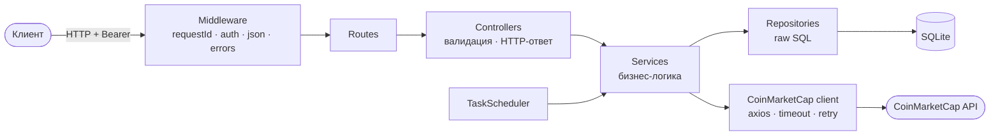
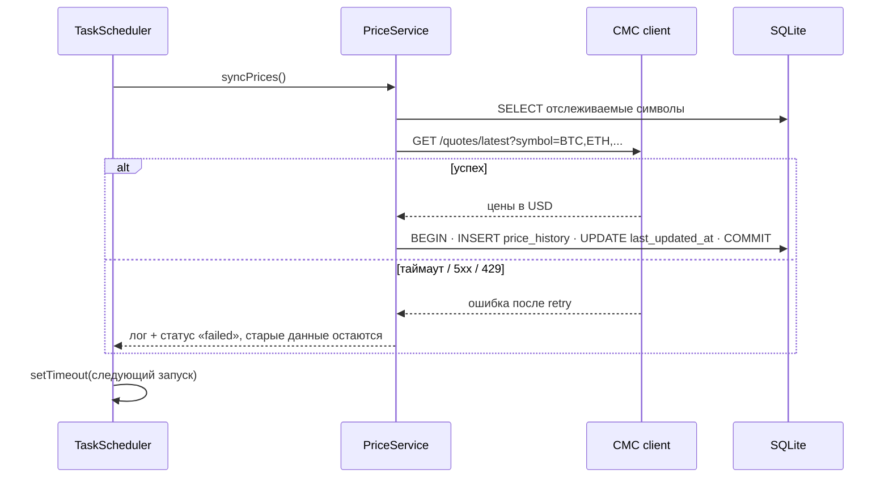

# Архитектура (черновик)

> Черновик этапа 0. Уточняется на этапах 1–2.

## Слои

Зависимости направлены внутрь: HTTP знает о сервисах, сервисы — о репозиториях, но не наоборот.



## Синхронизация цен



## Схема БД

Утверждена в [ADR 0013](../adr/0013-data-model.md): ER-диаграмма, индексы, доменные правила, миграции. Проверенный DDL — [`schema/0001_core.sql`](schema/0001_core.sql) (ядро ТЗ) и [`schema/0002_alerts.sql`](schema/0002_alerts.sql) (алерты).

## Эндпоинты (черновик)

| Метод | Путь | Auth | Назначение |
|---|---|---|---|
| GET | `/status` | — | Health-check |
| GET | `/docs` | — | Swagger UI |
| GET | `/api/cryptocurrencies` | ✔ | Список отслеживаемых |
| POST | `/api/cryptocurrencies` | ✔ | Добавить монету (по символу) |
| GET | `/api/cryptocurrencies/:id` | ✔ | Одна монета |
| PATCH | `/api/cryptocurrencies/:id` | ✔ | Изменить |
| DELETE | `/api/cryptocurrencies/:id` | ✔ | Удалить (вместе с историей) |
| GET | `/api/prices` | ✔ | Актуальные цены всех отслеживаемых |
| GET | `/api/cryptocurrencies/:id/prices` | ✔ | История: `from`, `to`, `limit` |

## Структура папок (план)

```
src/
  app.ts            # сборка Express-приложения (без listen — удобно для Supertest)
  server.ts         # точка входа: listen, scheduler, graceful shutdown
  config/           # чтение и проверка env
  db/               # подключение, миграции
  modules/
    cryptocurrencies/   # routes, controller, service, repository, validation
    prices/
  integrations/coinmarketcap/
  jobs/             # TaskScheduler, задачи
  common/           # errors, logger, middleware, utils
tests/
docs/
```
