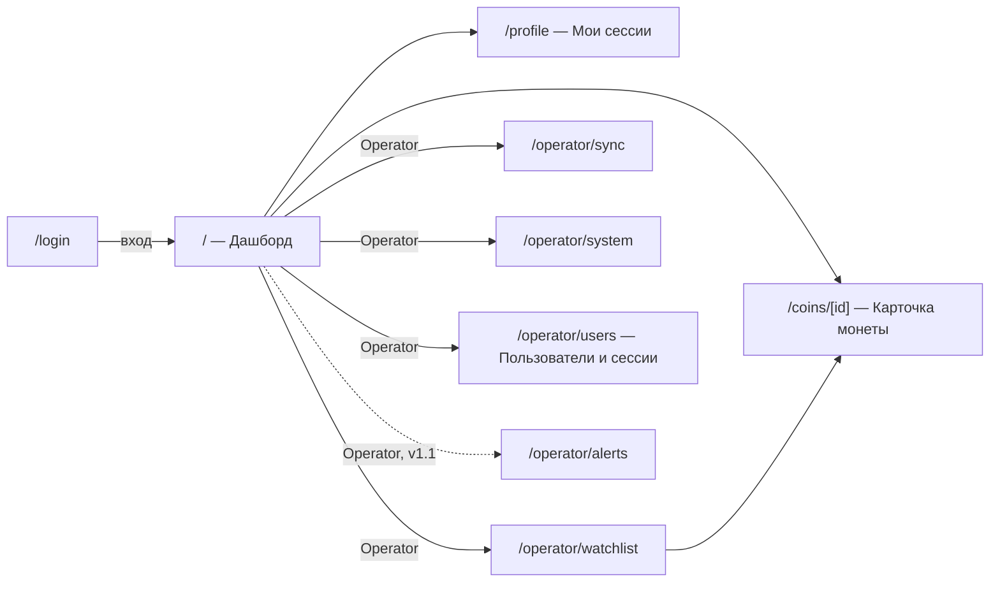
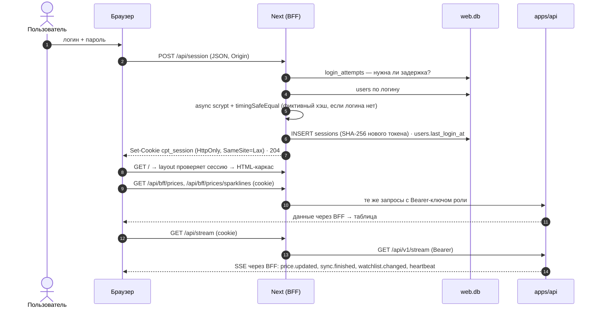
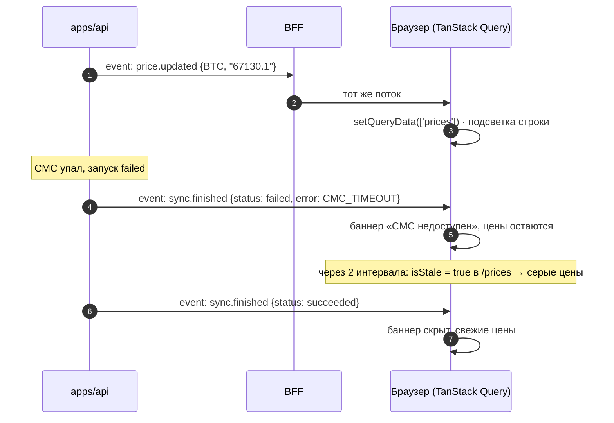
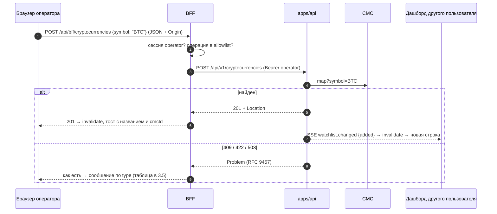
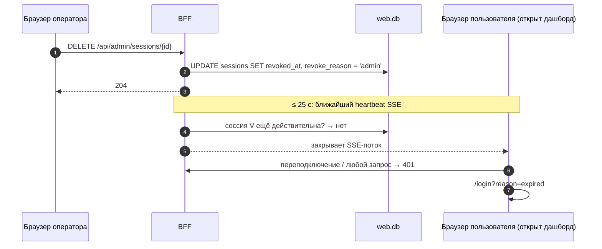

# UI-флоу: дашборд и панель оператора

Артефакт фазы A. Стек и решения:
- Next.js 16 как BFF — [ADR 0001](../adr/0001-web-framework.md);
- пользователи, сессии, маршруты BFF — [ADR 0016](../adr/0016-web-auth-and-bff-routes.md);
- графики, UI-кит, слой данных — [ADR 0012](../adr/0012-web-charts-and-ui-kit.md);
- контракт api — [ADR 0014](../adr/0014-api-contract.md);
- события — [ADR 0015](../adr/0015-ports-events-and-lifecycle.md).

## 1. Роли и возможности

| Возможность | Viewer | Operator | Источник данных |
|---|---|---|---|
| Дашборд: watchlist с ценами, изменение за 24 ч, мини-графики, свежесть | ✅ | ✅ | api: `listLatestPrices`, `listSparklines`, `streamEvents` |
| Карточка монеты: график (свечи / линия), сводка, история | ✅ | ✅ | api: `getCryptocurrency`, `getPriceAggregates`, `listPriceHistory` |
| Профиль: свои активные сессии, «Выйти на всех устройствах» | ✅ | ✅ | web: `/api/me/sessions` |
| Watchlist: добавить, переименовать, приостановить, удалить монету | — | ✅ | api: `createCryptocurrency`, `updateCryptocurrency`, `deleteCryptocurrency` |
| Синхронизация: история запусков, ручной запуск | — | ✅ | api: `listSyncRuns`, `triggerSyncRun`, `getSyncRun` |
| Система: состояние CMC, квоты, здоровье сервиса | — | ✅ | api: `getCmcStatus`, `/health/ready` |
| Пользователи и сессии: создать, сменить роль, отключить, сбросить пароль, отозвать сессию | — | ✅ | web: `/api/admin/users`, `/api/admin/sessions` |
| Алерты: правила, каналы, доставки | — | ✅ | v1.1 (вместе с модулем алертов в api) |

Для Viewer разделы оператора **не показываются**. Прямой переход по URL → страница «Недостаточно прав» (разметка раздела не отдаётся; HTTP-статус страницы — 200, запросы данных получают 403 от BFF). Защита — на сервере (BFF), а не скрытием в UI.

## 2. Карта экранов



**Общий layout:**
- верхняя панель: логотип, навигация (пункты оператора — только для Operator), индикатор realtime (●/○), меню пользователя («Профиль», «Выйти»);
- в футере — атрибуция TradingView (требование лицензии, ADR 0012).

**Загрузка данных — только на клиенте:** TanStack Query через BFF, со скелетонами. Без server-component prefetch и гидратации кэша: SEO дашборду за логином не нужен, а гидратация — лишняя сложность. Сервер Next отвечает только за проверку сессии в layout и BFF.

## 3. Экраны

### 3.1 `/login`

- Форма «Логин / Пароль». Ошибка одна на всё: «Неверный логин или пароль» (не раскрываем, существует ли логин).
- Прогрессивная задержка (ADR 0016) → «Слишком много попыток, повторите через N с».
- Уже вошёл → редирект на `/`. Истёкшая или отозванная сессия на любом экране → `/login?reason=expired` с пояснением «Сессия завершена, войдите снова».

### 3.2 `/` — Дашборд (Viewer, Operator)

```
┌──────────────────────────────────────────────────────────────────────────┐
│ Crypto Price Tracker  Дашборд [Watchlist][Синхр.][Система][Польз.] ● alexey▾│
├──────────────────────────────────────────────────────────────────────────┤
│ ⚠ Данные CoinMarketCap недоступны с 14:05. Показаны последние цены.     │ ← баннер, если isStale
│ Последняя синхронизация: 14:00:03 · успешно · следующая ≈ 14:05         │
├────────┬────────────────┬─────────────────┬──────────┬─────────┬─────────┤
│ Символ │ Название       │ Цена, USD       │ 24 ч     │ 24 ч ~  │ Обновл. │
├────────┼────────────────┼─────────────────┼──────────┼─────────┼─────────┤
│ BTC    │ Bitcoin        │ $67,123.45      │ ▲ +1.23% │ ╱╲╱‾    │ 2 мин   │
│ ETH    │ Ethereum       │ $2,512.08       │ ▼ −0.40% │ ‾╲╱╲    │ 2 мин   │
│ PEPE   │ Pepe           │ $0.0000123457   │ —        │         │ ожидает │ ← latest = null
└────────┴────────────────┴─────────────────┴──────────┴─────────┴─────────┘
```

| Аспект | Поведение |
|---|---|
| Данные | `listLatestPrices` + `listSparklines?window=24h` + `listCryptocurrencies` (признак паузы, кэшируется до `watchlist.changed`) — **три запроса на весь дашборд**, независимо от числа монет ([ADR 0017](../adr/0017-web-ui-data-gaps.md)). «Следующая ≈ …» в строке синхронизации видна только Operator: расписание отдаёт `getCmcStatus` |
| Realtime | `price.updated` → `setQueryData(['prices'])`, строка коротко подсвечивается (≤ 1 с, с учётом `prefers-reduced-motion`). Порядок строк не прыгает. `sync.finished` и `watchlist.changed` → фоновый перезапрос цен и мини-графиков (`watchlist.changed` — ещё и списка монет). Фоновый перезапрос не продлевает срок бездействия сессии ([ADR 0016](../adr/0016-web-auth-and-bff-routes.md), поправка 26). Незнакомый `cryptocurrencyId` в `price.updated` → тоже перезапрос списка (страховка) |
| Цена | `Intl.NumberFormat` **со строкой** на входе. ≥ 1 — 2 знака после запятой, < 1 — 6 значащих цифр. Полное значение — в `title` |
| 24 ч | Цвет **и** стрелка ▲/▼ (цвет — не единственный сигнал, a11y). `null` → «—» с подсказкой «Истории меньше суток» |
| Мини-график | Свой SVG по `points` из `listSparklines`. Обновляется по `sync.finished`; таймера нет |
| Свежесть | «2 мин назад» по `fetchedAt`. `isStale` → серый цвет и ⚠ |
| Пусто | Viewer: «Пока ничего не отслеживается». Operator: то же + кнопка «Добавить монету» |
| Ошибка загрузки | Карточка ошибки с `requestId` и «Повторить» |
| Realtime оборвался | Индикатор ○, автопереподключение с backoff. После переподключения — перезапрос всех трёх запросов (пропущенные события не досылаются, ADR 0014). Если сервер ответил не потоком (502), новую попытку планирует клиент: 1, 2, 4 … 30 с |
| Сессию отозвали | BFF шлёт в поток `session.expired` и закрывает его (ADR 0016) → `/login?reason=expired`. Тот же переход — по ответу 401 на любой запрос |

### 3.3 `/coins/[id]` — Карточка монеты

```
┌─────────────────────────────────────────────────────────────┐
│ ← Дашборд    BTC · Bitcoin      $67,123.45   ▲ +1.23% (24 ч) │
│ [1Ч] [4Ч] [1Д] [1Н]    Период: [24ч] [7д] [30д] [1г]          │
│ ┌─────────────────────────────────────────────────────────┐ │
│ │        свечи (Lightweight Charts)  ▕▌▐▕▌▐▐▕▌            │ │
│ └─────────────────────────────────────────────────────────┘ │
│ Сводка: open · close · min · max · avg · изменение · точек   │
│ История (сырые точки):  время │ цена │ время котировки CMC   │
│                         … [Загрузить ещё] (nextCursor)       │
└─────────────────────────────────────────────────────────────┘
```

| Аспект | Поведение |
|---|---|
| График | `getPriceAggregates` с выбранными интервалом и периодом; вид — свечи или линия. Недопустимые сочетания (> 1000 бакетов, ADR 0007, или меньше двух) в UI неактивны, с подсказкой: например, `1h` × `1г`. Шкала времени — UTC, как границы бакетов. Бакеты без данных в свечах остаются пустым промежутком |
| Подсказка | Значения бакета под курсором или выбранного стрелками клавиатуры — из строк api, не из чисел графика (ADR 0012, поправка 6) |
| Realtime | `price.updated` для этой монеты → `series.update()` последней свечи, цена в шапке, первая строка истории. Сводку перечитывает `sync.finished` |
| Мало данных | «Данных пока мало: история копится с момента добавления монеты (CMC Basic не отдаёт историю)» |
| История | `listPriceHistory`, курсорная пагинация «Загрузить ещё» |
| 404 | «Монета не отслеживается» + ссылка на дашборд. Если монету удалили, пока карточка открыта (`watchlist.changed: removed`) — тот же экран |

### 3.4 `/profile` — Мои сессии (Viewer, Operator)

- Логин, роль, время последнего входа.
- Таблица активных сессий: создана, последняя активность, IP, браузер (из User-Agent), метка «текущая».
- «Завершить» у любой, кроме текущей. «Выйти на всех устройствах» — с подтверждением, текущая тоже завершается.
- Смена своего пароля: старый + новый (≥ 12 символов). После смены все сессии отзываются, нужен новый вход.
- Неверный текущий пароль — ошибка у поля; после пяти неудач подряд — ожидание, как на входе (ADR 0016, поправка 32).
- Открывается из меню пользователя: «Профиль и сессии».

### 3.5 `/operator/watchlist` (Operator)

- Таблица: символ, название, `cmcId`, статус (активна / на паузе), последнее обновление, действия (переименовать, пауза/возобновить, удалить).
- **Добавление:** поле «Символ» (верхний регистр, `^[A-Z0-9]{1,15}$` — тот же паттерн, что в контракте) + необязательный «CMC ID» в блоке «Дополнительно».

| Ответ api | UI |
|---|---|
| 201 | Строка появляется. Тост «Добавлен Bitcoin (CMC #1)» — видно, какую монету выбрал сервис |
| 400 | Ошибки у полей (по `errors[].path`) |
| 409 `already-tracked` | «BTC уже отслеживается» + ссылка на карточку (`conflictingId`) |
| 422 `unknown-symbol` | «Символ не найден в CoinMarketCap» |
| 422 `watchlist-limit-reached` | «Достигнут лимит 100 монет (квота CMC)» |
| 503 | «CoinMarketCap недоступен, попробуйте через N с» (`Retry-After`) |

- **Удаление:** диалог «Будет удалена вся история цен BTC. Чтобы сохранить историю, поставьте на паузу». Кнопка подтверждения активна после ввода символа (защита от случайного удаления данных). Числа точек в диалоге нет: контракт его не отдаёт ([ADR 0017](../adr/0017-web-ui-data-gaps.md), пробел 3).
- **Обновление экрана:** результат мутации берётся из ответа api; чужие изменения приносит `watchlist.changed`, время последней цены — `price.updated`.

### 3.6 `/operator/sync` (Operator)

- Карточка «Сейчас»: статус последнего запуска, следующий запуск, кнопка «Синхронизировать сейчас». «Следующий запуск» и состояние планировщика показываются, только если api отдаёт блок `schedule` (контракт 1.1.0).
- **Ручной запуск:** `triggerSyncRun` → 202 → строка запуска `running` со спиннером. Завершение — по SSE `sync.finished`, без опроса. 409 → «Синхронизация уже идёт» + переход к ней.
- Таблица запусков (`listSyncRuns`, «Загрузить ещё»): время, триггер, статус (цвет + текст), сохранено цен, попыток, кредитов, ошибка (`code` + `message`).

### 3.7 `/operator/system` (Operator)

- CMC: последний успех, последняя ошибка (код, время), квота месяца — прогресс-бар `creditsUsedMonth / creditLimitMonthly`, использовано сегодня.
- **Прогноз:** «при текущем интервале и N монетах квоты хватит до …». Предупреждение, если раньше конца месяца. Нужен интервал из блока `schedule` (контракт 1.1.0); без него прогноза нет. Расход на запуск — среднее по последним 20 запускам.
- Здоровье сервиса: `/health/ready` (БД, миграции, планировщик). Ответ 503 с составом проверок показывается как состояние «не готов», а не как ошибка загрузки.
- Обновление: по событию `sync.finished` и кнопкой «Обновить»; опроса по таймеру нет.

### 3.8 `/operator/users` — Пользователи и сессии (Operator)

| Блок | Содержимое и действия |
|---|---|
| Пользователи | Логин, роль, статус, последний вход, активных сессий. Действия: создать (логин + роль), сменить роль, отключить / включить, сбросить пароль. Временный пароль создаёт сервер и показывает один раз — при создании и при сбросе (ADR 0016, поправка 29) |
| Активные сессии | Все пользователи: логин, создана, активность, IP, браузер. «Отозвать» |
| Ограничения | Нельзя отключить или понизить **последнего активного оператора** (кнопка неактивна, с объяснением). Отключение, смена роли и сброс пароля → все сессии пользователя отзываются сразу (ADR 0016) |
| Подтверждения | Отключение, смена роли и сброс пароля — диалог с последствиями: «у пользователя будут завершены N сессий». Действие над своей учётной записью — предупреждение «потребуется войти заново», после ответа — переход на вход |
| Свой пароль | Оператор не сбрасывает его здесь (кнопка неактивна): смена — в профиле |
| Обновление экрана | Событий потока по пользователям и сессиям нет. Пользователь обновляется из ответа мутации; список сессий и счётчики перечитываются, когда действие их изменило |

## 4. Ключевые флоу

### 4.1 Вход и первый экран



### 4.2 Realtime и деградация



### 4.3 Добавление монеты (Operator) и реакция других дашбордов



### 4.4 Оператор отзывает сессию пользователя



## 5. Сквозные правила UX

| Правило | Как |
|---|---|
| Точность | Цены — строки до самого `Intl.NumberFormat`. `Number()` только на входе в canvas графика (ADR 0006, 0012) |
| Время | В часовом поясе браузера («14:05»), в подсказке — ISO UTC. Относительное время («2 мин назад») обновляется раз в 30 с |
| Ошибки | `title`/`detail` из Problem + `requestId` для поддержки. Стеки и внутренние детали — никогда |
| Загрузка | Скелетоны таблиц и графика, без «прыжков» вёрстки |
| Доступность | Навигация с клавиатуры, видимый фокус, `aria-live="polite"` для тостов (не для каждого тика цены — иначе скринридер утонет) |
| Тема | Системная по умолчанию (`prefers-color-scheme`), переключатель «Светлая / Тёмная / Как в системе» (решение Q1, [README дизайна](design/README.md#принятые-решения)). Цвета роста и падения проверены на контраст |
| Мутации | Без оптимистичных обновлений: после ответа кэш правится из тела ответа api, остальное (цены, мини-графики) помечается устаревшим. Честность данных важнее скорости ([ADR 0012](../adr/0012-web-charts-and-ui-kit.md), поправка 11) |
| Деструктивные действия | Удаление монеты, отключение пользователя, «выйти везде» — диалог с последствиями. Удаление данных — с вводом символа |

## 6. Порядок реализации в фазе C

Всё перечисленное входит в объём (решение от 06.10). Порядок — от фундамента к деталям, чтобы на каждом шаге было работающее приложение:

1. Каркас Next.js, shadcn/ui, тема, layout; `web.db` + миграции; вход, выход, сессии.
2. BFF: allowlist + тест-сверка со спекой, SSE-прокси с перепроверкой сессии.
3. Дашборд: цены, realtime, мини-графики, баннер деградации.
4. Карточка монеты: график, сводка, история.
5. Оператор: watchlist (CRUD), синхронизация, система.
6. Пользователи и сессии, профиль.
7. E2e-сценарии Playwright (ADR 0009).
