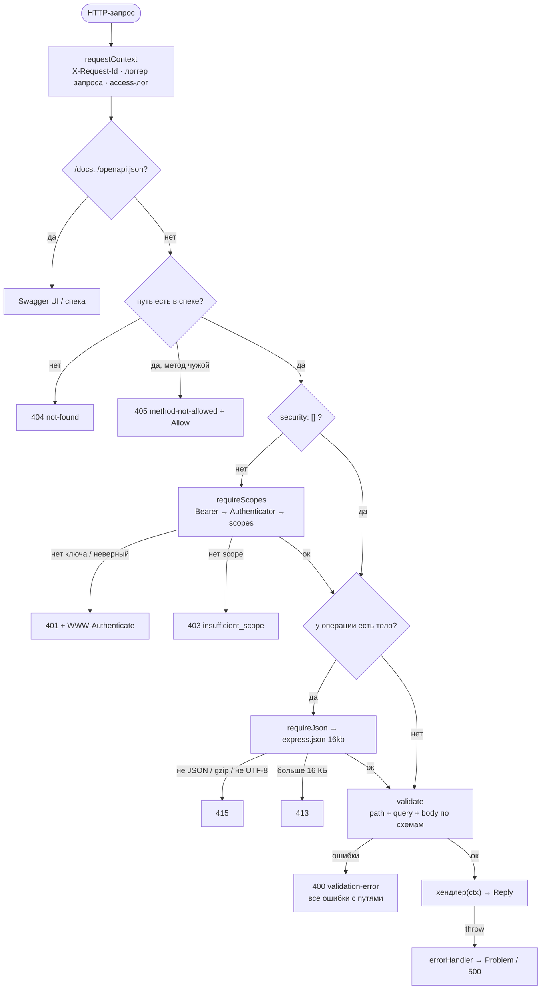

# 01. Express глазами Nest-разработчика: HTTP-слой из спеки (B4–B7)

> **Опорный принцип** (тема «Асинхронность в Node.js»): «…концепцию middleware — функций, которые обрабатывают запросы последовательно, как конвейер: от парсинга тела запроса и проверки авторизации до основной бизнес-логики и формирования ответа».

Разбор дня 3: конфиг, логгер, `Clock`, `X-Request-Id`, валидатор подмножества JSON Schema, роутер из `openapi.yaml`, ошибки RFC 9457, `createApp` и `/health/*`. Все цифры — из реальных прогонов на Node 24.21.

## Простыми словами

Nest прячет конвейер обработки запроса за декораторами: `@UseGuards`, `@UsePipes`, `@UseFilters`. В Express этот конвейер виден целиком. Это просто массив функций `(req, res, next)`, и каждая решает: пропустить запрос дальше (`next()`) или ответить сама.

Аналогия — проходная завода. Охранник записывает номер пропуска (request-id), проверяет допуск в цех (scopes), досматривает сумку (Content-Type, размер, схема). Только потом человек попадает к станку (хендлер). Если что-то не так, его разворачивают с бумагой установленного образца (Problem Details), а не криком.

Главная особенность проекта: **конвейер не пишется руками**. Роутер читает `openapi.yaml` и сам собирает цепочку для каждой операции. Маршрута «мимо контракта» не существует по построению.

## Как это в Nest → как в Express

| Nest | Express в проекте | Где |
|---|---|---|
| `@Module`, DI-контейнер, провайдеры | `createApp(deps)`: зависимости передаются аргументом | [`app.ts`](../../apps/api/src/app.ts) |
| `@Controller` + `@Get(':id')` | путь и метод из спеки, хендлер по `operationId` | [`router.ts`](../../apps/api/src/http/router.ts) `mountFromSpec` |
| `AuthGuard`, `RolesGuard` + `@Roles()` | middleware `requireScopes`, scopes из `x-required-scopes` | [`auth.ts`](../../apps/api/src/http/auth.ts) |
| `ValidationPipe` + DTO с class-validator | middleware `validate`: схемы из спеки, скомпилированные при старте | [`schema.ts`](../../apps/api/src/openapi/schema.ts), [`spec.ts`](../../apps/api/src/openapi/spec.ts) |
| `@nestjs/swagger`: спека из кода (code-first) | код из спеки (spec-first), Swagger UI на `/docs` | ADR 0008 |
| `ExceptionFilter` | error-middleware с 4 аргументами `(err, req, res, next)` | [`errors.ts`](../../apps/api/src/http/errors.ts) |
| `LoggingInterceptor`, `ClsService` | первый middleware: `X-Request-Id`, `res.locals.log`, access-лог | [`request-context.ts`](../../apps/api/src/http/request-context.ts) |
| `ConfigModule` + Joi-схема | `loadConfig(process.env)` — один раз при старте | [`config.ts`](../../apps/api/src/config.ts) |
| `NotFoundException` | `throw new HttpProblem(404, 'not-found')` | [`problem.ts`](../../apps/api/src/http/problem.ts) |

Главное отличие: **в Nest порядок задан фреймворком** (middleware → guards → interceptors → pipes → handler → filters), **а в Express его задаёт разработчик** порядком `app.use` и элементов массива. Это и свобода, и ответственность: поставить валидацию до auth — и неаутентифицированный клиент узнает схему ваших данных по ошибкам 400.

## Конвейер одного запроса

Все ответы с ошибкой (4xx и 5xx) формирует один error-middleware: каждый шаг просто бросает `HttpProblem`, а [`errors.ts`](../../apps/api/src/http/errors.ts) превращает её в `application/problem+json` с `type: urn:cpt:problem:<slug>` и `requestId`.

Порядок выбран осознанно:
- **405 до auth.** Неверный метод — ошибка клиента, не зависящая от прав. Ключ для этого не нужен.
- **Auth до разбора тела.** Без ключа сервис не читает и не парсит 16 КБ JSON и не раскрывает схему через ошибки 400.
- **Валидация — одним шагом для path, query и body.** Клиент получает все ошибки сразу, а не по одной за запрос.

Express 5 сам ловит отклонённый промис из `async`-middleware и передаёт ошибку в `next(err)`. Поэтому в коде нет обёрток `asyncHandler`, которые были обязательны в Express 4.

## Валидатор: компиляция вместо интерпретации

Схема из спеки при старте превращается в **функцию-замыкание** ([`schema.ts`](../../apps/api/src/openapi/schema.ts)). На запросе нет разбора схемы: выполняется готовая цепочка проверок. Это тот же приём, что у ajv, только без генерации кода.

| Свойство | Как сделано | Зачем |
|---|---|---|
| **Fail-fast** | неизвестное ключевое слово (`oneOf`, `discriminator`, `readOnly`, `format: email`…) → `SpecError` при старте | Спека не может обещать проверку, которой нет. Весь `openapi.yaml` компилируется в тесте — 16 операций |
| Ключевое слово «не по типу» | `pattern` у `integer` → ошибка старта | Почти всегда опечатка в спеке |
| Открытый объект | объект без `additionalProperties: false` → ошибка старта | Защита от mass assignment закреплена конструктивно, её нельзя забыть |
| `nullable` без `type` | ошибка старта | Ловушка OpenAPI 3.0.3 из ADR 0014 теперь проверяется кодом |
| `$ref` с соседями | ошибка старта | В 3.0 соседи `$ref` игнорируются — молча игнорировать нельзя |
| `allOf` | только из 1 элемента; `null` при `nullable: true` проходит до `allOf` | Идиома «`$ref` + nullable» значит `T \| null`, как и в сгенерированных типах |
| `integer` | только `Number.isSafeInteger` | `2^53 + 1` после `JSON.parse` — уже другое число |
| Строки | длина в символах Unicode (`'𝔹'.length === 2`, а символ один) | Так требует JSON Schema |
| `date-time` | RFC 3339, зона обязательна, календарь проверяется (31.04 и 29.02.2026 — ошибки) | «Голое» `12:00` неоднозначно |
| Query и path | приведение строго по типу: `"10"` → `10`, но `"010"`, `"1e3"`, `"+1"` не приводятся | Неоднозначный ввод отклоняется, а не угадывается |
| `__proto__` | `JSON.parse('{"__proto__":…}')` даёт собственное поле — оно «лишнее» → 400 | Защита от prototype pollution без отдельного кода |
| Пути ошибок | JSON Pointer (RFC 6901): `/body/a~1b`, `/query/limit`, `/path/id` | Клиент подсвечивает конкретное поле |

Результат валидации кладётся в `res.locals.input`, потому что в Express 5 `req.query` — геттер и перезаписать его нельзя (ADR 0008).

## Контракт проверяет компилятор

Тип `Handlers` выводится из сгенерированного `api-types.ts` ([`router.ts`](../../apps/api/src/http/router.ts)):
- нет хендлера для операции → ошибка компиляции (`satisfies Handlers` в `app.ts`);
- `input.path.id` — `number`, `input.body.symbol` — `string`, лишнее поле тела — ошибка компиляции;
- хендлер возвращает `{ status, body }` только со статусом из контракта и телом ровно по схеме. Ошибки (`application/problem+json`) не возвращаются, а бросаются: `throw new HttpProblem(…)`.

Это проверяют типовые тесты с `@ts-expect-error` ([`handler-types.test.ts`](../../apps/api/tests/http/handler-types.test.ts)). Если тип ослабнет, ожидаемая ошибка исчезнет, и упадёт typecheck. Один такой тест сразу нашёл дыру: `{ status: 204, body: {} }` компилировался. Возвращаемое значение функции не проверяется на лишние свойства, поэтому понадобилось явное `body?: never`.

В рантайме ответы сверяет Jest-матчер `expect(res).toMatchContract('getReadiness', 503)`. Он прогоняет тело через тот же валидатор. Матчер тоже нашёл баг в первый же день: для `text/event-stream` он проверял распарсенное тело (`{}` от supertest), а не текст.

## Общее ядро (B4)

- **Конфиг** ([`config.ts`](../../apps/api/src/config.ts)): все ошибки сразу, а не первая. **Значения переменных не попадают в сообщения никогда.** Это проще и надёжнее, чем помнить, какая переменная секретная. `SYNC_INTERVAL_MS < 180000` → отказ старта (квота CMC, ADR 0007).
- **Логгер** ([`logger.ts`](../../apps/api/src/common/logger.ts)): одна JSON-строка на событие, `child()` добавляет поля (`requestId`, `operationId`, `keyId`). Секреты маскируются дважды: **по имени поля** (`authorization`, `apiKey`, `password`…) и **по значению** (API-ключ сервиса узнаётся по префиксу `cpt_`, даже если поле названо невинно). Циклы и глубина не роняют логгер.
- **`Clock`** ([`clock.ts`](../../apps/api/src/common/clock.ts)): единственное место с `Date.now`, это закреплено ESLint. `FakeClock.advance()` будит спящих по очереди. Цепочка «ретрай → sleep → ретрай» проходит за один вызов — пригодится в B9 и B12.
- **`X-Request-Id`**: входящий id переиспользуется, только если он ≤ 64 символов из `[A-Za-z0-9._:-]`. Иначе клиент мог бы вставить перевод строки и подделать запись в логе (log injection).

## Подводные камни (найдены сегодня)

- **`type-is` считает телом `Content-Length: 0`.** А его шлёт любой POST без данных. Без своей `hasBody()` запрос `POST /sync-runs` получал бы 400 «тело не ожидается».
- **`esModuleInterop` в Jest.** Для `module: nodenext` он включён по умолчанию, для `commonjs` — нет. Без флага в `tsconfig.jest.json` `import express from 'express'` превращается в `undefined`.
- **Gzip-тело** распаковывается `express.json` по умолчанию, и 16 КБ сжатых данных могут оказаться гигабайтами. Ставим `inflate: false`, и такой запрос получает 415.
- **Ошибка после начала ответа** (SSE уже пишет поток). Problem дописать нельзя, заголовки ушли. Error-middleware рвёт соединение `res.destroy()`, иначе клиент принял бы обрывок за нормальный ответ.
- **`Allow` у 405** включает `HEAD`: Express сам обслуживает `HEAD` GET-хендлером без тела.
- **Детали 500 — только в лог.** Наружу уходит «See logs by requestId»: текст `SQLITE_CORRUPT…` раскрыл бы внутренности (C4).
- **`createApp` компилирует спеку при каждом вызове.** Это миллисекунды, зато каждый тест получает чистое приложение без общего состояния.

## Проверено руками

| Проверка | Результат |
|---|---|
| `node src/server.ts` без `CMC_API_KEY` | понятное сообщение, код выхода 1, значений переменных в выводе нет |
| `node src/server.ts` (Node 24, ESM) и `node dist/server.js` после `tsc` | `/health/ready` 200, `/docs/` и статика Swagger UI 200, 405 и 401 — Problem Details, access-лог в JSON |
| Тесты | 426, покрытие 100 % по всем файлам `apps/api/src` (пороги 100 % — `Decimal`, `src/openapi/`, `auth.ts`) |

## Вопросы на собеседовании

1. **Чем middleware в Express отличается от guard и pipe в Nest и как ты выбрал их порядок?** → В Nest порядок фиксирован фреймворком, в Express его задаёт порядок регистрации. У меня 405 → auth → Content-Type/размер → валидация → хендлер. Auth стоит до разбора тела, чтобы не парсить и не раскрывать схему чужим.
2. **Как гарантируешь, что спека и валидация не разъедутся?** → Валидатор читает ту же спеку, на неизвестном ключевом слове приложение не стартует, а `toMatchContract` сверяет каждый ответ в тестах. Типы хендлеров выведены из спеки, поэтому неверный статус или тело — ошибка компиляции.
3. **Почему 400, а не 422, для невалидного тела? И когда 415, 413?** → 400 — запрос не соответствует схеме. 422 — синтаксически верно, но не проходит бизнес-проверку (символа нет в CMC). 415 — тело не `application/json` (или сжато, или не UTF-8), 413 — больше 16 КБ.
4. **Как защищаешься от mass assignment и prototype pollution без библиотек?** → Каждый объект в спеке обязан иметь `additionalProperties: false`, иначе приложение не стартует. Лишнее поле, включая `__proto__` из `JSON.parse`, даёт 400.
5. **Зачем `X-Request-Id` и почему не любой входящий?** → Чтобы склеить логи web → api по одному id. Входящий принимаю только безопасного формата и длины, иначе возможна подделка строк лога.
