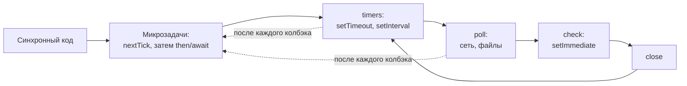

# 02. Event Loop и асинхронность

> **Опорный принцип** (тема «Асинхронность в Node.js», по карте тем `course-map.md`): «Один поток + неблокирующий I/O (Event Loop + libuv thread pool) → тысячи соединений. Блокировать основной поток нельзя: встанет всё».

## Простыми словами
Node.js — один официант на весь зал. Он не стоит у плиты, пока готовится заказ: принял, передал на кухню (libuv, ОС) и пошёл к следующему столику. Когда блюдо готово, кухня кладёт записку в очередь, и официант разносит по порядку. Зал обслуживается быстро, пока официант **ничего не делает долго сам**: если он сядет считать годовой отчёт, ждать будут все столики сразу.

Очередей несколько, и порядок между ними строгий:

Главное следствие: очередь микрозадач выполняется **до конца** после каждого колбэка. `await` уже готового промиса не отдаёт управление другим запросам, а `await` сети или таймера — отдаёт.

## Как это в Nest → как в Express
Разницы нет: оба работают поверх одного и того же `http.createServer()` и одного Event Loop. Nest добавляет DI и декораторы, но не потоки. Всё, что ниже, верно для любого Node-сервиса.

## В проекте
- **Синхронный драйвер БД — осознанно.** `node:sqlite` блокирует поток на время запроса ([ADR 0003](../adr/0003-sqlite-driver-and-node-version.md)). Поэтому каждый запрос обязан быть коротким: агрегаты читаются из часовых свёрток, а не считаются по сырым строкам. Замер из [ADR 0007](../adr/0007-aggregates-and-rollups.md): год по дням на лету — 179 мс блокировки, через свёртку — 10 мс.
- **Транзакция и `await`.** Соединение одно. Если внутри транзакции дождаться сети, Event Loop пустит другой запрос на то же соединение — посреди чужого `BEGIN`. [`TransactionRunner`](../../apps/api/src/db/transaction.ts) ставит транзакции в очередь, а вложенный вызов отличает через `AsyncLocalStorage`. Запрос в CoinMarketCap всегда идёт **вне** транзакции. Демо и диаграмма — [разбор 11, §6](11-фундамент-api.md).
- **Планировщик — цепочка ожиданий, а не `setInterval`.** [`SyncScheduler.cycle`](../../apps/api/src/sync/scheduler.ts): `await clock.sleep()` → `await sync.run()` → снова `sleep`. Следующий запуск отсчитывается от конца предыдущего, поэтому запуски не накладываются, даже если CMC отвечал дольше интервала.
- **Отмена — через `AbortController`.** Один сигнал прерывает ожидание планировщика, запрос axios и паузу между ретраями. Это тот же «сохранённый id таймера для `clearTimeout`», только для промисов.
- **Тяжёлое — один раз при старте.** Спека компилируется в функции-валидаторы до приёма первого запроса ([`compileSpec`](../../apps/api/src/openapi/spec.ts)); в горячем пути остаются только вызовы замыканий.
- **Тело запроса ограничено 16 КБ** ([`BODY_LIMIT`](../../apps/api/src/http/router.ts)): `JSON.parse` синхронный, и большой документ блокировал бы поток.
- **Поток SSE не держит цикл.** [`SseHub`](../../apps/api/src/events/sse-hub.ts) пишет в сокеты по событию шины, heartbeat идёт, только пока есть клиенты, а клиент с буфером записи больше 1 МБ отключается.

## Подводные камни
- `async` не делает код неблокирующим. Цикл на миллион итераций внутри `async`-функции блокирует поток так же, как без неё.
- `setInterval` не ждёт завершения колбэка: при медленном внешнем API запуски накладываются. Отсюда цепочка ожиданий и уникальный индекс «один запуск `running`» в БД.
- `jest.useFakeTimers()` не подменяет `setTimeout` из `node:timers/promises`. Время в коде идёт через порт `Clock` ([ADR 0009](../adr/0009-testing-strategy.md)).
- `server.close()` ждёт все соединения, включая keep-alive и SSE. Без их явного закрытия остановка зависает ([разбор 08](08-фоновые-задачи.md)).
- Ошибка в промисе без `await` и `catch` не попадает в error-middleware. Фоновые цепочки (`cycle`, heartbeat) ловят ошибки сами и пишут в лог.

## Вопросы на собеседовании
1. Что выполнится раньше: `setTimeout(fn, 0)`, `setImmediate(fn)` или `Promise.resolve().then(fn)`? → Сначала микрозадача. Порядок таймера и `setImmediate` из основного модуля не гарантирован, внутри колбэка I/O первым будет `setImmediate`.
2. Драйвер SQLite синхронный. Почему это допустимо? → Запросы короткие и по индексам, тяжёлые агрегаты заменены свёртками. Замер: 179 мс против 10 мс.
3. Почему нельзя делать сетевой запрос внутри транзакции? → `await` сети отпускает Event Loop, и другой запрос попадает в ту же транзакцию на общем соединении.
4. Чем цепочка `setTimeout` лучше `setInterval`? → Интервал считается от конца работы, наложение запусков невозможно.
5. Что будет, если хендлер посчитает что-то тяжёлое синхронно? → Встанут все запросы, включая `/health/live`, и оркестратор перезапустит контейнер. Выход — вынести расчёт заранее (свёртки) или в `worker_threads`.
