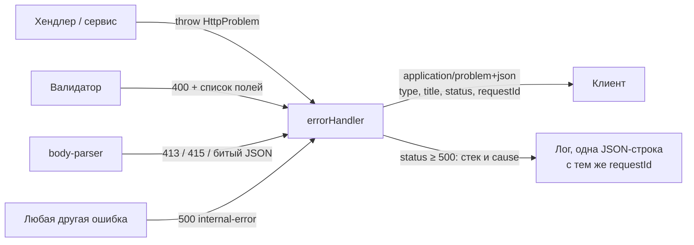

# 03. Ошибки и логирование

> **Опорный принцип** (темы «Структура и архитектура», «Контроль качества», по карте тем `course-map.md`): «Кастомные ошибки наследуют `Error` и несут `statusCode`, `requestId`, `context`. Логи — „чёрный ящик“ прода; requestId пробрасывается во все компоненты, чтобы склеить след запроса».

## Простыми словами
У ошибки два читателя, и им нужно разное. **Клиенту** — стабильный код, по которому можно написать `if`, и понятный текст без внутренностей сервера. **Дежурному инженеру** — всё: стек, причина, параметры. Связывает их один номер — `requestId`: клиент называет его в обращении, инженер находит по нему запись в логе. Аналогия — талон в сервисном центре: на руках у клиента только номер, вся история ремонта — в журнале мастерской.

## Как это в Nest → как в Express
| Nest | В проекте |
|---|---|
| `HttpException` и наследники | [`HttpProblem`](../../apps/api/src/http/problem.ts): статус + тип из контракта |
| глобальный `ExceptionFilter` | [`errorHandler`](../../apps/api/src/http/errors.ts) — последний middleware с четырьмя аргументами |
| `ValidationPipe` → 400 | валидатор из спеки → `validationProblem(errors)` |
| `Logger` + interceptor для access-лога | [`createJsonLogger`](../../apps/api/src/common/logger.ts) и [`request-context`](../../apps/api/src/http/request-context.ts) |
| `async`-ошибки ловит фреймворк | Express 5 сам передаёт отклонённый промис хендлера в error-middleware |

## В проекте
- **Формат ошибок один — RFC 9457.** Любой ответ с ошибкой — `application/problem+json` с полем `type` вида `urn:cpt:problem:<slug>`. Список типов закрыт и описан в `openapi.yaml` (13 значений: от `validation-error` до `internal-error`). Тип `ProblemSlug` выводится из контракта, поэтому опечатка в коде не скомпилируется.
- **Ошибки домена не знают про HTTP.** Сервисы бросают свои классы (`SyncAlreadyRunningError`, `MarketDataError` с кодом `CMC_*`), а в статус их переводит HTTP-слой: 409, 422, 503 + `Retry-After`.
- **Классификация вместо `catch (e)`.** У ошибок CMC шесть кодов; повторять можно три (`CMC_TIMEOUT`, `CMC_UNAVAILABLE`, `CMC_RATE_LIMITED`) — множество `RETRYABLE` в [`provider.ts`](../../apps/api/src/market-data/provider.ts).
- **500 без подробностей.** Клиент видит `Unexpected error. See logs by requestId`. Стек, текст и `cause` пишутся только в лог: они могут раскрыть структуру БД или секрет (C4).
- **Логируются только 5xx.** Ошибка клиента (4xx) — штатная ситуация, она видна в access-логе по статусу и не засоряет уровень `error`.
- **Логгер — одна JSON-строка на событие.** Уровни `debug` / `info` / `warn` / `error`, порог задаёт `LOG_LEVEL`. `child()` добавляет поля (`requestId`, операция), так что каждая запись запроса несёт его номер.
- **Секреты маскируются дважды:** по имени поля (`authorization`, `apiKey`, `password`…) и по значению (префикс `cpt_`). Вместо значения — `[REDACTED]`.
- **`X-Request-Id`** возвращается в каждом ответе и попадает в тело Problem. Подробный след запроса — [разбор 12, §5–6](12-http-слой-из-спеки.md).

## Подводные камни
- Если заголовки уже отправлены (поток SSE), дописать Problem нельзя. `errorHandler` рвёт соединение, клиент видит обрыв и переподключается.
- Текст ошибки — не контракт. Клиент должен ветвиться по `type`, а `detail` можно менять свободно.
- Ключ CMC — обычный UUID: по значению его не узнать, поэтому он не должен попадать в объекты, которые уходят в лог. Тест адаптера проверяет, что ключа нет в тексте ошибки.
- Неизвестный путь и неподдерживаемый метод — тоже Problem (404 `not-found`, 405 `method-not-allowed`), а не HTML-страница Express.
- Фоновая задача не имеет запроса и error-middleware: она ловит ошибки сама и записывает итог в журнал запусков (`failed` + `error_code`).

## Вопросы на собеседовании
1. Чем ошибка для клиента отличается от ошибки для лога? → Клиенту — стабильный `type` и `requestId`, в лог — стек и причина. Связь — по `requestId`.
2. Почему RFC 9457, а не свой формат `{ error: "…" }`? → Стандартный формат с готовым media type; клиенту не нужно изучать схему ошибок каждого сервиса.
3. Где в Express место, аналогичное `ExceptionFilter`? → Error-middleware с четырьмя аргументами, зарегистрированный последним.
4. Почему в ответе 500 нет текста исходной ошибки? → Он может раскрыть SQL, пути и секреты. Детали — в логе по `requestId`.
5. Как гарантировать, что секрет не попадёт в лог? → Маскирование по имени поля и по значению в логгере, плюс тест на отсутствие ключей в выводе.
