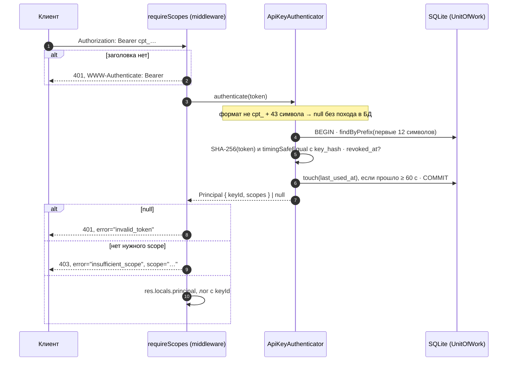

# 05. Аутентификация: API key, scopes, отзыв

> **Опорный принцип** (тема «Авторизация, API и работа с внешними источниками»): «В Express авторизация реализуется через middleware, который перехватывает запросы перед обработкой бизнес-логикой, проверяет права пользователя и либо пропускает запрос дальше, либо возвращает ошибку 403 Forbidden».

## Простыми словами

Ключ API — это пропуск в офис. На пропуске напечатан номер (**префикс** `cpt_abcdefgh`), по нему охрана находит карточку в картотеке. Сам пропуск охрана не хранит: в карточке лежит только его **отпечаток** (SHA-256). Человек прикладывает пропуск, охрана снимает отпечаток и сравнивает с карточкой. Если пропуск украли из картотеки, по отпечатку его не восстановить.

Дальше два вопроса. **Аутентификация** — «кто ты»: ключ существует, не отозван, отпечаток совпал. Иначе 401. **Авторизация** — «что тебе можно»: у ключа есть scope операции (`watchlist:write`). Иначе 403.

Почему SHA-256, а не bcrypt. Медленный хэш нужен паролям: у них мало энтропии, и их перебирают по словарю. В API-ключе 256 случайных бит. Перебор бессмысленен даже на быстром хэше, а bcrypt на каждый запрос стоил бы десятки миллисекунд CPU.

## Как это в Nest → как в Express

| Nest | В проекте |
|---|---|
| `PassportStrategy(HeaderAPIKeyStrategy)` + `validate()` | `ApiKeyAuthenticator.authenticate(token)`: адаптер порта `Authenticator` |
| `@UseGuards(AuthGuard)` + `@Scopes('watchlist:write')` + `Reflector` | `requireScopes(authenticator, scopes)` — middleware. Scopes берутся из `x-required-scopes` в спеке, а не из декоратора |
| `UnauthorizedException` / `ForbiddenException` | `throw new HttpProblem(401 \| 403, …)` + заголовок `WWW-Authenticate` по RFC 6750 |
| `@Injectable() ApiKeysService` + `Repository<ApiKey>` | порт `ApiKeyRepository` + `SqliteApiKeyRepository` (raw SQL), всё через `UnitOfWork.run` |
| `nest-commander` для CLI | `cli/keys-command.ts` на `node:util` `parseArgs`, ввод-вывод внедряется |

## В проекте

- [`src/auth/api-key.ts`](../../apps/api/src/auth/api-key.ts) — формат `cpt_` + 32 байта base64url, префикс, SHA-256, `hashesEqual` на `timingSafeEqual`, роли → scopes.
- [`src/auth/api-key-authenticator.ts`](../../apps/api/src/auth/api-key-authenticator.ts) — проверка по БД и троттлинг `last_used_at` (запись не чаще раза в 60 с, время через `Clock`).
- [`src/http/auth.ts`](../../apps/api/src/http/auth.ts) — middleware 401/403 (из B6). Здесь в B8 убран `denyAllAuthenticator`, теперь `authenticator` в `createApp` обязателен.
- [`src/auth/bootstrap.ts`](../../apps/api/src/auth/bootstrap.ts) — ключи из env при старте. Env — это желаемое состояние: `created`, `unchanged`, `rotated` (новый ключ в env, старый сразу перестаёт работать), `scopes-updated`, `revoked` (отозванный через CLI не воскресает).
- [`src/cli/keys-command.ts`](../../apps/api/src/cli/keys-command.ts) — `keys:create` и `keys:revoke`. Ключ печатается один раз и только в stdout, поэтому его можно забрать скриптом: `KEY=$(npm run -s keys:create -- --name web --role viewer)`. Подсказки идут в stderr.
- [`src/unit-of-work.ts`](../../apps/api/src/unit-of-work.ts), [`src/db/unit-of-work.ts`](../../apps/api/src/db/unit-of-work.ts) — порт `UnitOfWork` появился вместе с первым репозиторием.
- Тесты: [`tests/auth/`](../../apps/api/tests/auth/), [`tests/cli/`](../../apps/api/tests/cli/), [`tests/db/api-key-repository.test.ts`](../../apps/api/tests/db/api-key-repository.test.ts), матрица прав [`tests/http/auth-matrix.test.ts`](../../apps/api/tests/http/auth-matrix.test.ts): 14 защищённых операций × (без ключа, отозванный ключ, нет scope) = 42 проверки. Операции берутся из спеки, поэтому новая операция попадает в таблицу без правки теста. Порог покрытия 100 % на `src/auth/` записан в `jest.config.js`.

## Подводные камни

- **`timingSafeEqual` бросает исключение на буферах разной длины.** Наивная обёртка превратила бы битый хэш в 500. В `hashesEqual` длина проверяется заранее. Длина не секрет: у SHA-256 она всегда 32 байта.
- **Поиск по префиксу «утекает» по времени.** Есть ли ключ с таким префиксом, видно по времени ответа. Но префикс — не секрет: его печатают в списках, как у GitHub и Stripe. Секрет — остальные 35 символов, и их сравнение идёт за постоянное время.
- **Префикс может совпасть.** Это 48 случайных бит, совпадение почти невозможно, но `UNIQUE` в схеме его не простит. CLI берёт другой ключ, а после трёх совпадений подряд падает: это уже баг генератора, а не невезение.
- **Запрос к БД вне транзакции опасен.** Соединение одно. Если чужая транзакция выполнила `BEGIN` и ждёт `await`, «одиночный» `SELECT` или `UPDATE` попадёт внутрь неё. Поэтому каждый метод репозитория начинается с `assertInTransaction` (тест: вызов вне `UnitOfWork.run` → ошибка).
- **Каждая аутентификация — короткая транзакция `BEGIN IMMEDIATE`.** Для одного процесса это микросекунды. В `platform` с Postgres это был бы поход в БД на каждый запрос, там ключи кэшируют (Redis), а отзыв рассылают событием.
- **Префикс ключа нельзя логировать «как есть».** Логгер маскирует всё, что похоже на `cpt_…` (B4), поэтому в лог пишется `keyId`.
- **`instanceof TypeError` в Jest врёт для ошибок `node:*`.** Они создаются в другом realm. Ошибка `parseArgs` распознаётся по `code === 'ERR_PARSE_ARGS_…'`. Тест на неизвестный флаг сначала упал именно на этом.
- **Отозванный bootstrap-ключ.** Если при каждом старте «записывать ключ из env», отзыв через CLI отменялся бы рестартом. Решение: тот же хэш и `revoked_at` задан — значит, отзыв важнее env, в логе warn.

## Вопросы на собеседовании

1. Почему ключ хранится как SHA-256, а пароли так хранить нельзя? → У ключа 256 бит энтропии, перебор бессмысленен. У пароля энтропии мало, ему нужен медленный хэш с солью (scrypt/argon2).
2. Зачем `timingSafeEqual`, если сравниваются хэши? → `===` выходит на первом несовпавшем байте. По времени ответа можно подбирать хэш побайтно, а знание хэша позволяет проверить кандидата офлайн.
3. 401 или 403: когда какой и что в `WWW-Authenticate`? → 401 — нет учётных данных или они недействительны (`invalid_token`). 403 — личность известна, прав не хватает (`insufficient_scope` + нужные scope).
4. Как отозвать ключ и как его сменить без простоя? → `keys:revoke` пишет `revoked_at`, со следующего запроса ключ получает 401. Смена: выпустить новый, переключить клиента, отозвать старый. Для bootstrap — новый ключ в env и рестарт, старый перестаёт работать сразу.
5. Почему `last_used_at` пишется не на каждый запрос? → Иначе каждый GET становится записью в SQLite: блокировка записи и рост WAL на каждый запрос чтения. Минутной точности для аудита хватает.
