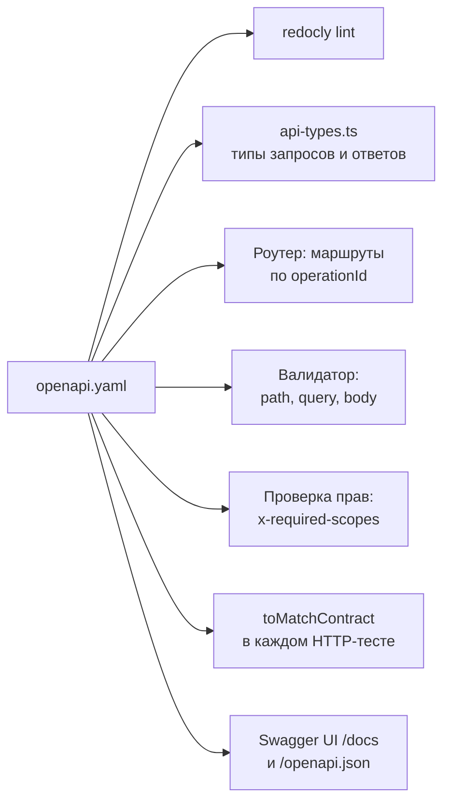

# 06. REST и OpenAPI

> **Опорный принцип** (тема «Авторизация, API и внешние источники», по карте тем `course-map.md`): «REST: ресурсы-URL + HTTP-методы + статус-коды, stateless. OpenAPI: контракт API в YAML/JSON → документация, SDK, валидация».

## Простыми словами
REST — договорённость о том, как называть вещи: в URL стоит **существительное** (ресурс), действие выражает **метод**, результат — **статус-код**. Клиент, который знает HTTP, наполовину знает и API. OpenAPI — тот же договор, записанный так, чтобы его читала машина. Аналогия — чертёж детали: по одному чертежу работают и токарь, и контролёр ОТК, и сборщик. Если чертёж один, деталь и её описание не могут разойтись.

В проекте чертёж первичен (spec-first): `openapi.yaml` написан до кода, и из него получается всё остальное.

## Как это в Nest → как в Express
| Nest (code-first) | В проекте (spec-first) |
|---|---|
| `@Controller`, `@Get()` | запись в `paths` + хендлер с именем `operationId` |
| DTO + `class-validator` | схема в `components.schemas`, валидатор компилируется из неё |
| `@ApiProperty` → Swagger генерируется из кода | код проверяется по спеке, а не наоборот |
| `@UseGuards(AuthGuard)` | `security` и `x-required-scopes` операции → middleware auth |

## В проекте
- **16 операций:** `/health/*`, `/api/v1/cryptocurrencies`, `/api/v1/prices` (и вложенные `…/{id}/prices`, `…/aggregates`), `/api/v1/sync-runs`, `/api/v1/system/cmc`, плюс поток `/api/v1/stream`. Контракт — [`openapi.yaml`](../../apps/api/openapi/openapi.yaml), решения — [ADR 0014](../adr/0014-api-contract.md).
- **Статусы несут смысл.** `POST /cryptocurrencies` → 201 + `Location`. `DELETE` → 204 без тела. `POST /sync-runs` → 202 + `Location`: запуск принят, итог читается отдельным запросом. Дубль → 409, неизвестный символ → 422, CMC недоступен → 503 + `Retry-After`.
- **Действие как ресурс.** «Запустить синхронизацию» — не `POST /sync/start`, а создание записи в коллекции `sync-runs`. У запуска появляется `id`, статус и история — бесплатно.
- **Роутер не пишется руками.** [`mountFromSpec`](../../apps/api/src/http/router.ts) обходит `paths` и собирает для каждой операции цепочку: 405 → auth → тип и размер тела → валидация → хендлер. Тип `Handlers` требует хендлер для каждого `operationId` — забытая операция не скомпилируется.
- **Три рубежа контракта:** типы (`Reply<Op>` не даст вернуть статус или тело вне спеки), валидатор на входе, `toMatchContract` на выходе в тестах. Подробно — [разбор 12, §4](12-http-слой-из-спеки.md).
- **Валидатор свой**, потому что ТЗ разрешает только перечисленные библиотеки ([ADR 0008](../adr/0008-validation-and-openapi.md)). Неподдерживаемая конструкция спеки — ошибка старта, а не молчаливый пропуск проверки.
- **Версия в пути** (`/api/v1`), пагинация истории — курсором, а не `offset` ([разбор 13](13-чтение-цен.md)).

## Подводные камни
- OpenAPI 3.0 — не JSON Schema: `nullable` вместо `type: [..., null]`, а соседи `$ref` игнорируются. Обе ловушки закрыты проверкой при старте.
- Query и path приходят строками. Приведение к числу и boolean делает валидатор по типу из схемы, а не хендлер.
- `additionalProperties: false` в теле запроса — защита от опечаток клиента и от полей вроде `__proto__`.
- 404 и 405 — разные ответы: путь есть, метода нет → 405 с заголовком `Allow`.
- SSE не укладывается в схему ответа JSON: для `text/event-stream` контракт описывает события таблицей в описании операции, а тест проверяет текст кадров.

## Вопросы на собеседовании
1. Spec-first или code-first — в чём разница и что выбрано? → Spec-first: контракт пишется до кода и управляет типами, маршрутами, валидацией и тестами. Расхождение документации и кода становится ошибкой сборки или теста.
2. Почему `POST /sync-runs` отвечает 202, а не 200? → Работа выполняется в фоне дольше запроса. 202 + `Location` честно говорит: принято, результат — по ссылке.
3. 400, 409 и 422 — когда какой? → 400 — запрос не прошёл схему. 409 — конфликт с текущим состоянием (монета уже отслеживается). 422 — схема верна, но значение не имеет смысла (символа нет в CMC).
4. Что значит stateless? → Сервер не хранит состояние между запросами: каждый несёт ключ в `Authorization` и обрабатывается без памяти о предыдущих.
5. Как узнать, что документация не устарела? → Ответ каждого HTTP-теста сверяется со спекой, а проверка C8 требует позитивный и негативный тест на каждую операцию.
