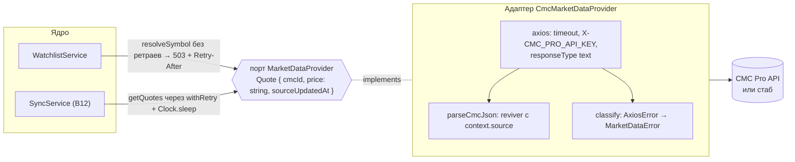

# 07. Надёжная работа с внешним API: CoinMarketCap

> **Из курса** (урок «Авторизация, API и работа с внешними источниками»): «Критически важные практики при работе с внешними API: добавление retry-логики с задержкой, установка разумных таймаутов…»

## Простыми словами

Внешний API — это поставщик, который иногда опаздывает, иногда закрыт на обед, а иногда привозит не тот товар. Сервис не должен из-за этого падать. Ему нужно знать, **какая именно беда случилась**, потому что от этого зависит реакция:

| Беда | Код | Что делаем |
|---|---|---|
| Не ответил вовремя | `CMC_TIMEOUT` | повторить позже |
| Лежит, 5xx, оборвал соединение | `CMC_UNAVAILABLE` | повторить позже |
| «Слишком часто», 429 | `CMC_RATE_LIMITED` | подождать, сколько просят (`Retry-After`, но не дольше 60 с) |
| Не принял ключ, 401/402/403 | `CMC_AUTH` | не повторять: это ошибка конфигурации сервиса. В лог — error |
| Прислал мусор | `CMC_BAD_RESPONSE` | не повторять: повтор не исправит формат |
| Такого символа нет | `CMC_UNKNOWN_SYMBOL` | клиенту 422 |

Ретрай — как звонок занятому человеку: перезваниваем через 1 с, потом через 2, потом через 4. **Jitter** (случайная доля задержки) нужен, чтобы тысяча клиентов, упавших одновременно, не перезвонили все в одну и ту же секунду (thundering herd).

## Как это в Nest → как в Express

| Nest | В проекте |
|---|---|
| `HttpModule.register({ timeout })` + `HttpService` (axios под капотом) | `axios.create({ baseURL, timeout, headers })` в адаптере `CmcMarketDataProvider` |
| интерсептор axios / `catchError` в RxJS | `classify(error)`: `AxiosError` → `MarketDataError` с кодом |
| `retry({ count, delay })` из RxJS | `withRetry(fn, { clock, attempts, … })` — 40 строк без библиотек (C7) |
| `jest.mock('axios')` или `nock` | HTTP-стаб на `node:http` (ADR 0009): настоящий сокет, настоящий таймаут |
| `ExceptionFilter` для доменных ошибок | `translate()` в хендлерах watchlist: `MarketDataError` → 422 / 503 + `Retry-After` / 500 |

## В проекте

- [`src/market-data/provider.ts`](../../apps/api/src/market-data/provider.ts) — порт: доменные `Quote`, `QuotesResult { quotes, missing, rejected, creditsUsed }`, коды ошибок и признак `retryable`.
- [`src/market-data/cmc-provider.ts`](../../apps/api/src/market-data/cmc-provider.ts) — адаптер. Ключ передаётся только в заголовке. Ответ CMC разбирается текстом, ошибки классифицируются. `skip_invalid=true`: делистнутый id не роняет батч, а попадает в `missing` (будущий статус `partial`).
- [`src/market-data/cmc-json.ts`](../../apps/api/src/market-data/cmc-json.ts) — `JSON.parse` с reviver: для ключа `price` берётся `context.source`, то есть исходный текст числа (ES2025, ADR 0006).
- [`src/market-data/retry.ts`](../../apps/api/src/market-data/retry.ts) — `backoffDelay = min(1 с · 2^(n−1), 30 с) · random(0.5…1)`, `withRetry`. Ретраятся только ретраибельные `MarketDataError`, ожидание идёт через `Clock` и прерывается `AbortSignal`.
- [`scripts/cmc-stub.ts`](../../apps/api/scripts/cmc-stub.ts) — стаб CMC: `quotes/latest` по `id` и по `symbol` (с однофамильцами), `key/info`, очередь неисправностей `fail({ kind: 'status' | 'drop' | 'hang' | 'raw' })`. Цены пишутся в тело голым JSON-числом, как у CMC.
- [`src/watchlist/watchlist-service.ts`](../../apps/api/src/watchlist/watchlist-service.ts) — порядок «проверки → CMC вне транзакции → повторная проверка и вставка → событие».
- Тесты: [`tests/market-data/`](../../apps/api/tests/market-data/) — 200, 429 + `Retry-After`, 5xx, 401/402/403, обрыв, настоящий таймаут 200 мс, закрытый порт, битый JSON, неизвестный символ, отмена, цена `0.0000000012345678901234` без потери цифр. Ретраи на `FakeClock`: число попыток, backoff, потолок 60 с, отмена во время сна.

## Подводные камни

- **Точность теряется в axios, а не в БД.** По умолчанию axios сам делает `JSON.parse`, и `67123.451234567891` превращается в `67123.4512345679` раньше кода приложения. Поэтому `responseType: 'text'`, пустой `transformResponse` и свой разбор.
- **Таймаут axios — это `ECONNABORTED`, а не `ETIMEDOUT`** (если не включён `transitional.clarifyTimeoutError`). Обрабатываем оба. Отмена через `signal` — `ERR_CANCELED`. Её не классифицируем как ошибку CMC и пробрасываем причину отмены (shutdown, ADR 0015 шаг 5).
- **Неизвестный символ — это HTTP 400 от CMC**, с текстом `Invalid value for "symbol"`. Любой другой 400 — баг в запросе сервиса, это `CMC_BAD_RESPONSE`, а не «символ не найден».
- **Битая цена одной монеты не должна ронять батч.** ADR 0006: точку отбрасываем с причиной (`rejected`), остальные котировки сохраняем. `CMC_BAD_RESPONSE` — только когда сломан ответ целиком.
- **В HTTP-запросе клиента не ретраим.** Три попытки с backoff — это до ~10 с удержания соединения. Честнее сразу ответить 503 + `Retry-After` (из заголовка CMC, от 1 до 60 с, по умолчанию 30). Ретраи нужны фоновой синхронизации (B12).
- **Сначала дешёвая проверка, потом кредит.** Лимит 100 и дубль проверяются до запроса в CMC: 101-я монета не тратит кредит (тест: запросов в стаб — 0). После CMC проверка повторяется в транзакции: два одновременных `POST BTC` дают 201 и 409, а не 500 от `UNIQUE`.
- **`Retry-After` больше 60 с всё равно ждём 60 с** — так записано в ADR 0015. Если CMC скажет «через час» (суточный лимит), следующий ретрай снова получит 429. Это один лишний запрос в рамках того же запуска; дальше запуск получит `failed`, а следующая синхронизация по расписанию попробует ещё раз.
- **`FakeClock.advance` сразу после вызова не видел `sleep`.** Функция успевает дойти до `Clock.sleep` только через микрозадачи, а `advance` проверял спящих синхронно, поэтому тест ретраев висел. Теперь `advance` сначала отдаёт управление циклу событий.
- **Прокси из env.** axios сам читает `HTTP(S)_PROXY` и `NO_PROXY`. В песочнице прокси задан, а `NO_PROXY` содержит `localhost` и `127.0.0.1`, поэтому стаб работает. Без этого тесты ушли бы в прокси.

## Вопросы на собеседовании

1. Какие ошибки внешнего API ты ретраишь, а какие нет и почему? → Временные (таймаут, 5xx, обрыв, 429) — да. Ключ, формат ответа, неизвестный символ — нет: повтор не изменит результат, только потратит квоту.
2. Зачем jitter в backoff? → Чтобы клиенты, упавшие одновременно, не вернулись одновременно и не уронили сервис снова.
3. Как ты не теряешь точность цены из ответа CMC? → Тело читаю текстом, `JSON.parse` с reviver забирает `context.source` для `price`, дальше `Decimal.parse`. Стандартный разбор axios отключён.
4. Почему при недоступности CMC `POST /cryptocurrencies` отвечает 503, а не 500 и не 201? → 500 — наша ошибка, а здесь чужая. 201 без проверки символа — непроверенные данные (C10). 503 + `Retry-After` говорит клиенту, когда повторить.
5. Почему стаб на `node:http`, а не `jest.mock('axios')`? → Мок не проверит настоящий таймаут, обрыв сокета и наш разбор тела. Стаб проверяет всё это и ещё станет контейнером `cmc-stub` для e2e и демо без ключа.
