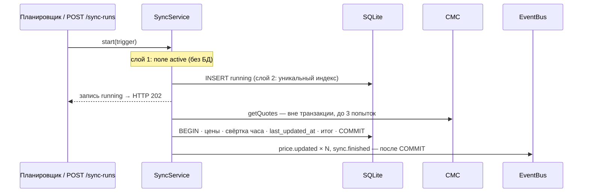
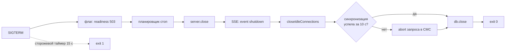

# 08. Фоновые задачи: синхронизация цен и планировщик

> **Из курса** (урок «Фоновые задачи и планировщики», по конспекту `course-map.md`): «`setTimeout` — один раз, `setInterval` — периодически (может „плыть“ при блокировке Event Loop). Graceful shutdown: хранить id таймеров → на SIGINT/SIGTERM `clearTimeout/clearInterval`».

Остановка процесса (graceful shutdown, B14) и поток событий SSE (B13) — в конце документа.

## Простыми словами
Раз в 5 минут сервис сам идёт в CMC, сохраняет цены и сообщает об этом подписчикам. Запуск один на всех: планировщик и ручной `POST /sync-runs` вызывают один и тот же `SyncService`.

Аналогия: курьер, который выходит за следующей посылкой через 5 минут **после возвращения**, а не каждые 5 минут по будильнику. Если он задержался, второй курьер ему навстречу не выйдет.

## Как это в Nest → как в Express
| Nest | Здесь |
|---|---|
| `@Interval()` / `@Cron()` из `@nestjs/schedule` | [`SyncScheduler`](../../apps/api/src/sync/scheduler.ts): цикл «ждать → запустить → ждать», старт и остановка вызываются явно из `server.ts` |
| `@Injectable() SyncService` | [`SyncService`](../../apps/api/src/sync/sync-service.ts): один экземпляр на процесс, передаётся в `createApp` и в планировщик |
| `EventEmitter2` | `EventBus`, публикация только после COMMIT |
| `OnModuleInit` | `scheduler.start()` после `listen` |

## В нашем проекте
- **Два слоя защиты от наложения.** Поле `active` в процессе — дёшево, без похода в БД. Частичный уникальный индекс `sync_runs_one_running` — работает и между процессами. Оба ведут к `409 sync-already-running` с `conflictingId`.
- **Сеть вне транзакции.** Транзакция держит единственное соединение SQLite; запрос в CMC на 10 секунд остановил бы все остальные запросы.
- **Одна транзакция на запись.** Цены, свёртка, `last_updated_at` и итог запуска — либо всё, либо ничего. Не бывает запуска `succeeded` без цен.
- **Идемпотентность.** `ON CONFLICT DO NOTHING` по `(монета, source_updated_at)`: CMC не обновил котировку — дубля нет. Свёртка часа пересчитывается целиком из сырых точек, поэтому результат не зависит от числа пересчётов.
- **Статусы.** `partial` — CMC не дал котировку по части монет, остальное сохранено. `failed` + `error_code` — после 3 попыток; старые цены продолжают отдаваться. `interrupted` — запуск оборван остановкой процесса.
- **Планировщик.** Ожидание идёт через `Clock.sleep` с `AbortSignal` — это та же цепочка `setTimeout`, только её можно прервать и можно тестировать на `FakeClock`. При старте зависшие `running` помечаются `interrupted`; первый запуск — сразу, если цены старше интервала, иначе через остаток.
- **Квота CMC.** После успешного запуска читается `key/info` (кредиты не тратит) и кэшируется для `GET /system/cmc`.
- Тесты — [`tests/sync/sync.test.ts`](../../apps/api/tests/sync/sync.test.ts), [`scheduler.test.ts`](../../apps/api/tests/sync/scheduler.test.ts).

## Подводные камни
- `finished` у запуска никогда не отклоняется: это фоновая работа, её никто не ждёт. Необработанное отклонение уронило бы процесс.
- Монету могут удалить, пока идёт запрос в CMC. `INSERT … WHERE EXISTS` пропускает её цену; без этого упал бы внешний ключ и откатился весь батч.
- Пустой watchlist — `succeeded` без вызова CMC. Успехом CMC в `/system/cmc` такой запуск не считается (`attempts = 0`).
- `markInterrupted` ставит `finished_at = max(started_at, now)`: часы после рестарта могли отстать, а `CHECK` требует `finished_at >= started_at`.
- Если CMC вернул ту же котировку, `fetchedAt` последней цены не двигается, и через 2 интервала она станет `isStale`. При интервале 5 минут и обновлении CMC раз в минуту это не проявляется.

## Вопросы на собеседовании
1. Чем цепочка `setTimeout` лучше `setInterval`? → Следующий запуск планируется после завершения текущего: нет наложения и «долга» таймеров.
2. Зачем два слоя защиты, если есть индекс? → Флаг отсекает дубль без похода в БД; индекс страхует от второго процесса и от ошибки в коде.
3. Почему `POST /sync-runs` отвечает 202, а не 201? → Запись создана, но работа ещё идёт; итог — по `Location`.
4. Почему события публикуются после COMMIT? → При откате подписчик увидел бы цену, которой нет в БД.
5. Что будет с запуском, если процесс убили посреди запроса в CMC? → Останется `running`; при следующем старте станет `interrupted`, иначе индекс не дал бы запуститься никогда.

## Graceful shutdown (C6, B14)

> **Из курса** (тот же урок): на SIGINT/SIGTERM — очистить таймеры и дать текущей работе завершиться.

**Простыми словами.** Docker и k8s перед остановкой шлют `SIGTERM` и ждут (по умолчанию 10 и 30 с), потом убивают процесс. Если просто выйти — оборвём запросы на середине, оставим запуск синхронизации `running` и несброшенный WAL. Поэтому процесс «закрывает смену» по порядку: перестаёт брать новую работу, доделывает текущую, закрывает ресурсы.

| Nest | Здесь |
|---|---|
| `app.enableShutdownHooks()` | `shutdown.listen(process)` в [`server.ts`](../../apps/api/src/server.ts) |
| `OnApplicationShutdown` в каждом провайдере, порядок — по графу модулей | [`ShutdownCoordinator`](../../apps/api/src/shutdown.ts): порядок записан явно, одним методом |
| `@Sse()` + `Observable` | [`SseHub`](../../apps/api/src/events/sse-hub.ts): `Set` соединений, подписка на `EventBus`, heartbeat через `Clock` |

- **Почему порядок такой.** `server.close()` не завершится, пока открыт SSE-поток, и ждёт keep-alive сокеты до 5 с. Поэтому сразу после него — `sse.closeAll()` и `closeIdleConnections()`. Проверено тестом на настоящем сервере: остановка проходит, хотя `FakeClock` стоит на месте, то есть без ожидания grace.
- **Одно окно grace (10 с)** на синхронизацию и соединения. Не успела синхронизация — `sync.abort()`: axios отменяет запрос, запуск получает `interrupted`. Не закрылись соединения — `closeAllConnections()`.
- **Сторожевой таймер (15 с)** заводится первым: зависший шаг не оставит процесс висеть, он выйдет с кодом 1.
- **Всё внедряется:** источник сигналов, `exit`, часы. Поэтому [`tests/shutdown.test.ts`](../../apps/api/tests/shutdown.test.ts) проверяет порядок шагов и таймауты без процесса, а [`tests/e2e/sigterm.test.ts`](../../apps/api/tests/e2e/sigterm.test.ts) — настоящий `SIGTERM` (только Linux).

**Подводные камни**
- `scheduler.stop()` нельзя ждать сразу: его цикл может быть внутри идущей синхронизации, и остальные шаги встали бы за ней.
- В Docker нужен `CMD ["node", …]` (exec-форма) и `init: true`. Через `npm start` или shell-форму сигнал получит оболочка, а не Node.
- На Windows `SIGTERM` не доставляется: `child.kill()` там — принудительное завершение. Локально работает только Ctrl+C (`SIGINT`).
- SSE-клиент, который не читает поток, копит наши записи в памяти сервера. Хаб отключает его после 1 МБ в буфере.
- События в SSE — at-most-once. `Last-Event-ID` ничего не досылает: после переподключения клиент перечитывает состояние через REST.

**Вопросы**
6. Что произойдёт, если по SIGTERM вызвать только `server.close()`? → Зависнет на SSE и keep-alive; оркестратор убьёт процесс по таймауту (SIGKILL).
7. Зачем сторожевой таймер, если есть grace? → Grace страхует известные ожидания, таймер — любое зависание, включая ошибку в самом координаторе.
8. Почему readiness снимается первым шагом? → Балансировщик перестаёт слать новые запросы раньше, чем мы закроем порт.
