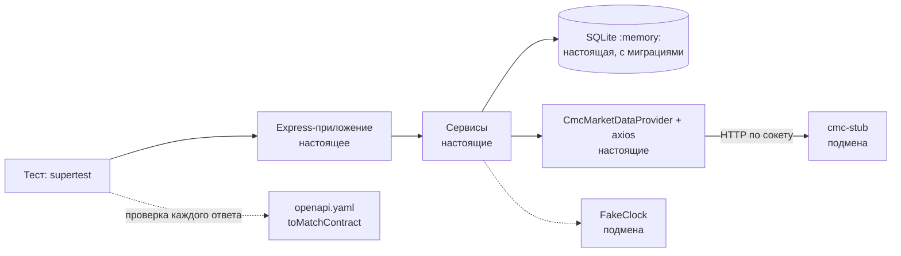

# 09. Тестирование: что мокать и почему

> **Из курса** (урок «Контроль качества», по конспекту `course-map.md`): «Внешние API мокаем, БД — не мокаем: проверяем цепочку от запроса до результата».

## Простыми словами
Мок отвечает так, как **мы думаем**, что ответит настоящая система. Чем больше замокано, тем больше тест проверяет наши ожидания, а не код. Поэтому правило одно: подменяем только то, чем не управляем (чужой сервис, время, сигналы ОС), и подменяем **на границе** — как можно дальше от проверяемого кода.

## Как это в Nest → как в Express
| Nest | Здесь |
|---|---|
| `Test.createTestingModule().overrideProvider()` | [`createTestApp(overrides)`](../../apps/api/tests/helpers/app.ts): те же зависимости, что в `server.ts`, но с `FakeClock` и БД в памяти |
| `jest.mock('axios')` | HTTP-стаб [`cmc-stub.ts`](../../apps/api/scripts/cmc-stub.ts) на `node:http`: axios и адаптер работают по-настоящему |
| `jest.useFakeTimers()` | порт `Clock` и [`FakeClock`](../../apps/api/tests/helpers/fake-clock.ts): `await clock.advance(25_000)` |
| e2e через `@nestjs/testing` + supertest | то же: supertest поверх `createApp`, без сети |

## В нашем проекте
- **БД настоящая.** Мок репозитория не поймал бы ни ошибку в SQL, ни `CHECK`, ни уникальный индекс «один запуск running». SQLite в памяти создаётся за миллисекунды — причин мокать нет.
- **CMC — стаб, а не мок axios.** Таймаут, обрыв соединения, `429` + `Retry-After`, битый JSON, потеря цифр цены при `JSON.parse` — всё это живёт между сокетом и адаптером. `jest.mock('axios')` этот слой вырезал бы.
- **Время — через порт.** `jest.useFakeTimers()` не подменяет `setTimeout` из `node:timers/promises` (проверено, ADR 0009). `FakeClock` двигает только наше время, а настоящие сокеты к стабу живут по настоящим часам.
- **Контракт проверяется в каждом тесте.** `expect(res).toMatchContract('listLatestPrices', 200)` сверяет статус, заголовки и тело с `openapi.yaml`. Документация не может разойтись с кодом незаметно.
- **C8 доказан, а не обещан.** Имена тестов — `describe('[operationId] …')`, `it('✅ …')`, `it('❌ …')`. Скрипт [`check-endpoint-coverage`](../../apps/api/scripts/check-endpoint-coverage.ts) сверяет отчёт Jest со спекой и падает, если у операции нет ✅ или ❌. Результат — [матрица](../project/test-matrix.md).
- **Права — таблицей.** [`auth-matrix.test.ts`](../../apps/api/tests/http/auth-matrix.test.ts) берёт операции из спеки: новая операция получает проверки 401/403 без правки теста.
- **То, что нельзя проверить в процессе, проверяется процессом.** [`sigterm.test.ts`](../../apps/api/tests/e2e/sigterm.test.ts) запускает `node src/server.ts` и шлёт настоящий `SIGTERM`; job `docker` в CI делает `docker compose stop` и ждёт код 0.

## Подводные камни
- Покрытие 100 % строк не значит «всё проверено»: проверка C8 в первый же запуск нашла операцию `getSyncRun` без позитивного теста — строки были покрыты чужим тестом.
- Поток SSE не заканчивается, supertest ждал бы вечно. Для него — свой клиент на `node:http` ([`tests/helpers/sse.ts`](../../apps/api/tests/helpers/sse.ts)).
- Фейк с отложенным ответом должен дождаться самого запроса, иначе тест «отвечает» раньше, чем код спросил, и виснет.
- Стаб повторяет формат CMC по документации. Настоящий формат проверяет только `npm run smoke:cmc` с живым ключом.
- `SIGTERM` на Windows не доставляется: e2e остановки идёт только на Linux (CI, Docker).

## Вопросы на собеседовании
1. Почему БД в тестах настоящая, а CMC — нет? → БД — наша, быстрая и детерминированная; CMC — чужой, платный и нестабильный.
2. Чем HTTP-стаб лучше `jest.mock('axios')`? → Проверяется настоящий сетевой путь: таймауты, обрывы, разбор тела.
3. Как доказать, что у каждого эндпоинта есть негативный тест? → Соглашение об именах + скрипт, сверяющий отчёт Jest со спекой, в CI.
4. Почему не `jest.useFakeTimers()`? → Не подменяет `timers/promises`; порт `Clock` даёт управляемое время только нашему коду и не трогает настоящие сокеты.
5. Что не покрыто тестами? → Формат живого ответа CMC (только smoke с ключом) и `server.ts` как точка сборки (проверяется e2e и Docker-smoke).
