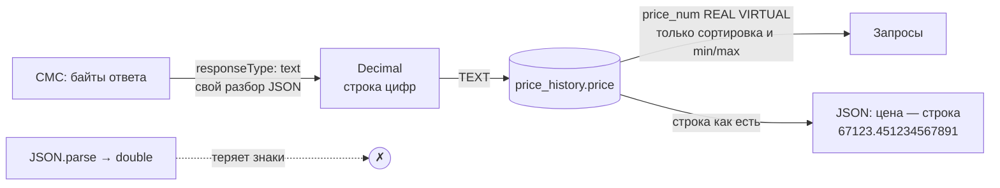

# 10. Финтех-бэкенд: точность, идемпотентность, доставка событий

> **Опорный принцип** (тема «Работа с базой данных», по карте тем `course-map.md`): «Транзакции: всё или ничего; ROLLBACK в `catch`; retry только для идемпотентных операций».

## Простыми словами
В обычном сервисе ошибка в последнем знаке или повторная запись — мелочь. В финтехе это расхождение в отчёте, которое кто-то будет искать руками. Отсюда три привычки:

1. **Точность.** Число хранится и передаётся так, чтобы ни один знак не потерялся по дороге.
2. **Идемпотентность.** Повтор операции (ретрай, двойной клик, перезапуск) даёт тот же результат, что и один вызов. Аналогия — кнопка лифта: сколько ни нажимай, лифт приедет один раз.
3. **Честная доставка.** Для каждого события известно, что будет при сбое: потеряется, придёт дважды или не потеряется никогда.

Сервис цен не двигает деньги: это рыночные данные, а не бухгалтерия. Но привычки те же, и вопрос «почему цена во float?» на интервью неизбежен.

## Как это в Nest → как в Express
Тема не зависит от фреймворка. В Nest + TypeORM те же решения выглядели бы как колонка `NUMERIC` с трансформером в `Decimal` и уникальный индекс под `upsert`; здесь — `TEXT` в SQLite и `ON CONFLICT` в raw SQL.

## В проекте
- **Цена — строка от сокета до клиента** ([ADR 0006](../adr/0006-price-precision.md)). axios по умолчанию делает `JSON.parse`, и `67123.451234567891` превращается в `67123.4512345679` ещё до кода приложения. Поэтому ответ читается как текст и разбирается своим парсером ([`cmc-json.ts`](../../apps/api/src/market-data/cmc-json.ts)).
- **Арифметика — [`Decimal`](../../apps/api/src/common/decimal.ts)** на `BigInt`: `add` / `sub` / `mul` / `div`, округление `HALF_EVEN` (банковское: не накапливает сдвиг вверх). Покрытие класса — 100 %, это порог в конфиге Jest.
- **Double — только там, где нужен порядок.** `price_num` — виртуальная колонка `CAST(price AS REAL)`: по ней SQLite сортирует и ищет min/max, а в ответ уходит точная строка найденной записи.
- **Повторная синхронизация не создаёт дублей.** `UNIQUE (cryptocurrency_id, source_updated_at)` + `ON CONFLICT DO NOTHING` в [`prices.ts`](../../apps/api/src/db/repositories/prices.ts): та же котировка CMC записывается один раз, сколько бы раз её ни получили.
- **Свёртки пересобираются, а не накапливаются.** Часовой бакет считается из сырых строк заново (`ON CONFLICT … DO UPDATE`), а не через `+=`. Повторный пересчёт и `npm run rollups:rebuild` дают тот же результат ([ADR 0007](../adr/0007-aggregates-and-rollups.md)).
- **Один запуск синхронизации.** Частичный уникальный индекс `sync_runs_one_running` не даст появиться второй строке `running`, даже если защита в процессе не сработала.
- **Повторять — только безопасное.** Ретраятся `GET`-запросы к CMC с кодами `CMC_TIMEOUT`, `CMC_UNAVAILABLE`, `CMC_RATE_LIMITED`. `POST /cryptocurrencies` сам ретраев не делает: при сбое CMC клиент получает 503 + `Retry-After`, а повторный `POST` той же монеты — 409 с `conflictingId`.
- **События — после COMMIT, гарантия названа.** В `apps/api` шина in-process, at-most-once: уведомление может потеряться при падении процесса, данные — нет, клиент перечитает их из БД. Для редакции `platform` спроектированы outbox и очередь с at-least-once ([ADR 0015](../adr/0015-ports-events-and-lifecycle.md), [ADR 0011](../adr/0011-platform-composition.md)) — это проект, кода пока нет.
- **Время — UTC и два разных поля:** `source_updated_at` (когда цену посчитал CMC) и `fetched_at` (когда её получил сервис). Клиент видит оба и признак устаревания.

## Подводные камни
- `0.1 + 0.2 !== 0.3` — не единственная беда double. Хуже тихая потеря знаков у длинных цен: 15–17 значащих цифр, дальше — мусор.
- Число в JSON-ответе клиент снова распарсит в double. Поэтому цена в контракте — `string` с шаблоном, а не `number`.
- At-least-once без идемпотентного потребителя — это дубли. Очередь не избавляет от уникального ключа операции.
- Публикация события внутри транзакции даёт «фантом»: клиент увидел цену, а транзакция откатилась.
- Сравнивать цены как строки нельзя: `"9" > "10"`. Для порядка в SQL есть `price_num`, для точного сравнения в коде — `Decimal.compare`.

## Вопросы на собеседовании
1. Почему нельзя хранить цену во float? → Double держит 15–17 значащих цифр и не представляет точно большинство десятичных дробей. Ошибка появляется уже на `JSON.parse`.
2. Какие есть варианты хранения и что выбрано? → Целые минимальные единицы, `NUMERIC`, строка-decimal. Здесь — строка: у CMC нет фиксированного шага цены, а SQLite не имеет точного десятичного типа.
3. Что такое идемпотентность и где она в проекте? → Повтор не меняет результат. Запись цены (`ON CONFLICT DO NOTHING`), пересборка свёрток, индекс «один `running`».
4. At-most-once, at-least-once, exactly-once — в чём разница? → Может потеряться / может прийти дважды / эффект ровно один. Третье на практике — это at-least-once плюс идемпотентный потребитель.
5. Зачем outbox? → Запись в БД и отправка в очередь не атомарны. Outbox кладёт событие в ту же транзакцию, а отдельный процесс доставляет его с повторами.
