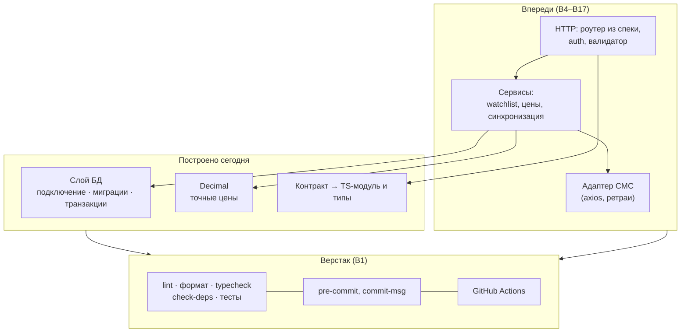
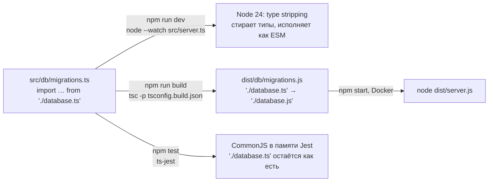
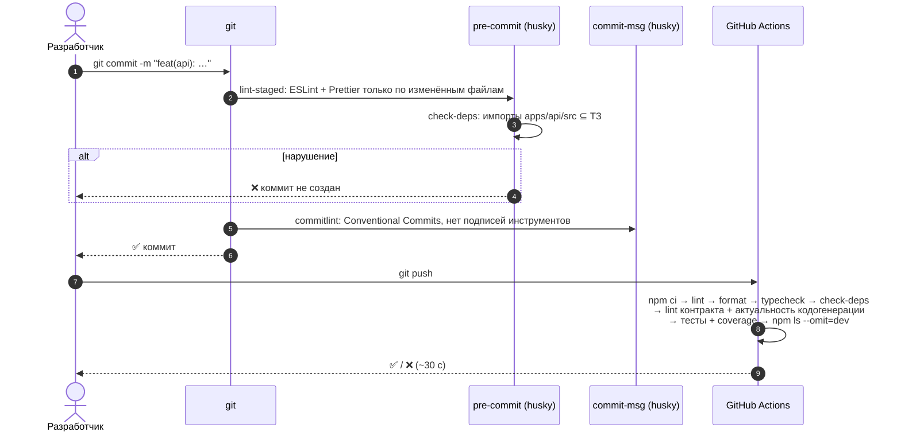
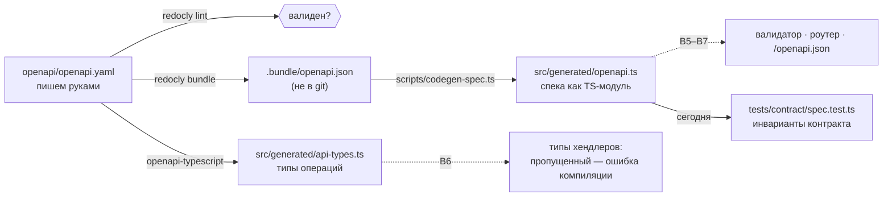
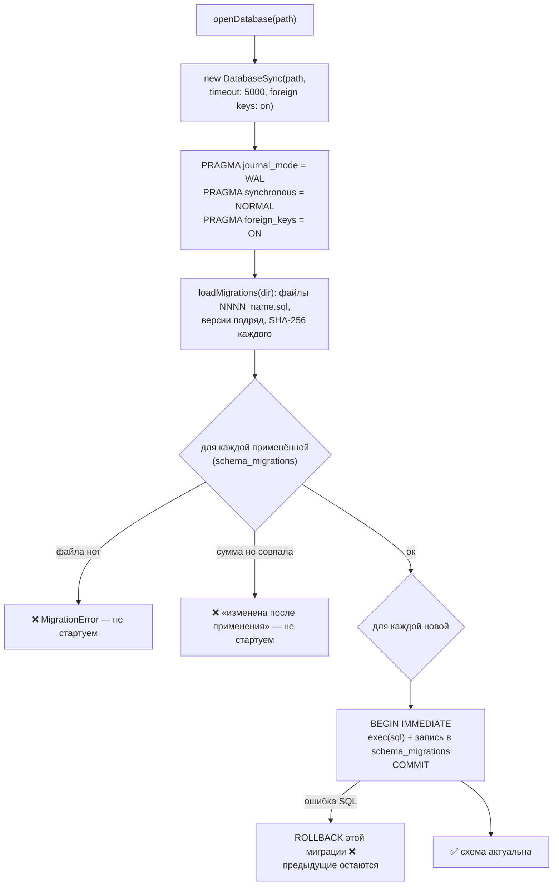
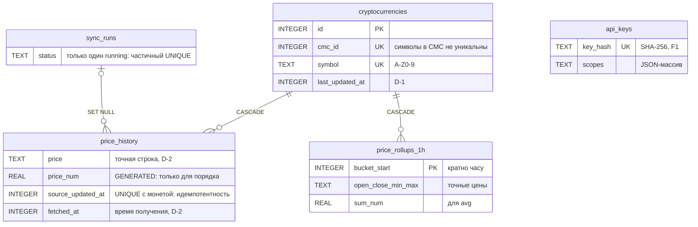
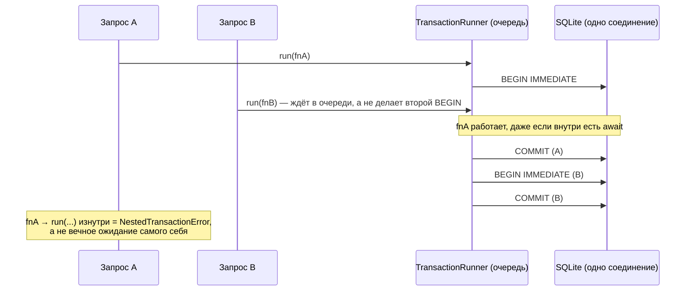
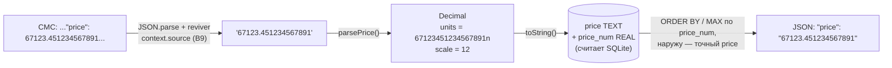
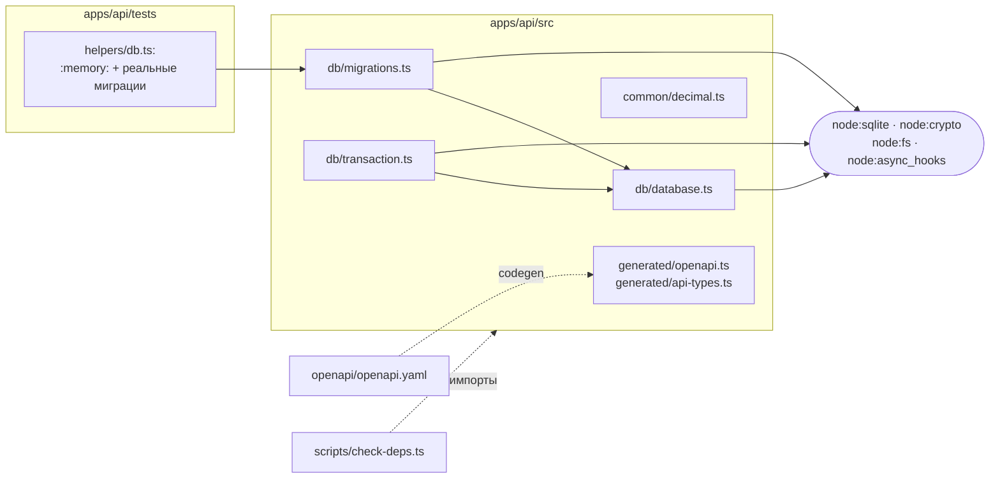

# 11. Фундамент `apps/api`: как всё связано (B1–B3)

> **Из курса** (урок «Структура и архитектура Node.js-приложений»): «Ядро структуры — слои. Каждый слой отвечает за свой аспект».

Разбор того, что построено за день 2: что сделали, как это работает, что от чего зависит, почему именно так и на что ориентировались. Все цифры ниже — из реальных прогонов на Node 24.21, а не из документации.

## 0. Место на карте

Бэкенд — это не только код, который отвечает на HTTP-запросы. Сегодня построены два нижних этажа: **верстак** (как код проверяется и собирается) и **фундамент данных** (как данные хранятся и считаются). HTTP-этажа ещё нет.



Почему начали снизу: всё, что выше, **зависит** от нижних этажей. Роутеру нужна спека, сервисам — БД и `Decimal`, а всему вместе — проверки, которые не дадут сломать уже сделанное. Обратных зависимостей нет: `Decimal` ничего не знает об HTTP, а БД — о сервисах. Это и есть «зависимости направлены внутрь» из урока.

## 1. Один `.ts` — три способа исполнения

Самое неочевидное в каркасе. Один и тот же исходник исполняется тремя разными путями:



| Путь | Кто превращает TS в JS | Модульная система | Зачем так |
|---|---|---|---|
| Разработка | сам Node (type stripping) | ESM | Без `tsx` и `ts-node`: меньше зависимостей, а dev исполняет тот же JS, что и прод (ADR 0004) |
| Прод | `tsc` | ESM | Прод не должен зависеть от экспериментального поведения: собираем заранее, запускаем готовый JS |
| Тесты | `ts-jest` | **CommonJS** | ESM в Jest до сих пор экспериментальный (`--experimental-vm-modules`). CJS — стабильный путь |

Что из этого следует:
- **`erasableSyntaxOnly`.** Node умеет только *стирать* типы, но не *генерировать* код. Поэтому запрещены `enum` и parameter properties (`constructor(private db)`). Второе встретилось в `TransactionRunner` — такую ошибку ловит typecheck.
- **`import.meta` запрещён в `src`.** В CommonJS его нет, тест упал бы. Поэтому спека встраивается в TS-модуль, а путь к миграциям передаётся параметром (раздел 3).
- **`rewriteRelativeImportExtensions` выключен только для Jest.** `tsc` переписывает `./x.ts` в `./x.js`, потому что в `dist` лежат `.js`. А Jest работает с исходниками: переписанный `./x.js` он не нашёл бы. Первый запуск тестов упал именно на этом.

**Как в Nest.** Nest CLI собирает через `tsc` или webpack, тесты гоняет через тот же `ts-jest`. Разница в том, что в проекте нет отдельного dev-рантайма (`ts-node`): его заменил сам Node 24.

## 2. Конвейер качества: что происходит на `git commit` и `git push`



Почему два уровня. Хук — быстрая обратная связь за секунды и только по изменённому. CI — полная проверка на чистой Linux-машине: хук можно обойти (`--no-verify`), а CI нельзя. К тому же CI проверяет то, что локально не видно, например что тесты проходят не только на Windows.

| Проверка | От чего защищает | Требование |
|---|---|---|
| `check-deps` | В рантайм api попадает библиотека вне ТЗ: прямо или как phantom dependency из соседнего пакета | **C7** |
| `codegen:check` | Спека поменялась, а типы и встроенный модуль — нет: код проверяет старый контракт | F8, ADR 0008 |
| `redocly lint` | Невалидный контракт, недокументированные ответы | F8 |
| ESLint: `Date.now`, `node:timers/promises` | Время в обход порта `Clock`, нестабильные тесты | C9, ADR 0009 |
| Coverage-порог 100 % у `Decimal` | Непроверенная ветка в денежной арифметике | ADR 0006 |
| `npm ls --omit=dev` | Показывает, что именно попадёт в прод-образ | C7 |
| commitlint | Хаотичная история, подписи инструментов в коммитах | бриф §4 |

Проверено руками: файл с `import { z } from 'zod'` и `import fs from 'fs'` →

```
check-deps: 2 нарушений C7
apps\api\src\_probe.ts:1: zod — 'zod' нет в allowlist ТЗ (express, axios, swagger-ui-express)
apps\api\src\_probe.ts:2: fs — встроенный модуль без префикса: используйте 'node:fs'
```

**Почему это важно.** C7 — самое легко нарушаемое требование ТЗ: одна строка `import` в любом файле. Ревьюер может пропустить её глазами, скрипт — нет. На интервью ответ «я гарантирую это автоматически, вот проверка в CI» звучит иначе, чем «я старался не импортировать лишнего».

## 3. Spec-first: из одного YAML — всё остальное



- **Почему спека — TS-модуль, а не чтение JSON с диска.** Чтобы прочитать файл, нужен путь к нему. В ESM это `import.meta.dirname`, а в Jest (CommonJS) его нет. Модуль `export const openapiDocument = {...}` одинаково грузится в Node, `tsc` и Jest. Тип `unknown` выбран намеренно: структуру проверит компилятор спеки при старте (fail-fast).
- **Тест инвариантов контракта** проверяет 47 условий: 16 уникальных операций, у каждой либо `security: []`, либо известные scopes, у всех есть 400 (решение R1), у защищённых — 401 и 403. Ошибка в спеке ловится до того, как станет ошибкой старта.

## 4. Старт базы данных



| Настройка | Что делает | Что будет без неё |
|---|---|---|
| `journal_mode = WAL` | Запись идёт в отдельный журнал, читатели не ждут писателя | Чтение блокируется на время записи синхронизации |
| `synchronous = NORMAL` | Меньше fsync. В режиме WAL целостность сохраняется, при сбое питания теряется максимум последняя транзакция | `FULL` медленнее на каждую запись, а выигрыша для проекта нет |
| `foreign_keys = ON` | Включает проверку внешних ключей и `ON DELETE CASCADE` | Удалил монету — история осталась «сиротой». SQLite по умолчанию ключи **не проверяет** |
| `timeout` (busy_timeout) | Ждать до 5 с, если файл заблокирован другим процессом | Мгновенная ошибка `SQLITE_BUSY` |

**Почему контрольная сумма.** Сценарий без неё: кто-то правит `0001_core.sql`, у новых установок схема одна, у старых — другая, и никто об этом не знает. С суммой расхождение видно сразу при старте. Так делают Flyway и Liquibase. TypeORM, к слову, сумму не хранит. Отдельная ловушка — переводы строк: тот же файл с CRLF на Windows дал бы другую сумму. Поэтому перед хешированием они нормализуются.

**Почему только вперёд.** Down-миграция «удалить колонку» не вернёт данные, которые в ней были. Ошибку исправляют новой миграцией — так же, как в бухгалтерии исправляют проводку новой проводкой, а не стирают старую.

## 5. Схема ядра: что зачем



Каждая таблица отвечает на конкретное требование: `cryptocurrencies` — D-1, `price_history` — D-2 и F4, `price_rollups_1h` — агрегация за ≤ 20 мс (ADR 0007), `sync_runs` — наблюдаемость синхронизации и защита от наложения (D10), `api_keys` — F1. **Инварианты продублированы в CHECK**: даже если валидатор ошибётся, мусор в БД не попадёт. Тесты `schema.test.ts` это доказывают: `btc`, `1.2e-9`, `-5`, второй `running` — отклоняются.

## 6. Транзакции и Event Loop — главное место дня

Синхронный драйвер, одно соединение и асинхронный код — сочетание, где легко ошибиться. Ключ к пониманию — разница между **микро-** и **макрозадачами** Event Loop.

Демо (`await` внутри «транзакции», рядом стоит «другой запрос» через `setImmediate`):

```
2a await готового промиса: BEGIN (resolved) → COMMIT
2b await настоящего I/O  : BEGIN (io) → другой запрос (макрозадача) → COMMIT
```

- **2a.** `await` уже готового промиса — это микрозадача. Event Loop **не отпускает** поток к другим запросам, пока очередь микрозадач не опустеет. Транзакция проходит целиком, никто не вклинится.
- **2b.** `await` настоящего ожидания (сеть, таймер) отпускает Event Loop. Другой запрос выполняется **посреди транзакции** на том же соединении. Он видит незакоммиченные данные, а если попробует свой `BEGIN` — получит «cannot start a transaction within a transaction».

Отсюда три правила в `TransactionRunner`:



1. **Очередь.** Параллельные `run` выполняются по одному.
2. **Вложенность — ошибка.** Вложенный `run` ждал бы сам себя. Отличить вложенный вызов от параллельного помогает `AsyncLocalStorage`: он помнит «я внутри транзакции» вдоль цепочки `await`. Простой флаг путал бы два случая — так работала первая версия, исправлено до запуска.
3. **Никакой сети внутри транзакции.** Поэтому в синхронизации (ADR 0015) сначала запрос в CMC, потом короткая транзакция.

**Как в Nest/TypeORM.** `dataSource.transaction()` берёт отдельное соединение из пула, поэтому там этой проблемы почти нет. Но в SQLite соединение одно, и задачу пула решает очередь.

## 7. Путь цены: от байтов CMC до клиента



Каждый шаг закрывает конкретную ловушку. Демо:

```
1a JSON.parse     : { price: 67123.4512345679, tiny: 1.2345678901234e-9 }   ← точность потеряна до кода приложения
1b reviver source : { price: '67123.451234567891', tiny: '0.0000000012345678901234' }
4a MAX(price)     : '9.5'      ← строки сравниваются посимвольно: '9' > '1'
4b MAX(price_num) : '100.1'    ← правильно, а наружу отдаём точный TEXT этой строки
3a number : typeof 'real',    bucket 497604.58222222223   ← бакет по часу «поплыл»
3b bigint : typeof 'integer', bucket 497604
```

- **Где float разрешён:** `price_num` (нужен только порядок), `avg` (это статистика, а не цена, ADR 0007), графики в web. **Где запрещён:** везде, где значение уходит клиенту как цена.
- **`Decimal` внутри** — целое число и сдвиг: `123.45` = `12345n` и `scale = 2`. Сложение — выровнять масштабы и сложить целые. Поэтому `0.1 + 0.2 = 0.3` ровно.
- **Округление всегда явное.** У `div` и `round` есть параметр `mode`, по умолчанию HALF_EVEN. Неявного округления, которое кто-то не заметит, нет.

## 8. Что от чего зависит (код на сегодня)



Внешних пакетов в `src` пока нет вообще: только `node:*`. `Decimal` не зависит ни от чего. Так и должно быть у доменного value object: его можно унести в любой проект, включая `platform`.

## 9. На что ориентировались

| Решение | Источник |
|---|---|
| Слои, зависимости внутрь, транзакции с try/catch и ROLLBACK, параметризованные запросы | курс: «Структура и архитектура», «Работа с базой данных» |
| БД в тестах не мокаем, время — через абстракцию | курс: «Контроль качества»; ADR 0009 (проверено: fake timers не подменяют `node:timers/promises`) |
| `node:sqlite` вместо `better-sqlite3`, Node 24 LTS | ТЗ C7 + статус модуля в документации Node (release candidate с 24.15) — ADR 0003 |
| Цены строками | практика бирж: Binance, Coinbase, Kraken отдают цены строками — ADR 0006 |
| Миграции с контрольной суммой, только вперёд | Flyway / Liquibase |
| HALF_EVEN | банковское округление: режим по умолчанию в IEEE 754 и в `decimal` Python, в Java — `RoundingMode.HALF_EVEN` |
| Conventional Commits, хуки, CI | бриф §4, Korefan (CI/CD), ценность Evercode «простота»: проверки дешёвые и автоматические |
| npm workspaces вместо pnpm / Turborepo | State of JS 2024 + размер монорепо (3–5 пакетов) — ADR 0005 |

## 10. Почему это важно (для сдачи и интервью)

- **Для проверяющего.** C1, C7 и точность цен проверяются автоматически на каждый коммит, а не обещаются в README.
- **Для команды.** Через неделю никто не вспомнит, почему `BigInt` в SQL. Тест `database.test.ts` с `7 / 2 = 3.5` объяснит это лучше комментария и не даст «упростить».
- **Для интервью.** Каждое место в этом разборе — готовый ответ на «почему так?» с доказательством: демо, тест или ADR.

## 11. Потрогай руками (10 минут)

Каждый пункт — сломать и посмотреть, что поймает защита. После эксперимента откати изменения через `git checkout -- <файл>`.

| Сделай | Ожидаемый результат | Что это доказывает |
|---|---|---|
| Добавь в любой файл `apps/api/src` строку `import { z } from 'zod';` и выполни `npm run check-deps` | ❌ «'zod' нет в allowlist ТЗ» | C7 контролируется автоматически |
| Поменяй пробел в `apps/api/migrations/0001_core.sql`, затем `npx jest tests/db/migrations.test.ts` в `apps/api` | тесты ✅: они берут сумму из файла. А реальная БД, где миграция уже применена, не стартует | разница между «файл изменился» и «БД расходится с файлом» |
| В `decimal.ts` поменяй `quotient % 2n === 0n` на `true` и запусти тесты | ❌ падают кейсы `3.5 → 4`, и coverage-порог 100 % не пройден | тест и порог страхуют денежную арифметику |
| Сделай `git commit --allow-empty -m "fix stuff"` | ❌ commitlint: нет типа Conventional Commits | история остаётся читаемой |
| Запусти `node --test "scripts/**/*.test.ts"` в корне | ✅ 7 тестов на встроенном `node:test` | корневым скриптам не нужен Jest |

## Подводные камни (сводка)

- Type stripping не умеет `enum` и parameter properties → `erasableSyntaxOnly`.
- `import.meta` не существует в Jest (CommonJS) → спека как модуль, пути — параметрами.
- Jest не находит `./x.js` → в Jest выключен `rewriteRelativeImportExtensions`.
- npm 11 по умолчанию блокирует install-скрипты пакетов. Заодно не сработал сбор статистики Scarf у `swagger-ui-express`.
- `PRAGMA busy_timeout` возвращает колонку `timeout`.
- `await` настоящего I/O внутри транзакции пускает чужой запрос на то же соединение.
- `MAX()` по TEXT и `number` в параметрах SQLite — см. раздел 7.

## Вопросы на собеседовании

1. Как один `.ts` исполняется в dev, в проде и в тестах и почему по-разному? → Dev — type stripping в Node (ESM), прод — `tsc` в `dist` (ESM), тесты — `ts-jest` в CommonJS, потому что ESM в Jest экспериментальный. Цена: без `enum` и `import.meta`.
2. Зачем и pre-commit, и CI, если проверки одни и те же? → Хук даёт быструю обратную связь, но его можно обойти. CI — гарантия на чистой Linux-машине.
3. Почему `await` внутри транзакции SQLite может быть опасен и когда — нет? → `await` готового промиса — микрозадача, Event Loop не переключается. `await` сети отпускает поток, и другой запрос попадает внутрь транзакции на том же соединении.
4. Как отличить вложенный вызов транзакции от параллельного? → `AsyncLocalStorage` хранит контекст вдоль цепочки `await`. Флаг их не различает.
5. Почему `foreign_keys = ON` нужно включать явно? → В SQLite проверка внешних ключей по умолчанию выключена, и `ON DELETE CASCADE` молча не работает. `node:sqlite` включает её сам, но проект не полагается на неявное поведение драйвера.
