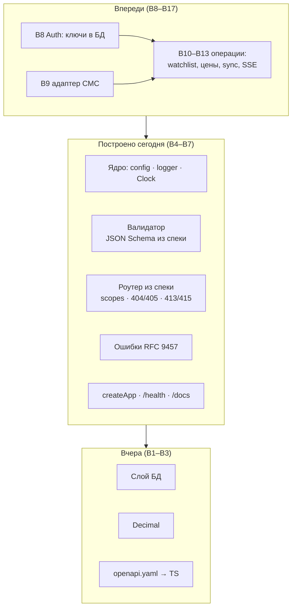
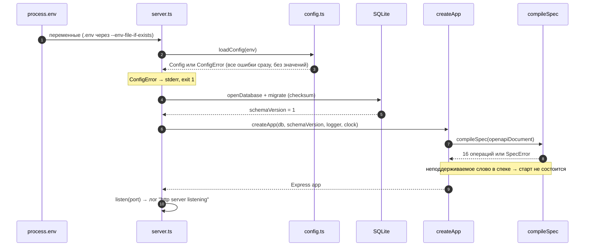
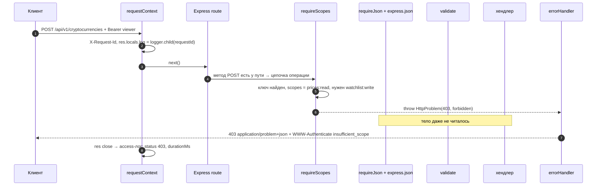
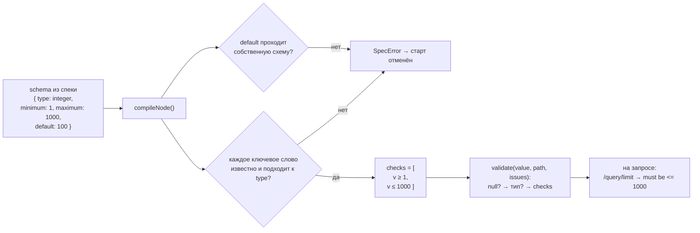
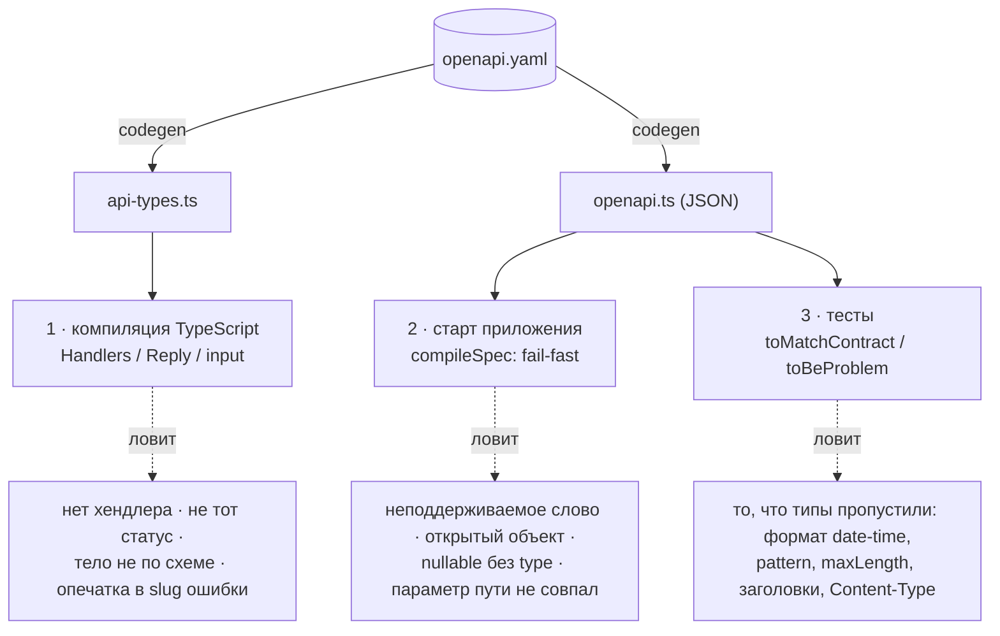
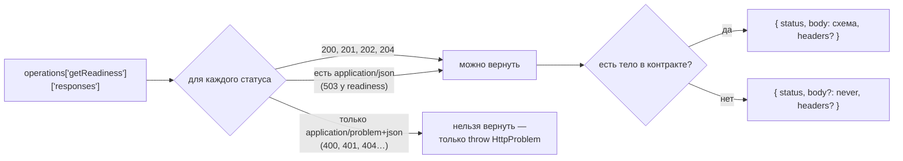
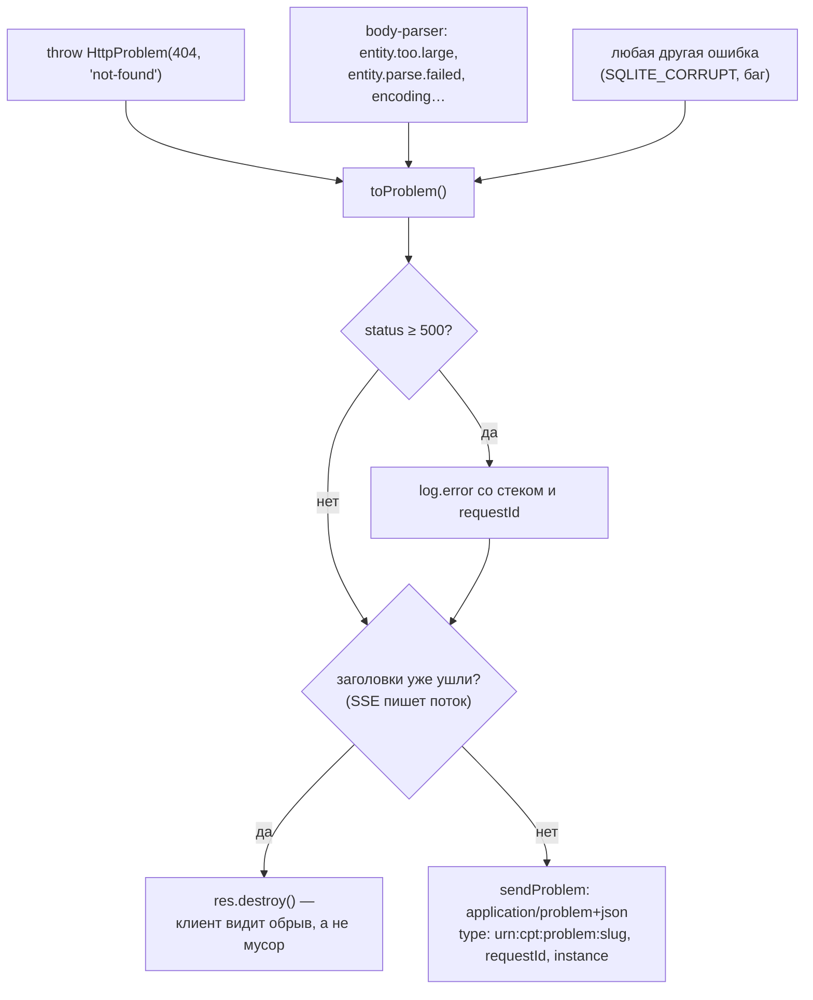
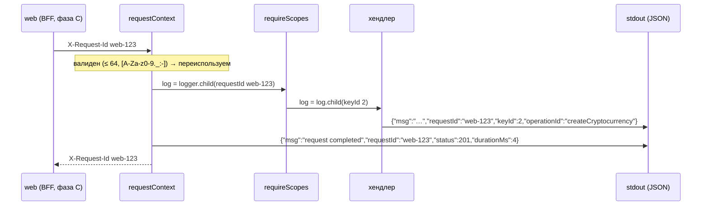
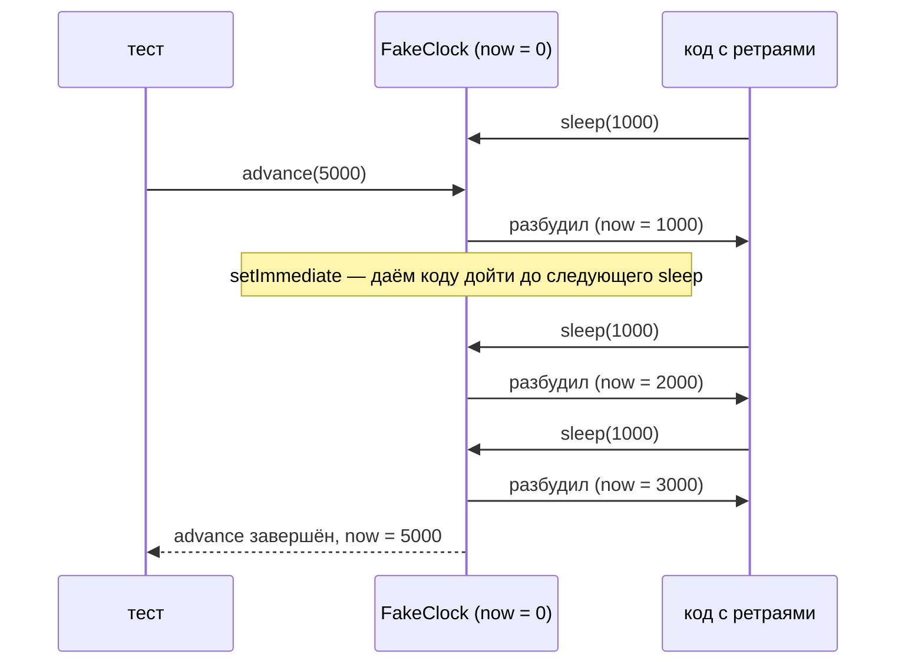
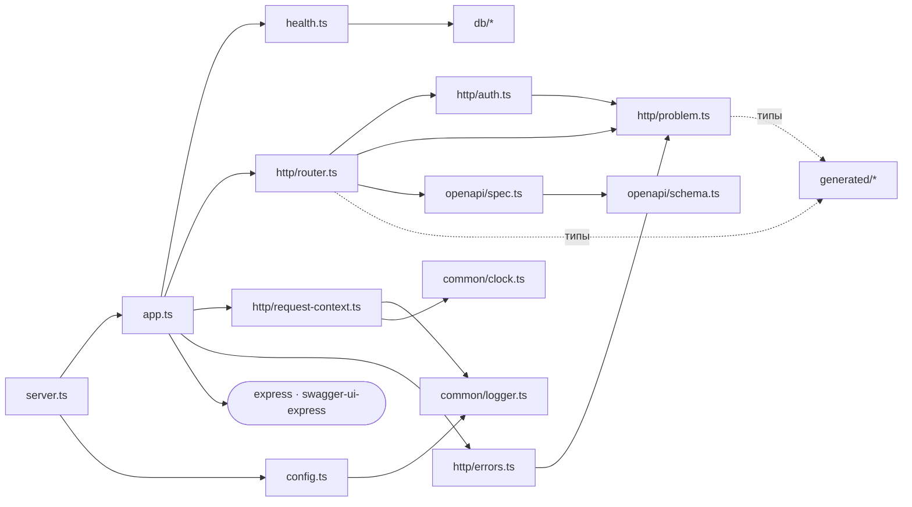

# 12. HTTP-слой из спеки: как всё связано (B4–B7)

> **Из курса** (урок «Авторизация, API и работа с внешними источниками»): «В Express авторизация реализуется через middleware, который перехватывает запросы перед обработкой бизнес-логикой, проверяет права пользователя и либо пропускает запрос дальше, либо возвращает ошибку».

Разбор дня 3 в формате [11](11-фундамент-api.md): что построили, как это работает по шагам, что от чего зависит и почему именно так. Сравнение Express и Nest вынесено в [01](01-express-глазами-nest.md), здесь — устройство изнутри. Все цифры — из реальных прогонов на Node 24.21.

## 0. Место на карте

Вчера был фундамент: верстак, БД, `Decimal`. Сегодня над ним появился **HTTP-этаж**, и сервис впервые отвечает на запросы. Бизнес-операций пока нет: из 16 операций контракта работают две (`/health/*`), остальные 14 явно отвечают «не реализовано». Но всё, через что пройдёт каждая из них, уже готово и проверено.



Порты, которые сегодня появились «пустыми», уже вставлены в нужные места. `Authenticator` получит реализацию в B8, `Lifecycle` — в B12 (планировщик) и B14 (остановка). Остальной код менять не придётся: это и есть смысл портов.

## 1. Старт приложения: от переменных окружения до `listen`



Что важно:
- **Три точки fail-fast, все до `listen`:** конфиг (шаг 3), миграции с контрольной суммой (шаг 4), спека (шаг 8). Если что-то не так, процесс не начинает принимать трафик. Хуже упавшего старта только сервис, который работает, но молча делает не то.
- **Логгера на шаге 3 ещё нет:** его уровень берётся из конфига. Поэтому ошибка конфига пишется прямо в stderr. В ней нет значений переменных, только имена и ожидаемый формат.
- **Путь к миграциям — от `process.cwd()`**, потому что `import.meta` в `src` запрещён (ADR 0004). `npm -w` и Docker запускают из `apps/api`.

Проверено руками: без `CMC_API_KEY` выводится «Некорректная конфигурация: CMC_API_KEY: обязательна…» и код выхода 1. С ключом от записи «database ready» до «http server listening» проходит 14 мс, и `/health/ready` отвечает 200.

## 2. Один запрос целиком: кто какой статус отдаёт

Схема конвейера — в [01](01-express-глазами-nest.md#конвейер-одного-запроса). Здесь один конкретный запрос по шагам — добавление монеты без нужного права и с лишним полем:



| Шаг | Статус | Кто отвечает | Почему здесь |
|---|---|---|---|
| Путь неизвестен | 404 | `notFound` после роутера | Express дошёл до конца цепочки, никто не ответил |
| Путь есть, метода нет | 405 + `Allow` | `route.all` в роутере | Роутер знает все методы пути из спеки |
| Нет ключа / ключ неверный | 401 + `WWW-Authenticate` | `requireScopes` | RFC 6750: без ключа — только `Bearer`, с плохим — `error="invalid_token"` |
| Нет scope | 403 | `requireScopes` | `error="insufficient_scope"` и список нужных scope |
| Тело не JSON, сжато, не UTF-8 | 415 | `requireJson` / body-parser | До чтения тела, кроме кодировки |
| Тело больше 16 КБ | 413 | body-parser | Считаются фактически прочитанные байты: заниженный `Content-Length` не поможет |
| Битый JSON | 400 | body-parser → `errorHandler` | Синтаксис JSON — тоже валидация |
| Не по схеме | 400 + все `errors` | `validate` | Одна проверка на path, query и body |
| Бизнес-отказ | 409 / 422 / 503 | хендлер (B10+) | Схема верна, но действие невозможно |
| Что угодно ещё | 500 | `errorHandler` | Детали — только в лог |

## 3. Валидатор изнутри: из YAML в замыкания

ADR 0008 обещал «интерпретатор ~250 строк». Вышло больше: [`schema.ts`](../../apps/api/src/openapi/schema.ts) и [`spec.ts`](../../apps/api/src/openapi/spec.ts) — около 760 строк вместе с комментариями. Логики примерно 350 строк, остальное — проверки самой спеки, их сообщения и `checkResponse` для тестов. Каждая строка покрыта: 100 % по строкам и ветвям, порог закреплён в `jest.config.js`.

Ключевая идея — **компиляция**. Схема разбирается один раз, при старте, в цепочку маленьких функций. На запросе выполняются только они:



`$ref` компилируется один раз и кэшируется по имени схемы. Для рекурсивных схем (дерево ссылается само на себя) в кэш сначала кладётся заглушка: она вызывает функцию, которая появится после компиляции. Без неё `compileNode` ушёл бы в бесконечную рекурсию. Сейчас в контракте рекурсии нет, но тест на неё есть: проверка не должна зависеть от того, повезло ли со спекой.

**Цифры** (Node 24.21, обычный ноутбук):

```
compileSpec: 1.01 мс                              ← весь контракт, 16 операций, на старте
parseRequest listPriceHistory: 1.25 мкс           ← path + 4 query-параметра, с приведением и date-time
parseRequest createCryptocurrency: 0.43 мкс       ← тело с 2 полями
```

Для сравнения: один запрос к SQLite — десятки микросекунд, сеть — миллисекунды. Валидация по спеке практически бесплатна, поэтому кешировать или отключать её в проде незачем.

Что валидатор знает о данных, которых не видно в спеке:

```
JSON.parse 9007199254740993 → 9007199254740992 safe: false   ← клиент прислал одно число, сервер получил другое
'𝔹'.length = 2 , [...] = 1                                    ← maxLength считаем по символам, как JSON Schema
JSON.parse __proto__: own key = [ '__proto__' ]               ← это собственное поле, а не прототип…
Object.assign({}, parsed).isAdmin = true                       ← …пока кто-то не скопирует объект: prototype pollution
```

Последние две строки — причина, почему правило «у каждого объекта `additionalProperties: false`» проверяется при старте, а не оставлено на совесть автора спеки. Поле `__proto__` для валидатора просто лишнее и отклоняется до того, как попадёт в `Object.assign` или spread.

## 4. Три рубежа контракта

Один и тот же `openapi.yaml` проверяет код в трёх разных моментах. Каждый рубеж ловит то, чего не видят остальные.



| Рубеж | Пример, пойманный сегодня |
|---|---|
| 1 · типы | `{ status: 204, body: {} }` компилировался. Возвращаемое значение функции не проверяется на лишние поля, поэтому в тип добавлен `body?: never`. Нашёл тест `@ts-expect-error`: ожидаемая ошибка не появилась |
| 2 · старт | Весь контракт компилируется в тесте. Любая будущая правка спеки с `oneOf` уронит CI раньше, чем деплой |
| 3 · тесты | SSE-ответ сверялся с распарсенным телом (`{}` от supertest), а не с текстом. Матчер упал на первом же тесте `streamEvents` |

**Почему типов недостаточно.** TypeScript знает, что `price` — `string`, но не знает про `pattern: '^(0|[1-9][0-9]*)…$'`. Поэтому рубеж 3 обязателен в каждом HTTP-тесте, и в матрице C8 (B15) он станет условием.

Тип `Reply<Op>` выводится из ответов операции так:



## 5. Ошибки: от `throw` до Problem Details



- **Slug ошибки берётся из enum контракта** через тип `ProblemSlug`. Опечатка `'not_found'` — ошибка компиляции. Новый тип ошибки появляется сначала в спеке, потом в коде, и никак иначе.
- **`instance` — путь без query.** В query мог оказаться курсор или что-то, что клиент не хотел бы видеть в чужих логах.
- **У 500 наружу уходит только «See logs by requestId».** Клиент или поддержка приносят `requestId`, а по нему в логе находится стек.
- **Express 5 сам передаёт отклонённый промис `async`-middleware в `next(err)`.** В Express 4 без обёртки `asyncHandler` запрос висел бы до таймаута. Здесь обёрток нет, и это не забывчивость.

## 6. Логи и `X-Request-Id`: след одного запроса



Каждый слой добавляет своё поле через `child()`, и ни один не знает о других. Поиск по `requestId` в логах даёт весь путь запроса — от web до SQL-ошибки.

Маскирование секретов — два независимых слоя:

| Слой | Ловит | Не ловит |
|---|---|---|
| По имени поля: `authorization`, `cookie`, `password`, `secret`, `token`, `api_key`/`apiKey` | заголовки, конфиг CMC | секрет в поле с невинным именем |
| По значению: `cpt_…` | API-ключ сервиса где угодно, даже в тексте ошибки | ключ CMC (это просто UUID — по виду не узнать) |

Поэтому ключ CMC защищён ещё и тем, что его никто не логирует: он живёт в `config.cmc.apiKey`, а это имя ловит первый слой.

## 7. Время в тестах: `FakeClock`

Сегодня `Clock` почти не используется: только `durationMs` в access-логе и время в логах. Но он нужен для B9 (ретраи с backoff) и B12 (планировщик). Поэтому `FakeClock` сделан и протестирован сейчас, на простом случае:



Главная тонкость — пауза `setImmediate` после каждого пробуждения. Без неё продолжение кода после `await sleep()` не успело бы выполниться и заснуть снова. Тогда `advance(5000)` разбудил бы только первого спящего, а тест ретраев проверял бы не то.

## 8. Что от чего зависит (код на сегодня)



- **`openapi/` не знает про Express.** Валидатор и компилятор спеки — чистые функции над данными. Их можно взять в `apps/web` (BFF) или в `platform` без изменений.
- **`http/` знает про Express, но не про БД.** `Authenticator` — интерфейс: реализация из B8 придёт через `createApp(deps)`.
- **Express и Swagger UI импортируются только в `app.ts` и `http/`.** Остальное приложение от фреймворка не зависит. Это порты и адаптеры в масштабе одного дня.

## 9. На что ориентировались

| Решение | Источник |
|---|---|
| Конвейер middleware, авторизация до бизнес-логики | курс: «Асинхронность в Node.js», «Авторизация, API…» |
| Problem Details, `application/problem+json` | RFC 9457 (заменил RFC 7807) |
| 401 и 403, `WWW-Authenticate`, `insufficient_scope` | RFC 6750 §3 |
| 405 + `Allow` | RFC 9110 §15.5.6 |
| `date-time` с обязательной зоной | RFC 3339 §5.6 |
| Пути ошибок `/body/a~1b` | JSON Pointer, RFC 6901 |
| Подмножество ключевых слов, `nullable` | OpenAPI 3.0.3 (опирается на JSON Schema Wright Draft 00) |
| `additionalProperties: false` везде | OWASP API Security Top 10: API3 — Broken Object Property Level Authorization (mass assignment) |
| Компиляция схем в функции | подход ajv (там — генерация кода, здесь — замыкания) |
| `requestId` во всех логах | курс: «Контроль качества» — correlationId |
| Секреты не в логах и ошибках | ТЗ C4, курс: «Контроль качества» |
| Автоматическая обработка `async`-ошибок | документация Express 5: «Error handling», раздел про промисы |

## 10. Почему это важно (для сдачи и интервью)

- **Для проверяющего.** C10 «валидация всех входных данных» выполняется по построению, а не перечислением проверок в каждом эндпоинте. Открываешь `/docs`, отправляешь кривой запрос — получаешь ровно то, что описано в спеке.
- **Для следующих дней.** В B10–B13 хендлер пишет только бизнес-логику: вход уже проверен и типизирован, ошибки — `throw`, ответ проверяет компилятор. Оценки B10–B13 на это и рассчитаны.
- **Для интервью.** «Как вы гарантируете, что документация не врёт?» — три рубежа из раздела 4, у каждого есть пойманный сегодня пример.

## 11. Потрогай руками (10 минут)

Каждый пункт — сломать и посмотреть, что поймает защита. Откат: `git checkout -- <файл>`.

| Сделай | Ожидаемый результат | Что это доказывает |
|---|---|---|
| В `openapi.yaml` у `Symbol` замени `pattern` на `oneOf: [{ type: string }]`, затем `npm run codegen -w @cpt/api` и `npx jest tests/openapi/spec.test.ts` в `apps/api` | ❌ `SpecError: … ключевое слово "oneOf" не поддерживается` | fail-fast: спека не обещает лишнего |
| В `health.ts` верни `{ status: 200, body: { status: 'alive' } }` из `getLiveness` и запусти `npm run typecheck` | ❌ `'alive'` не входит в enum `ok` | контракт проверяет компилятор |
| `CMC_API_KEY=x node src/server.ts` в `apps/api`, затем `curl -i "localhost:3000/health/live?debug=1"` | 400 с `errors: [{ path: '/query/debug' … }]` | R1: неизвестный query-параметр |
| `curl -i -X DELETE localhost:3000/health/live` | 405, `Allow: GET, HEAD` | R2: Problem вместо HTML |
| `curl -i localhost:3000/health/live -H "X-Request-Id: a b"` | в ответе другой, сгенерированный id | защита от log injection |
| Открой `http://localhost:3000/docs` | Swagger UI, 16 операций | F8 |

## Подводные камни (сводка)

- `type-is` считает телом `Content-Length: 0`, поэтому нужна своя `hasBody()`.
- `esModuleInterop` нужно включать в Jest явно: для `commonjs` он выключен по умолчанию.
- `express.json` распаковывает gzip — ставим `inflate: false`.
- Возвращаемое значение функции не проверяется на лишние поля — `body?: never`.
- Supertest подставляет `body: {}` для не-JSON ответов — сверяем `text`.
- Ошибка после `res.write` — только `res.destroy()`.

## Вопросы на собеседовании

1. Что произойдёт, если в спеку добавить `oneOf`? → Приложение не стартует: `compileSpec` бросит `SpecError` с местом в спеке. CI упадёт ещё раньше, потому что весь контракт компилируется в тесте.
2. Сколько стоит валидация по спеке на запрос и почему её не отключают в проде? → Около микросекунды: схемы скомпилированы в функции при старте. Это на порядки меньше запроса к БД.
3. Как отличаешь, что вернуть из хендлера, а что бросить? → Возвращаются статусы, у которых в контракте `application/json` (2xx и 503 readiness). Ошибки в `application/problem+json` бросаются через `HttpProblem`. Тип `Reply` не даст вернуть 404.
4. Почему `__proto__` в JSON опасен, если `JSON.parse` создаёт обычное поле? → Само по себе поле безопасно, но `Object.assign` или spread превращают его в прототип: `isAdmin` появится у объекта. Оно отклоняется как лишнее поле ещё на валидации.
5. Зачем `FakeClock.advance` отдаёт управление после каждого пробуждения? → Чтобы код после `await sleep()` успел дойти до следующего `sleep`. Иначе цепочка ретраев не прошла бы за один `advance`.
