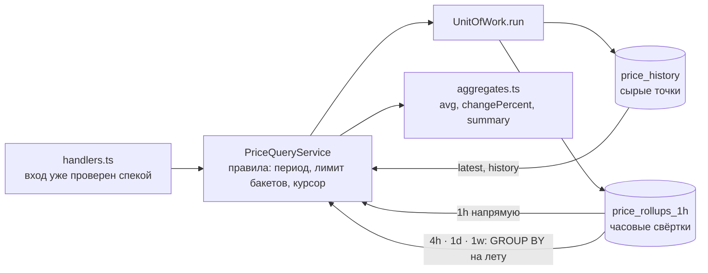

# 13. Чтение цен: актуальные, история, агрегаты, спарклайны

> **Опорный принцип** (тема «Фоновые задачи и планировщики», по карте тем `course-map.md`): «Паттерн: обновлять данные заранее в фоне и сразу отдавать сохранённое».

## Простыми словами
Все четыре операции чтения ходят **только в БД**. CMC они не трогают: ответ быстрый, не зависит от доступности CMC и не тратит квоту. Насколько данные свежие, клиент видит сам — по `fetchedAt`, `isStale` и `lastSync`.

Аналогия: табло в аэропорту. Оно показывает то, что уже записано, а не звонит в каждую авиакомпанию при каждом взгляде. Рядом написано «обновлено в 12:05» — это `fetchedAt` и `lastSync`.

## Как это в Nest → как в Express
| Nest | Здесь |
|---|---|
| `@Controller` + `@Query()` с `ValidationPipe` | [`prices/handlers.ts`](../../apps/api/src/prices/handlers.ts): вход уже провалидирован роутером из спеки |
| `@Injectable() PricesService` | [`PriceQueryService`](../../apps/api/src/prices/price-query-service.ts), зависимости — в конструктор |
| `ExceptionFilter` | `translate()`: `PriceQueryError` → `HttpProblem` (404 или 400 с `errors[].path`) |
| Репозиторий TypeORM | порт [`PriceRepository`](../../apps/api/src/prices/price-repository.ts) + raw SQL в [`db/repositories/prices.ts`](../../apps/api/src/db/repositories/prices.ts) |

## В проекте
- **Курсор** — [`common/cursor.ts`](../../apps/api/src/common/cursor.ts): пара `(fetchedAt, id)` в base64url. SQL: `(fetched_at, id) < (?, ?) ORDER BY fetched_at DESC, id DESC`. Следующая страница начинается строго после последней строки предыдущей, поэтому новая цена между запросами не даёт ни дубля, ни пропуска. С `OFFSET` дала бы. `id` нужен, потому что у двух точек `fetched_at` может совпасть.
- **«Есть ли следующая страница»** — запрашиваем `limit + 1` строку. Лишняя пришла — страница не последняя. Отдельный `COUNT` не нужен.
- **Агрегаты** — `1h` читается из свёрток как есть, `4h`/`1d`/`1w` собираются из них `GROUP BY` на лету. Номер бакета: `((bucket_start + offset) / size) * size - offset`. `offset` нужен только неделе: 01.01.1970 — четверг, сдвиг на 3 дня переносит границу на понедельник.
- **Bare columns** — у SQLite рядом с единственным `min()`/`max()` «голая» колонка берётся из той же строки. Так `min`/`max` сравниваются по `REAL`, а отдаётся точная `TEXT`-строка наблюдённой цены.
- **Лимит** — `(to − from) / interval ≤ 1000`, иначе 400. Это и валидация входа, и защита Event Loop: `node:sqlite` синхронный.
- **Статистика** — [`prices/aggregates.ts`](../../apps/api/src/prices/aggregates.ts): `avg` считается в double и округляется до 10 значащих цифр, `changePercent` — точно в `Decimal`. Сводка за период собирается в JS из уже полученных бакетов.
- **Спарклайны** — один запрос на весь watchlist через `json_each(ids)`, а не запрос агрегатов на каждую монету (N+1).
- Тесты — [`tests/prices/prices.test.ts`](../../apps/api/tests/prices/prices.test.ts).

## Подводные камни
- `MIN`/`MAX` по `TEXT` сравнивают строки: `'10.25' < '9.5'`. В тестах есть ровно такая пара цен.
- JS number уходит в `node:sqlite` как `REAL`. Деление на размер бакета дало бы дробь, и группировка развалилась бы. Параметры идут через `sqlInt()` (BigInt → INTEGER).
- Период агрегатов режется по началу часа свёртки: точность границ `from`/`to` — час.
- Пустые бакеты не выдумываются. `points` показывает, насколько бакет полон.
- `change24hPercent = null`, если истории меньше суток. Не `0`: ноль означал бы «цена не изменилась».

## Вопросы на собеседовании
1. Почему keyset, а не `OFFSET`? → Нет дублей и пропусков при вставках, и запрос идёт по индексу, а не пролистывает пропущенные строки.
2. Почему `avg` в double, если деньги во float считать нельзя? → Это статистика для графика, а не сумма к оплате. Наблюдённые цены (`open/close/min/max`) отдаются точно.
3. Зачем свёртки, если есть сырые точки? → Год истории — это ~105 тыс. точек на монету; свёртка за час сжимает их в 8 760 строк, и запрос не блокирует Event Loop.
4. Как неделя начинается с понедельника при целочисленном делении от эпохи? → Сдвиг на 3 дня перед делением.
5. Что вернёт запрос на 1001 бакет? → 400 `validation-error` с `errors[0].path = /query/from`.
