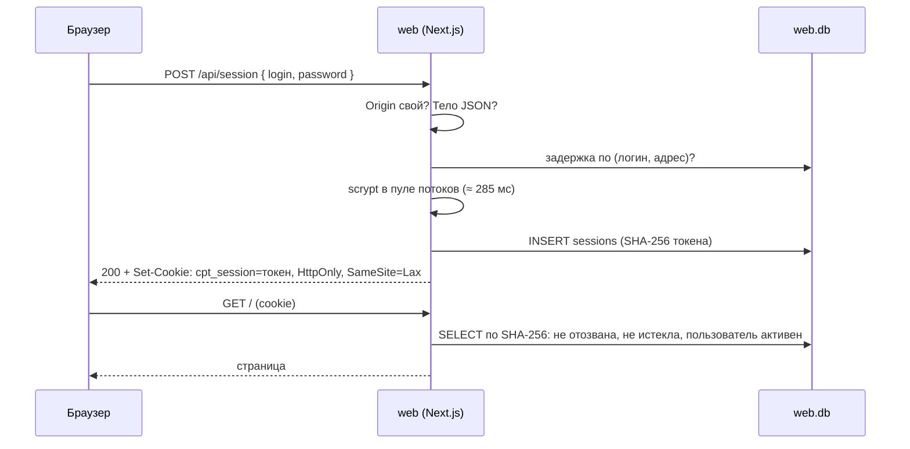

# 14. Web: вход, пароли и серверные сессии

> **Из курса** (урок «Авторизация, API и внешние источники», по конспекту `course-map.md`): «JWT: stateless; минусы — нельзя отозвать до истечения, размер. Basic Auth: нет отзыва и logout».

## Простыми словами
Вход — это обмен пароля на пропуск. Пропуск бывает двух видов. **Самодостаточный** (JWT): на нём написано, кто владелец и до какого часа он действует, охрана проверяет только подпись. Отобрать такой пропуск раньше срока нельзя — его не с чем сверять. **Номерной** (серверная сессия): на пропуске только случайный номер, а всё остальное лежит в журнале на проходной. Каждый проход — взгляд в журнал, зато строку можно вычеркнуть, и пропуск перестаёт работать в ту же секунду.

Здесь выбран номерной: оператор должен уметь отключить пользователя и «выйти везде» сразу, а не через час.

## Как это в Nest → как в Next.js
| Nest | В проекте |
|---|---|
| `AuthGuard` на контроллере | проверка в серверном layout группы `(app)` и в Route Handlers |
| `middleware` | [`proxy.ts`](../../apps/web/src/proxy.ts) — только редирект по наличию cookie, без похода в БД |
| `@nestjs/passport` + `passport-local` | [`AuthService.login`](../../apps/web/src/server/auth-service.ts) — около 30 строк |
| провайдеры в DI-контейнере | [`createServices`](../../apps/web/src/server/container.ts) — явная сборка, один набор на процесс |
| контроллер | [`route.ts`](../../apps/web/src/app/api/session/route.ts) связывает стандартные `Request` → `Response` с сервисами |
| `OnModuleInit` | [`instrumentation.ts`](../../apps/web/src/instrumentation.ts): открыть БД, запустить очистку раз в час |

## В проекте
- **Пароль — scrypt, и только асинхронный** ([`passwords.ts`](../../apps/web/src/server/passwords.ts)). Параметры N = 2^17, r = 8, p = 1 — минимум OWASP, это около 285 мс на хэш. `scryptSync` на такое время остановил бы Event Loop для всех пользователей; `crypto.scrypt` считает в пуле потоков libuv. Параметры записаны в самой строке хэша (`scrypt$17$8$1$соль$хэш`), поэтому их можно усилить без миграции.
- **Токен сессии хэшируется быстрым SHA-256, а пароль — медленным scrypt.** Причина одна: энтропия. В токене 256 случайных бит, перебирать его бессмысленно на любой скорости. В пароле человека — десятки бит, и только цена попытки делает перебор дорогим.
- **В БД нет токенов** ([`sessions.ts`](../../apps/web/src/server/sessions.ts)): хранится SHA-256, дамп базы не даёт рабочих сессий. Тот же приём, что у ключей api.
- **Два срока.** Бездействие — 2 часа, абсолютный предел — 12 часов. Активность продлевает первый, но не дальше второго. Запись `last_seen_at` — не чаще раза в минуту.
- **Новый токен при каждом входе** — защита от session fixation: подсунутый заранее идентификатор не превращается в сессию жертвы.
- **Время ответа не выдаёт причину отказа.** Нет логина или пользователь отключён — scrypt всё равно считается по фиктивному хэшу, а ответ один: «Неверный логин или пароль».
- **Задержка вместо блокировки** ([`login-throttle.ts`](../../apps/web/src/server/login-throttle.ts)): после 5 неудач по паре «логин + адрес» — 1, 2, 4 … секунд, до 15 минут. Блокировка аккаунта целиком стала бы способом отключить чужого пользователя.
- **CSRF в три слоя** ([`request.ts`](../../apps/web/src/server/request.ts)): `SameSite=Lax`, тело только `application/json`, заголовок `Origin` совпадает с адресом web.
- **Cookie:** `HttpOnly` (скрипт страницы не прочитает токен), по HTTPS — `Secure` и префикс `__Host-` (поддомен не подменит cookie).
- **Схема сама отклоняет некорректное** ([миграция](../../apps/web/src/server/migrations/0001-auth.ts)): пароль в открытом виде, токен вместо хэша, отзыв без причины — ошибки `CHECK`, а не надежда на код.
- **Тесты — на настоящей SQLite в памяти**, время — внедрённая функция `now()`, scrypt — с N = 2^10 (тот же код, миллисекунды вместо 285 мс). 92 теста, включая обработчики `/api/session` без запуска Next.

## Подводные камни
- **`$` в `.env.local`.** Загрузчик окружения Next подставляет переменные, и `scrypt$17$8…` превращается в `scrypt…`. Знаки экранируются: `\$`. Неэкранированный хэш останавливает сервер на старте с ошибкой конфига — так и было при первой проверке.
- **Адрес клиента.** Route Handler не видит адрес сокета, а `X-Forwarded-For` клиент может прислать сам. Без `WEB_TRUST_PROXY=true` заголовок игнорируется, и задержка считается только по логину.
- **`proxy.ts` — не защита.** Он смотрит только на наличие cookie. Поддельная cookie пройдёт его и остановится на проверке в layout.
- **`scrypt` и память.** N = 2^17 требует 128 МБ, а предел `maxmem` по умолчанию — 32 МБ. Без явного `maxmem` хэширование падает с ошибкой.
- **Синглтон сервисов в dev.** Next перезагружает модули при правках; без хранения в `globalThis` каждая перезагрузка открывала бы БД заново.
- **Миграции — строки в коде.** Сборка `output: standalone` копирует только импортированное: SQL-файл рядом с сервером в образ мог не попасть.

## Вопросы на собеседовании
1. Серверная сессия или JWT — что выбрано и почему? → Сессия: нужен мгновенный отзыв (выход, отключение пользователя, «выйти везде»). JWT до истечения отозвать нельзя без того же серверного списка.
2. Почему токен сессии хэшируется SHA-256, а пароль — scrypt? → У токена 256 бит энтропии, перебор невозможен. Пароль короткий, и защищает его только цена одной попытки.
3. Что такое session fixation и как от неё защититься? → Атакующий заранее задаёт жертве известный идентификатор сессии. Защита — выдавать новый токен при каждом входе.
4. Почему задержка, а не блокировка аккаунта после N неудач? → Блокировку можно вызвать нарочно и отключить настоящего пользователя. Задержка по паре «логин + адрес» мешает только перебирающему.
5. Чем опасен `scryptSync` в обработчике входа? → Он блокирует Event Loop на сотни миллисекунд: в это время сервер не отвечает никому.
