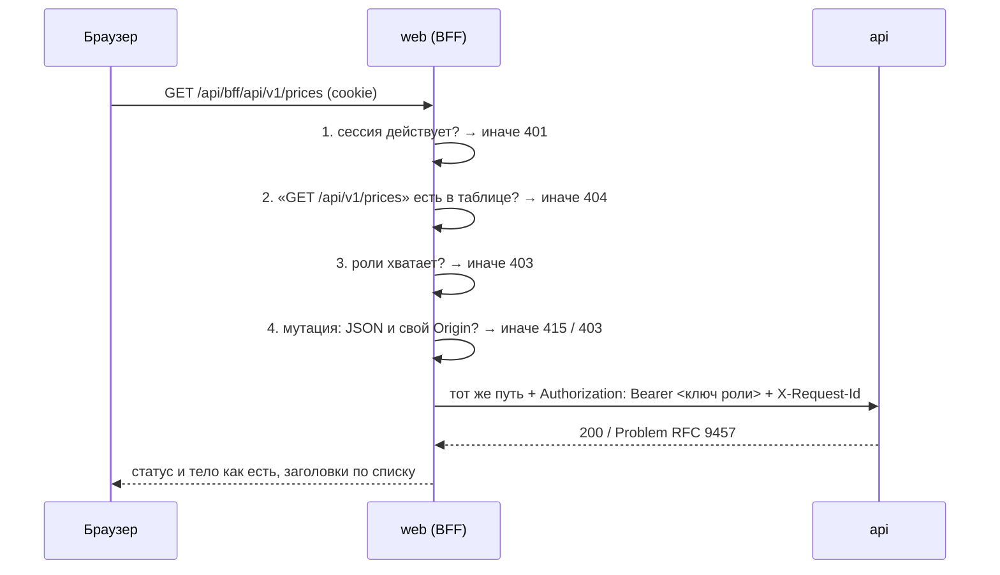

# 15. Web: BFF, allowlist и SSE-прокси

> **Из курса** (урок «Авторизация, API и внешние источники», по конспекту `course-map.md`): «Внешние API: таймауты, retry с задержкой, пул соединений; данные валидировать → трансформировать → нормализовать; учитывать rate limit, кэшировать, graceful degradation».

Для web таким «внешним API» служит `apps/api`: у запроса есть таймаут, а его недоступность — штатный ответ, а не падение.

## Простыми словами
BFF (Backend for Frontend) — это стойка администратора в бизнес-центре. Посетитель (браузер) показывает гостевой пропуск (cookie сессии). Администратор сверяется со списком «кому куда можно» и сам открывает нужную дверь своим служебным ключом. Посетитель ключа в руках не держит, а в комнаты не из списка администратор не водит вовсе.

Зачем это нужно: api принимает только ключи (`Authorization: Bearer cpt_…`). Ключ в браузере — это ключ у любого, кто откроет DevTools. Поэтому ключи живут на сервере Next, а браузер знает только свою сессию.

## Как это в Nest → как в Next.js
| Nest | В проекте |
|---|---|
| `@Controller('bff')` + `@All('*')` | catch-all маршрут [`app/api/bff/[...path]/route.ts`](../../apps/web/src/app/api/bff/[...path]/route.ts) |
| `AuthGuard` + `RolesGuard` с `@Roles()` | проверки в [`handleBff`](../../apps/web/src/server/bff/bff-http.ts): сессия → таблица → роль |
| метаданные `@Roles('operator')` на методе | строка таблицы [`ALLOWLIST`](../../apps/web/src/server/bff/allowlist.ts) |
| `HttpService` (axios) с интерцептором, который ставит ключ | [`callApi`](../../apps/web/src/server/bff/upstream.ts) на встроенном `fetch` |
| `@Sse()` + `Observable` | Route Handler возвращает `new Response(ReadableStream)` |
| `ConfigModule` с `validate` | [`loadConfig`](../../apps/web/src/server/config.ts): ошибка → процесс не стартует |

В Express то же самое было бы middleware-цепочкой перед `http-proxy-middleware`. Здесь прокси написан руками: 100 строк, зато видно каждое решение.

## В проекте

### Таблица вместо «прокси всего»
[`allowlist.ts`](../../apps/web/src/server/bff/allowlist.ts) — 15 строк «метод + путь → минимальная роль». Это **allowlist**: разрешено только перечисленное. Обратный подход (denylist: «всё, кроме…») ломается первым же новым эндпоинтом api, про который забыли.

Таблицу держат в согласии с контрактом два механизма:
- **Компилятор.** Тип `ContractRoute` строится из сгенерированного `paths`. Опечатка в пути или метод, которого у пути нет, — ошибка `tsc`.
- **Тест** [`bff-allowlist.test.ts`](../../apps/web/tests/bff-allowlist.test.ts) читает `openapi.yaml` и проверяет обратное: каждая операция контракта есть в таблице, а роль соответствует `x-required-scopes`. Добавили операцию в api и забыли про web — красный CI.

Проверено мутацией: роль `system/cmc` заменена на `viewer` — 1 тест красный; строка удалена — 2 красных.

Поток событий в таблицу не входит: у него свой маршрут.

### Порядок проверок
[`handleBff`](../../apps/web/src/server/bff/bff-http.ts): 401 → 404 → 403 → 415/403 (CSRF) → 413 → запрос.
- **401 раньше 404:** без сессии нельзя узнать, какие маршруты существуют.
- **Путь разбирается из `URL.pathname`**, а он уже нормализован: `..` и `%2e%2e` схлопнуты. Параметр `{id}` — один сегмент из `[A-Za-z0-9_-]`, закодированная косая черта (`%2F`) не проходит.
- **Мутации** — те же слои CSRF, что у входа: `Content-Type: application/json` и свой `Origin`.

### Что уходит в api и что возвращается
- В api: `Accept`, `Content-Type`, тело — и два заголовка от BFF: `Authorization` с ключом роли и новый `X-Request-Id`. Cookie сессии и `Authorization` из браузера в api не попадают.
- В браузер: статус, тело и четыре заголовка — `Content-Type`, `Location`, `Retry-After`, `X-Request-Id`. `Cache-Control: no-store` ставит BFF: ответ зависит от cookie.
- Ошибку api (RFC 9457) BFF не переписывает. Свои ошибки отдаёт в том же формате, но с типом `urn:cpt:web:problem:*` — по префиксу видно, кто отказал.

### Двойная защита
Ключ выбирается по роли сессии ([`keyForRole`](../../apps/web/src/server/bff/upstream.ts)). Ключ viewer умеет только `prices:read`. Если в таблице BFF окажется ошибка, api всё равно ответит 403 по правам ключа. Конфиг не даёт задать один ключ на обе роли.

### Таймаут и недоступность
[`callApi`](../../apps/web/src/server/bff/upstream.ts): `AbortSignal.any([сигнал клиента, таймаут])`. Обычный ответ читается целиком под тем же таймаутом, поэтому клиент получает либо полный ответ, либо 504, но не обрывок JSON. api не отвечает — 502. В лог идёт `requestId`, цель и код сети (`ECONNREFUSED`); ключа в логе нет — это проверяет тест.

### SSE-прокси
[`stream-http.ts`](../../apps/web/src/server/bff/stream-http.ts). `fetch` к api возвращает `ReadableStream`; Next отдаёт его браузеру чанк за чанком.

Проблема: сессия проверяется при открытии потока, а поток живёт часами. Пользователя отключили — а события ему всё идут. Решение — [`guardStream`](../../apps/web/src/server/bff/stream-http.ts): обёртка читает проходящие байты и на каждой строке `event: heartbeat` (api шлёт её раз в 25 с) заново проверяет сессию. Сессии нет — клиент получает событие `session.expired`, поток и запрос к api закрываются.

Проверено в Docker: вход → открыт поток → выход → поток закрылся через 25,2 с с событием `session.expired`; повторное подключение — 401.

Три детали:
- **`touch: false`.** Перепроверка не продлевает срок бездействия. Иначе открытая вкладка держала бы сессию до абсолютного предела в 12 часов.
- **Ключ viewer для любой роли.** Потоку хватает `prices:read` — оператору незачем слушать его более сильным ключом.
- **Сторож тишины.** 60 секунд без единого байта (два пропущенных heartbeat) — соединение с api считается зависшим и закрывается. `EventSource` переподключится сам.

### Docker
[`apps/web/Dockerfile`](../../apps/web/Dockerfile): две стадии, `output: standalone` (сервер и только импортированные файлы `node_modules`), пользователь `node`, healthcheck по `/api/health`. Образ — 297 МБ (api — 271 МБ).

В [`docker-compose.yml`](../../docker-compose.yml) сервис `web` включён **профилем**: `docker compose up` поднимает те же два сервиса, что и раньше, `docker compose --profile web up` — три.

## Подводные камни
- **`${VAR:?ошибка}` в сервисе с профилем ломает запуск без профиля.** Compose подставляет переменные во всём файле до выбора профилей. Поэтому у web значения по умолчанию пустые, а отсутствие ключа ловит сам web на старте.
- **Ошибка в `instrumentation.ts` не останавливает Next.** Standalone-сервер пишет её в лог и продолжает слушать порт, отвечая 500. Fail-fast пришлось сделать явно: `process.exit(1)` в [`startup.ts`](../../apps/web/src/server/startup.ts). Код вынесен из `instrumentation.ts` в отдельный модуль: сборка проверяет `instrumentation.ts` и для Edge-рантайма, где `process.exit` нет.
- **`HOSTNAME` в контейнере.** Docker кладёт туда имя контейнера, и Next слушает только этот адрес — healthcheck по `127.0.0.1` не проходит. В образе задано `HOSTNAME=0.0.0.0`.
- **Код выхода 143 у web — не сбой.** Next сам обрабатывает `SIGTERM`, закрывает сервер и намеренно выходит с кодом сигнала (128 + 15). Остановка занимает около секунды.
- **`$` в хэше пароля.** В `.env` для compose хэш берётся в одинарные кавычки; в `.env.local` для Next знак `$` экранируется обратной косой чертой.
- **Событие может прийти разрезанным.** TCP не знает про границы событий SSE: `event: hea` и `rtbeat` в разных чанках — штатная ситуация. Поэтому неоконченная строка ждёт продолжения, а декодер работает в режиме `stream: true` (иначе рвутся многобайтовые символы).
- **`Location` от api — путь api** (`/api/v1/sync-runs/6`). Клиенту нужно добавить префикс `/api/bff` самому.
- **Буферизация прокси перед web** убивает SSE. Заголовки `Cache-Control: no-transform` и `X-Accel-Buffering: no` просят nginx не копить события.

## Вопросы на собеседовании
1. **Зачем BFF, если у api уже есть авторизация?** → api авторизует сервисы по ключам, а не людей. Ключ в браузере равен публичному ключу. BFF меняет сессию человека на ключ сервиса и не выпускает ключ за пределы сервера.
2. **Чем allowlist лучше прокси «всё подряд»?** → Новая операция api по умолчанию закрыта. Плюс тест-сверка: забыть про неё нельзя — CI красный.
3. **Как закрыть открытый SSE-поток у пользователя, которого отключили?** → Перепроверять сессию на heartbeat, который api и так шлёт раз в 25 с. Отзыв действует не позже чем через 25 секунд.
4. **Почему 401 раньше 404?** → Чтобы аноним не мог перебором узнать карту маршрутов.
5. **Что вернёт BFF, если api завис?** → 504 в формате RFC 9457 через `API_TIMEOUT_MS`; запрос в api отменяется через `AbortSignal`.
